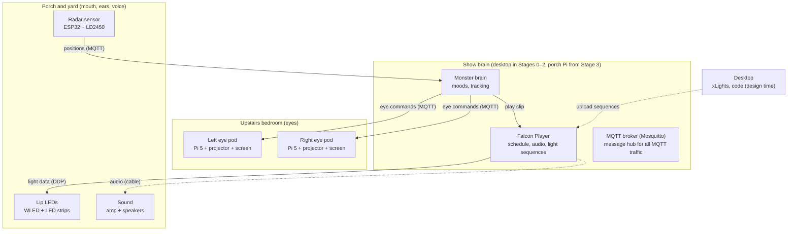
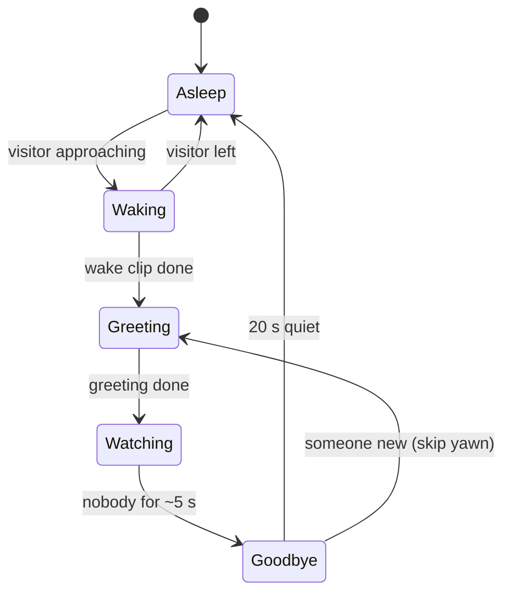

# Monster House — System Architecture

_Version 0.2 · Nov 8, 2026 · Target: Halloween 2027_

> Requirements, components and interface documents (ICDs) now live in [requirements/](requirements/README.md), [architecture/](architecture/components.yaml) and [interfaces/](interfaces/).

A friendly monster face on the house. The two upstairs bedroom windows are **eyes** that open, blink and follow trick-or-treaters. The porch is a **mouth** with LED lips that talk in sync with the monster's voice. A radar sensor tells the monster when someone is coming. Everything is set up and taken down each season (and for other holidays), and the bedroom has to stay livable.

> **Changes in 0.2**
> - **Eye pods:** Now 1GB Pi 5s with GPU-drawn eyes.
> - **Windows:** The two windows are different sizes, so each eye has its own configuration, and a projector may sit on its side.
> - **Projector class:** Now AAXA P400 (0.7:1 throw).
> - **Black mask:** One goes over each screen to hide the projector's gray "black."
> - **Brain location:** The monster brain runs on the desktop through Stage 2 and moves to the porch Pi in Stage 3.
> - **Build order:** Now organized as capability stages (section 11).

---

## 1. Overview diagram



> Solid arrows travel over Wi-Fi; dotted arrows are a cable or a one-time upload. All MQTT messages pass through the broker; the arrows show who is talking to whom. The diagram uses Mermaid, which renders on GitHub, in Obsidian, and in most Markdown viewers. If yours shows code instead, the table below has the same information.

### Connections at a glance

| From | To | What | How |
|---|---|---|---|
| Radar sensor | Show brain (MQTT) | Up to 3 visitor positions (x, y in mm), ~10×/s | Wi-Fi, MQTT |
| Monster brain | Eye pods | Where to look, expression, blink | Wi-Fi, MQTT |
| Monster brain | Falcon Player | Which voice and lip clip to play | MQTT or HTTP API |
| Falcon Player | Lip LEDs | Per-LED color frames, in sync with audio | Wi-Fi, DDP |
| Falcon Player | Amp + speakers | Monster voice and sound effects | Cable (USB audio → amp) |
| Desktop (xLights) | Falcon Player | Sequences (`.fseq`) + audio files | Wi-Fi upload, before the show |
| Your phone | Monster brain | Manual buttons: costume, burp, sing, mute | Browser, local web page |

### Design principles

1. **One brain, simple limbs.** All decisions happen in the monster brain. Eye pods, lips and the radar don't decide anything; they report or obey. That keeps every limb swappable and easy to debug.
2. **Wi-Fi everywhere except audio.** One power plug per box, no data cables through the house. Audio is the exception: a cable to the amp avoids Bluetooth/Wi-Fi lag and dropouts.
3. **Real-time eyes, pre-made mouth.** Eyes are drawn live so they can follow people. Mouth movements are made ahead of time in xLights with the voice clip, which keeps the lips perfectly in sync.
4. **Fail friendly.** If any piece drops out, the rest keeps going and the monster just looks sleepy. It never shows an error screen to the street.
5. **Themes are data, not code.** Each holiday is a folder of eye art, clips and settings.

---

## 2. Eye pods (×2)

**Job:** Draw a big cartoon eye in each bedroom window that can open, blink, emote and look at visitors.

### Hardware (per pod)
| Part | Notes |
|---|---|
| Raspberry Pi 5, **1GB** ($45) | Runs the eye renderer full-screen on the GPU, no desktop environment |
| Short-throw LED projector (AAXA P400 class, 0.7:1 throw, ~400 lumens) | About 0.7 × the image's long side behind the screen (a 3-ft image needs ~2.1 ft). LED, so it can run on its side for a tall window (confirm with the manufacturer) |
| Rear-projection screen, cut to the window glass | Hangs on the inside of the window, facing out |
| Black mask | Black fabric with an eye-shaped hole, fixed over the screen, so the projector's not-quite-black never shows as a gray rectangle |
| Light shroud | Blackout fabric on a light PVC or 1×2 frame that runs from the projector to the window frame, so no light spills into the bedroom |
| Stand or small cart | Sets the projector height so it points straight at the screen (no keystone) |
| 1 power strip | Pi + projector on one plug |

### Software
- **Eye renderer:** custom code, drawn on the GPU. Two candidates get a short trial in Stage 0: Python with OpenGL shaders (e.g. `moderngl` + `pygame-ce` for the window), or Godot. Shaders must stay compatible with **OpenGL ES 3.0 / GLSL ES 3.00**, which the Pi 5's GPU supports. Avoid drawing on the CPU (plain pygame drawing at 1080p60 strains a Pi).
- **Target:** 60 fps at the projector's native resolution (720p is plenty at sidewalk distance).
- **Same code everywhere:** It runs on the desktop for development and previews, and on the Pi in production.
- **On the Pi:** Runs as a system service that starts at boot, full-screen, cursor hidden, with no desktop environment (direct KMS/DRM output) to save memory.
- **Image is mirrored horizontally**, because the audience sees the screen from behind. This is a setting in the renderer (or in the projector's "rear" mode). Don't do both.

### Per-eye configuration (the windows are different sizes)
One window is much smaller than the other, and the larger one may have a center divider. Each eye has its own settings:

```yaml
eyes:
  left:                       # as seen from the street
    window_m: {w: 0.0, h: 0.0}        # glass size, to be measured
    position_m: {x: -1.6, y: -0.5, z: 5.0}   # window center in house coordinates
    rotate_deg: 90            # 0 or 90: projector on its side for a tall window
    mirror: true              # rear projection
    eye_center: [0.5, 0.5]    # where the eye sits in the window (0–1)
    eye_size: 0.9             # fraction of the window
    brightness: 1.0           # match the two eyes (a bigger image looks dimmer)
  right: { ... }
```

The design can lean into this as a lopsided, goofy monster (one big eye, one small) or draw matched eyes at the small window's size. That's an open decision, made in Stage 0 using the house preview.

### How an eye is drawn
Layers, back to front:
1. **Sclera** (the white of the eye; can be a tinted color per theme)
2. **Iris + pupil.** Moves to look somewhere; pupil size changes with mood (big = excited, small = surprised).
3. **Highlights and sparkles.** A small white glint that moves slightly with the iris. Sparkle overlay for "great costume."
4. **Eyelids.** Top and bottom shapes that close over the eye. Lid openness and tilt make most of the expression: half-closed = sleepy, tilted in = happy squint, wide = surprised.
5. **Brow** (optional). A simple arc above the eye.

An **expression** is just a set of numbers. The brain asks for an expression by name and the renderer eases from the current numbers to the new ones over a few hundred milliseconds. Starting values, from the interactive sketch (`docs/reference/eye-sketch.html`):

| Expression | `open` (upper lid) | `low` (lower lid rise) | `curve` (lower-lid smile) | `pupil` (scale) | `spark` |
|---|---|---|---|---|---|
| `neutral` | 1.0 | 0.0 | 0 | 1.0 | 0 |
| `happy` | 0.9 | 0.38 | 1 | 1.15 | 0 |
| `sparkle` | 0.95 | 0.3 | 1 | 1.3 | 1 |
| `surprised` | 1.15 | 0.0 | 0 | 0.65 | 0 |
| `sleepy` | 0.42 | 0.08 | 0 | 0.9 | 0 |
| `asleep` | 0.0 | 0.05 | 0 | 1.0 | 0 |

Design rules that matter in a real window:
- **Black around the eye.** Black means no light, which hides the shroud and the window grids.
- **A bold dark outline and a big catchlight** keep the eye readable from the sidewalk and make it look alive.
- **Friendly cues:** big round pupils, and smiles made by the lower lid. No slit pupils.

### Looking at a visitor
The brain sends a 3D point (where the visitor's head probably is). Each eye works out its own direction from **its own position on the house** to that point. Because the two windows are a few meters apart, the pupils angle slightly toward each other for a close kid and look parallel for someone far away. That small parallax is what makes the eyes feel like they're really focusing.

Movement is smoothed. Pupils glide to the target with an ease-out curve, plus tiny random movements (micro-saccades) so they never look frozen.

### Blinks
The brain owns blinks so both eyes blink at the same moment. Each renderer also has a fallback blink timer it uses if it hasn't heard from the brain in a while.

### Messages it listens to (MQTT)
| Topic | Payload example | Meaning |
|---|---|---|
| `monster/eyes/look` | `{"x": 1.2, "y": 3.5, "z": 1.0}` | Look at this point (meters, from the radar) |
| `monster/eyes/look` | `{"mode": "idle"}` | Wander and look around on your own |
| `monster/eyes/expression` | `{"name": "happy", "ms": 300}` | Ease into an expression |
| `monster/eyes/blink` | `{"ms": 180}` | Blink now |
| `monster/theme` | `{"name": "halloween"}` | Load this theme's art (retained message) |

Each pod publishes `monster/eyes/left/status` (or `right`) as `online`/`offline`, using MQTT's last-will so the brain knows if a pod drops.

### Setup and teardown
1. Hang the screen in the window (tension rod or removable hooks).
2. Roll in the stand, plug in the strip, and attach the shroud.
3. Power on. The Pi boots straight into the eye, and the projector auto-starts.
4. Teardown is the reverse. Nothing stays in the room.

### Risks and open questions
- **Window grids** will show as dark lines over the eye. Test early: embrace them, or check whether the grids pop out.
- **Brightness at dusk** versus street lights. Test a projector in the real window in spring.
- **Projector fan noise** in the bedroom. The schedule turns pods off at bedtime.
- **Window glass size** is still needed; it sets the screen size and the projector distance.

---

## 3. Show brain (desktop, then porch Pi)

**Job:** The one box that decides and coordinates.

**Where it runs, by stage:**
- **Stages 0–2:** The monster brain and Mosquitto run on the **desktop**, which sits elsewhere in the house and talks to everything over Wi-Fi. There's no Falcon Player yet; a fake FPP logs clip triggers and plays placeholder audio locally.
- **Stage 3 onward:** Everything moves to a **Raspberry Pi just inside the front door**, which is wired to the porch amp. The show then doesn't depend on the desktop being awake. The brain must therefore be portable: plain Python, configuration in files, no desktop-only dependencies.

Three programs run on it:

### 3a. Falcon Player (FPP)

**Job:** Plays the monster's voice and the matching lip animation at exactly the same time, runs the show schedule, and sends light data to the lip LEDs.

- **What it plays:** Each voice line is a pair: an audio file plus an xLights sequence (`.fseq`) for the lips. FPP plays both together, which is what keeps the lips in sync.
- **Playlists as the building blocks:** Each clip lives in a one-item playlist (`greet_01`, `comment_04`, `yawn`, `snore`, `bye_02`...) so the brain can trigger any of them by name.
- **Schedule:** FPP's scheduler sets show hours (for example, 5:30–9:30 pm). Outside those hours the brain keeps the monster asleep and muted.
- **Being told what to play:** FPP accepts commands over MQTT (for example, `falcon/player/FPP/set/playlist/<name>/start`) and over its HTTP API. It publishes its status under `falcon/player/FPP/...`, so the brain knows when a clip has finished. Verify exact topics against the FPP version we install.
- **Light output:** FPP sends the lip frames to WLED using the DDP protocol over Wi-Fi.
- **Audio output:** The Raspberry Pi 5 has **no headphone jack**, so audio goes out through a USB audio adapter (or a DAC add-on board) to the amp. FPP's volume, plus a hard cap in the operating system, keeps it neighbor-friendly.

### 3b. Monster brain (custom Python service)

**Job:** Decides what mood the monster is in and tells everything else what to do.

#### Moods



| Mood | Eyes | Mouth / sound | Leaves when |
|---|---|---|---|
| **Asleep** | Closed, occasional droopy flutter | Lips glow softly in and out like breathing; quiet snore about every 30 s | A visitor enters range and is heading toward the house |
| **Waking** | Blink open, look around, lock on | Yawn shape; long yawn, then "Ooh! Visitors!" | Wake clip ends (or visitor leaves → Asleep) |
| **Greeting** | Happy squint, pupils follow the visitor | One random greeting with lip sync | Greeting ends |
| **Watching** | Keep following, blink every few seconds, switch between kids in a group | Comment or giggle every 10–20 s; burp on request | Nobody in range for about 5 s |
| **Goodbye** | Look where they left, then droop | "Bye! Happy Halloween!" | 20 quiet seconds → Asleep; new visitor → Greeting (no yawn) |

#### Inputs
- **Radar positions:** ESPHome publishes each value on its own MQTT topic (for example, `monster-radar/sensor/target_1_x/state`). The brain combines them into up to three targets, each with x, y and speed.
- **FPP status:** Tells the brain when a clip is playing and when it ends.
- **Phone buttons:** The brain serves a tiny web page on the home network. Buttons: **great costume** (sparkle eyes + compliment), **burp**, **sing**, **mute voice**, **sleep now**, **wake now**. These cover what the radar can't know, like costumes or when candy was handed out.
- **Timers:** For blinks, comment spacing, timeouts.

#### Outputs
- Eye commands on `monster/eyes/...` (look, expression, blink).
- Clip triggers to FPP.
- Its current mood on `monster/state` (retained), which is handy for debugging and for the phone page.

#### Turning radar data into a gaze
1. The radar reports each person as (x, y) in millimeters, measured from where it's mounted on the porch.
2. The brain converts that to house coordinates (meters) using the radar's measured mount position, and assumes a head height (about 1.0 m for kids, adjustable).
3. It filters the position (a simple smoothing filter) to remove radar jitter.
4. It picks a **focus target**. A new arrival wins, otherwise it holds on one person for 3–6 s, then switches. Closest wins ties.
5. It publishes the look point about 10 times a second. Each eye does its own angle math (see section 2).

#### Variety and politeness rules
- **Clip pools:** 5–10 clips each for greetings, comments and goodbyes. Shuffle through a pool without repeats until every clip in it has played.
- **Minimum gap** between spoken lines (10 s), so the monster doesn't chatter.
- **Crowd mode:** With 3 people present for a while, talk less and look around more.
- **Quiet hours** and a **mute** switch that keeps eyes and lights but no voice.

#### Settings file (per theme)
```yaml
theme: halloween
show_hours: ["17:30", "21:30"]
volume_cap: 70
radar:
  mount: {x: 0.0, y: 0.0, z: 1.2}        # meters, house coordinates
  approach_range_m: 5.0
eyes:
  left:  {x: -1.6, y: -0.5, z: 5.0}
  right: {x:  1.6, y: -0.5, z: 5.0}
  head_height_m: 1.0
timing:
  goodbye_after_s: 5
  sleep_after_s: 20
  comment_every_s: [10, 20]
clips:
  wake: [yawn_01]
  greet: [greet_01, greet_02, greet_03, greet_04, greet_05]
  comment: [comment_01, comment_02, comment_03, giggle_01]
  bye: [bye_01, bye_02]
  costume: [costume_01, costume_02]
  burp: [burp_01]
```
The positions above are placeholders; we measure them during install.

#### What happens when something fails
| Failure | Monster's behavior |
|---|---|
| Radar offline | Stays in an "ambient" mode: eyes wander and blink, no greetings (or phone buttons only) |
| One eye pod offline | The other keeps going; the brain logs it |
| FPP not responding | Eyes still work; voice and lips pause |
| Wi-Fi blip | Eye pods fall back to idle wandering and their own blink timer until the brain returns |

### 3c. MQTT broker (Mosquitto)

**Job:** The message board everything talks through. Devices publish to named topics, and anything interested subscribes. Nothing needs to know anyone else's address.

- Runs on the show brain and listens on the home network only, with a username/password.
- **Retained messages** for things a device should know the moment it connects (current theme, current mood).
- **Last-will messages** so the brain notices if an eye pod or the radar drops off.

#### Topic map
| Topic | Publisher | Subscribers |
|---|---|---|
| `monster-radar/sensor/...` | Radar (ESPHome) | Monster brain |
| `monster/eyes/look`, `/expression`, `/blink` | Monster brain | Both eye pods |
| `monster/eyes/left/status`, `/right/status` | Eye pods | Monster brain |
| `monster/state` | Monster brain | Phone page, debugging |
| `monster/theme` | Monster brain | Eye pods |
| `falcon/player/FPP/...` | FPP | Monster brain |
| `falcon/player/FPP/set/...` | Monster brain | FPP |

### Show-brain hardware
Raspberry Pi 5 + official power supply + case with fan + 32GB microSD + USB audio adapter. Put it on a shelf just inside the front door, with a short cable through the door frame or a window to the porch amp.

---

## 4. Radar sensor

**Job:** Notice people approaching and report where they are. These are the monster's "ears."

### Hardware
- **HLK-LD2450** 24 GHz mmWave radar. Reports X/Y position and speed for up to **3 people** at once, out to about **6 m**.
- **ESP32 dev board** running ESPHome, wired to the radar over a serial connection (4 wires).
- 5 V USB power supply and a small box.

### Placement
- Under the porch roof, out of the rain. The module is intended for indoor use, so it needs cover.
- Aimed down the walkway toward the sidewalk. The 6 m range should cover the walk and steps; check whether the sidewalk itself is in range.
- About 1–1.5 m high, angled slightly down. Avoid pointing it at the street so passing cars and moving branches don't count as visitors (use ESPHome zones to ignore those areas).

### Software (ESPHome)
- ESPHome has a native LD2450 component. It requires radar firmware V2.02.23090617 or newer; update with the manufacturer's phone app if needed.
- Publish to MQTT (not Home Assistant's API) so the brain can read it directly.
- Expose for each target: X, Y, speed. Also a target count, and one **approach zone** (the walkway).
- Limit updates to about 10 per second.

### Calibration (do this at install time)
1. Mount it, then walk the path while watching the live X/Y values on your phone.
2. Note the corners of the walkway and steps, and set those as the approach zone.
3. Measure where the radar sits relative to the windows and put those numbers in the settings file.

### Risks
- Metal railings and the inflatable decorations can cause false targets. Zones fix most of it.
- **Wi-Fi on the porch:** The ESP32 needs a decent 2.4 GHz signal. Check it before mounting.

---

## 5. Lip LEDs

**Job:** The monster's lips. Two lines of light along the porch: the **upper lip** under the porch roof edge and the **lower lip** along the railing. They breathe while it sleeps and move with its voice.

### Hardware
| Part | Notes |
|---|---|
| WS2815 12 V addressable LED strip, 60 LEDs/m, IP65 | About 14 m total (measure the porch). 12 V means less voltage drop over long runs |
| Aluminum channel + diffuser | Hides the individual dots so the lips read as a smooth glowing line |
| Year-round mounting clips | Clips stay up all year; channels snap on and off |
| QuinLED Dig-Quad controller (WLED pre-installed) | 4 outputs: upper lip, lower lip, 2 spare (teeth uplight, throat glow) |
| 12 V ~350 W power supply | Plus WLED's brightness limiter set so it never draws the worst-case maximum |
| Weatherproof box | Holds the controller and the power supply on the porch |

### Wiring notes
- Power the 7 m runs from both ends (power injection) to keep colors even.
- Put a fuse on each output (the Dig-Quad has these built in).
- Keep the data wire from controller to first LED short. Put the box near one end of the porch.

### Software
- **WLED** firmware on the controller.
- **Two modes, automatic:** When FPP is streaming light data, WLED shows it. When FPP stops, WLED falls back to its own effect after a short timeout. Set that effect to a slow purple "breathe" so the asleep state needs no extra work.
- Segments: 1 = upper lip, 2 = lower lip, 3 and 4 = extras.

### How talking works (xLights Singing Faces)
xLights splits a voice line into **mouth shapes** (phonemes) automatically from its text. We define what each mouth shape looks like on two lines of LEDs:

| Mouth shape | Upper lip | Lower lip |
|---|---|---|
| Rest / closed | Center third, dim | Center third, dim |
| MBP (lips together) | Center third, bright | Center third, bright |
| E / ee | Long and thin, nearly full width | Long and thin, nearly full width |
| AI / ah (wide open) | Full width, bright | Full width, bright, with the middle shifted lower (brighter railing) |
| O / oo | Short center segment, bright | Short center segment, bright |
| FV, L, WQ, etc. | In-between variations | |

Then, in xLights: import the voice clip, type the line, let it break into phonemes, nudge the timing, and export the sequence to FPP. A few minutes per line.

### Risks
- Rain and snow: IP65 strip in a channel under the porch roof is fine; the lower lip on the railing gets more weather. Check end caps and seal connectors.
- **Neighbors and brightness:** Cap WLED brightness. Lips don't need to be blinding to read.

---

## 6. Sound

**Job:** The monster's voice, plus snores, giggles and the felt rumble.

### Hardware
| Part | Notes |
|---|---|
| USB audio adapter on the show brain | The Pi 5 has no headphone jack |
| Class-D stereo amp board (TPA3116 class) + 24 V supply | In the porch weatherproof box or just inside the door |
| Pair of 5.25" weatherproof speakers | Under the porch ceiling, aimed down the walkway |
| Speaker wire | 16 AWG |
| _Optional:_ tactile transducer or small sub | Bolted under the porch floor for a rumble kids can feel |

### Audio content
- **Voice:** Record it yourself (or a friend with a good monster voice). It's the most charming option, and you control the tone. A cheap USB mic or a phone works; edit in Audacity.
- **Effects:** Snores, giggles, yawns, burps, from Freesound.org (check each clip's license) or recorded.
- **Format:** 48 kHz, normalized to the same loudness so no clip jumps out.
- **Mono is fine.** Optionally, pan comments toward the side where the visitor is standing.

### Neighbor-friendly
- Volume cap in FPP and in the operating system.
- Voice only when someone is actually approaching, and only during show hours.
- A mute button on the phone page.

---

## 7. Desktop (development and design)

**Job:** Where the code and content are made. It also runs the brain during Stages 0–2. From Stage 3 it isn't needed during the show.

- **xLights:** Lip models, Singing Faces sequences, any light-show sequences for other holidays. Uploads to FPP over Wi-Fi.
- **Eye art:** Inkscape or Krita for sclera, iris and lid shapes per theme.
- **Audacity:** Record and edit the voice.
- **Code:** The monster brain and eye renderer live in one Git repository, developed with Claude Code (see section 10).
- **Simulator:** The brain and both eyes can run on the desktop with the mouse standing in for a visitor, so behavior can be tuned in winter without hardware.

---

## 8. Network

- **Home Wi-Fi.** ESP32s need 2.4 GHz; the Pis can use either band.
- **Reserve fixed addresses** in the router for each device, and use friendly names:
  - `monster-brain`
  - `eye-left`
  - `eye-right`
  - `monster-lips`
  - `monster-radar`
- Clocks sync automatically (needed for show hours).
- Nothing is exposed to the internet. The phone page works only on the home network.

---

## 9. Themes (multi-holiday)

The hardware stays the same; a theme folder changes the personality.

```
themes/
  halloween/
    settings.yaml        # timings, clip pools, show hours
    eyes/                # sclera, iris, lids, sparkles (PNG/SVG)
    audio/               # voice lines and effects
    sequences/           # xLights .fseq lip and light sequences
  christmas/
    ...                  # snow-globe eyes, red/green lips, "ho ho ho"
  valentines/
    ...                  # heart pupils
```

Switching themes: choose it on the phone page (or by calendar date). The brain publishes `monster/theme` and loads the new clip pools, the eye pods load the new art, and FPP gets the new playlists.

---

## 10. Code repository layout

```
monster-house/
  brain/            # monster brain service (Python): moods, gaze, phone page
  eyes/             # eye renderer (GPU-drawn; per-eye config)
  sim/              # simulators: fake radar (drag visitors), fake FPP, house preview
  shared/           # message formats (MQTT topics + payload schemas) used by everything
  esphome/          # radar config (YAML)
  xlights/          # xLights show folder (lip models, sequences)
  themes/           # see section 9
  deploy/           # setup scripts, service files, Mosquitto config
  docs/             # this file, wiring photos, install checklist
```

### Development approach: built with Claude Code
All custom software is written with Claude Code, working in this repository:

| Piece | Claude Code builds | You do |
|---|---|---|
| Monster brain | Mood logic, gaze math, clip pools, phone page, tests | Tune timings and personality |
| Eye renderer | Layered eye drawing, expressions, MQTT control, mirroring, simulator | Art direction; approve the look |
| Radar config | ESPHome YAML, zones | Mount it, walk the path for calibration |
| Deploy | Pi setup scripts, system services, Mosquitto config, install checklist | Flash SD cards, run the scripts |
| xLights / FPP | Notes and checklists; FPP playlist naming conventions | Sequencing in the xLights app (GUI-based) |

Conventions that make this work well:
- A `CLAUDE.md` at the repository root describes the architecture (this doc), the MQTT topic map and the coding conventions, so every Claude Code session starts with full context.
- A **desktop simulator** for every piece (fake radar from the mouse, both eyes in windows, a fake FPP that logs clip triggers), so Claude Code can run and test changes without the real hardware.
- Tests for the mood logic and the gaze math. Claude Code runs them before each change.
- Each milestone in section 11 is its own Claude Code task.

---

## 11. Build order (capability stages)

Each stage is a complete, showable monster. Costs are rough, before tax and shipping.

| Stage | When | Adds | Approx. cost |
|---|---|---|---|
| 0. Simulator | Nov–Feb | Eyes, brain, fake radar, house preview, all on the desktop (see `stage-0-plan.md`) | $0 |
| 1. Eyes | Mar–Apr | One eye pod first (test in the smaller window), then the second. Brain on the desktop | ~$415–515 per pod with a P400-class projector (~$830–1,030 for two); ~$280–380 per pod with a budget projector |
| 2. Eyes that see | May | Radar + ESP32 on the porch; live tracking | ~$30–60 |
| 3. Voice | Jun–Jul | Porch Pi (FPP + brain + Mosquitto move here), USB audio, amp, speakers | ~$190–315 |
| 4. Mouth | Aug | Lip LEDs, controller, power, teeth, tongue | ~$400–735 |
| 5. Extras | Sep | Fog, rumble; full install, night tests, timed setup and teardown | ~$75–155 |
| Show | Oct | | |

---

## 12. Open questions

> These are tracked, with IDs and what resolves them, in the [TBD register](TBD.md).

- What's the monster's name, and who voices it?
- Lopsided eyes (one big, one small) or matched eyes? Decide with the Stage 0 house preview
- Does each projector sit on its side (tall eye) or flat? Depends on window shape and projector vents
- Window glass width and height for **both** windows, any fixed dividers, and floor space behind each (sets the screen, rotation and projector distance)
- Porch roofline and railing length (sets the LED quantity)
- Wi-Fi signal strength on the porch
- Window grids: embrace them, or remove them for the season?
- Where exactly the show brain sits inside the front door, and the cable route to the amp
