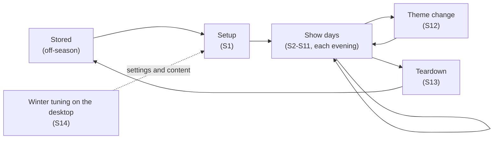
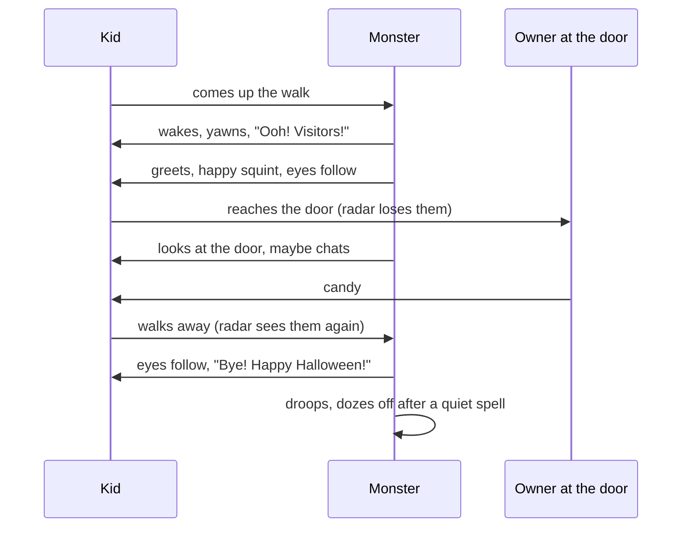

# Concept of operations — Monster House

> **Status:** Draft for the owner to edit (SRR package, item 1) · **Updated:** 2026-11-09 · **Reviews:** [plan](reviews/README.md)

How the monster is used, told as a season and an evening, from the point of view of
the people around it. Each step cites the system requirements (`SYS-NNN`,
[system.yaml](requirements/system.yaml)) it relies on. For SRR, every step must be
covered by requirements, and every requirement must trace to a step here or to a
stated constraint ([§8](#8-coverage)).

Much of this is personality and taste. Where the draft guesses, it says so, and the
open questions are collected in [§9](#9-questions-for-the-owner).

## 1. What it is, in one paragraph

For a few evenings a year the front of the house becomes a friendly, goofy monster face.
The two upstairs bedroom windows are its eyes, the porch is its mouth, and it notices
trick-or-treaters coming up the walk. It wakes up, says hello, watches the kids, chats a
little while they get candy at the door, and waves them off. The rest of the time it
snoozes. It is never scary (SYS-036), never shows an error (SYS-037), and when a part
fails it just looks sleepy (SYS-017).

## 2. The people around it

| Who | What they want | What they do |
|---|---|---|
| **Trick-or-treaters** (kids, often in groups) | Something fun and surprising that notices *them* | Walk up the path, stop at the door for candy, walk away |
| **Grown-ups with them** | A friendly show, nothing too scary for little ones | Often wait on the sidewalk or walk up with the kids |
| **The owner** | A show that runs itself, small tweaks from a phone, easy setup and teardown | Sets it up, picks the theme, presses buttons now and then, answers the door |
| **Whoever sleeps in the bedroom** | A livable room: no light spill, quiet at night | Lives with the eye pods for the season |
| **Neighbors** | Not too loud, not too bright, not too late | Hear and see it from next door and the street |
| **Passers-by** | Nothing; some will enjoy it | Walk or drive past without coming up the path |

## 3. Where it operates

- **The house front:** two upstairs windows of different sizes (left is smaller), the
  porch with its roof edge and railing, the walkway and steps, the sidewalk, the street.
- **Inside:** the eye pods in the bedroom; from Stage 3 a small computer just inside the
  front door, wired to the porch amp; in Stages 0-2 the owner's desktop.
- **When:** evenings, from dusk, during show hours (TBD-024; architecture's example is
  5:30-9:30 pm), on Halloween and other holidays with their own themes.
- **Conditions:** dark or dusk with street lights; cold, rain or snow possible on the
  porch; the home Wi-Fi.

## 4. The season at a glance

## 5. A Halloween evening, hour by hour

Times are examples (show hours: TBD-024).

| When | What's happening | What the monster does |
|---|---|---|
| Afternoon | Power is already on from setup; the eye pods were off overnight | Off, or eyes closed and asleep |
| Show hours begin (example 5:30) | Dusk; few visitors yet | Asleep: eyes closed, lips breathing, a quiet snore now and then |
| Early evening | Small groups, gaps between them | Wakes for each group, greets, watches, chats at the door, waves goodbye, dozes off again |
| Peak | Groups arrive while others are still leaving | Stays awake; says goodbye to leavers and glances at newcomers without yawning again |
| Show hours end (example 9:30) | A few late visitors | Stays asleep and silent, whatever the radar sees |
| Bedtime | The household goes to bed | The eye pods switch off (TBD-025) |

## 6. Scenarios

Each step lists the system requirements it relies on.

### S1 — Season setup (each fall, and for other holidays)

| Step | What happens | Requirements |
|---|---|---|
| S1.1 | The owner hangs each screen in its window with removable fittings, rolls in the stand, attaches the shroud, plugs in the power strip | SYS-035, SYS-034, SYS-044, SYS-045 |
| S1.2 | The owner snaps the lip channels onto the year-round clips, puts the porch boxes in place, runs the cords | SYS-045, SYS-046, SYS-034 |
| S1.3 | Everything joins the home Wi-Fi under its usual name; nothing is reachable from the internet | SYS-033, SYS-038 |
| S1.4 | The owner powers on: each Pi boots straight into its eye, the projector shows it, no keyboard needed | SYS-045, SYS-039, SYS-037 |
| S1.5 | (First season, Stage 2) The owner walks the path while watching the radar's live values on the phone, and records the zones and positions | SYS-026, SYS-047 |

### S2 — Show day begins

| Step | What happens | Requirements |
|---|---|---|
| S2.1 | The eye pods come back on for the show day | SYS-018 |
| S2.2 | At the start of show hours the monster is asleep: eyes closed, lips breathing, snoring now and then | SYS-014, SYS-001, SYS-031 |

### S3 — One visitor, start to finish (the main thread)

| Step | What happens | Requirements |
|---|---|---|
| S3.1 | A kid turns up the walk toward the house. The monster notices and starts to wake: eyes blink open, look around, lock on; a long yawn, then "Ooh! Visitors!" | SYS-002, SYS-020, SYS-026, SYS-010 |
| S3.2 | It greets the kid with one line, a happy squint, lips moving with the words | SYS-003, SYS-011, SYS-022, SYS-021 |
| S3.3 | As the kid walks up, both eyes follow, converging as the kid gets close; they blink now and then | SYS-004, SYS-019, SYS-028, SYS-024, SYS-009 |
| S3.4 | While watching, the monster makes the odd comment or giggle, never chattering | SYS-006, SYS-027, SYS-015 |
| S3.5 | The kid reaches the door; the radar loses them. The monster keeps them "at the door", looks at the door, and may say a door line | SYS-047, SYS-048 |
| S3.6 | The kid turns and walks away; the radar picks them up again. The monster follows them with its eyes and says goodbye | SYS-049 |
| S3.7 | With nobody left, it droops; after a quiet spell it goes back to sleep | SYS-007, SYS-008, SYS-001 |

### S4 — A group

| Step | What happens | Requirements |
|---|---|---|
| S4.1 | Three kids come up together; the monster tracks all three | SYS-025 |
| S4.2 | Its gaze moves between them, holding on each for a few seconds | SYS-005 |
| S4.3 | A grown-up waits on the sidewalk, outside the approach zone; the monster doesn't count them (guess: see Q3) | SYS-026 |
| S4.4 | The group leaves together; one goodbye covers them (the gap rule stops a goodbye per kid) | SYS-049, SYS-027 |

### S5 — A busy stretch

| Step | What happens | Requirements |
|---|---|---|
| S5.1 | A new group comes up while the last is still at the door | SYS-050, SYS-047 |
| S5.2 | The monster glances at the newcomers with a happy or surprised look, without yawning again | SYS-050, SYS-008 |
| S5.3 | It says goodbye to the leavers and keeps watching the newcomers | SYS-049, SYS-005 |
| S5.4 | Over a long evening clips start repeating, but never twice in a row within a pool | SYS-015 |

### S6 — Passers-by

| Step | What happens | Requirements |
|---|---|---|
| S6.1 | People walk past on the sidewalk or cars pass in the street; the monster stays asleep (guess: see Q4) | SYS-002, SYS-026 |

### S7 — The owner on the phone

| Step | What happens | Requirements |
|---|---|---|
| S7.1 | The owner opens the phone page on the home Wi-Fi; it shows the current mood | SYS-012, SYS-032, SYS-038 |
| S7.2 | A great costume walks up: the owner taps **great costume**; the eyes sparkle and the monster pays a compliment within half a second | SYS-012, SYS-023 |
| S7.3 | For fun, **burp** or **sing** | SYS-012 |
| S7.4 | Talking to a neighbor at the door, the owner taps **mute**: no voice, but the eyes and lips carry on | SYS-013 |
| S7.5 | **Sleep now** and **wake now** put the monster to sleep or wake it on demand (outside show hours: see Q5) | SYS-012, SYS-014 |

### S8 — End of show hours

| Step | What happens | Requirements |
|---|---|---|
| S8.1 | Show hours end; the monster goes to sleep and stays silent, even if someone walks up | SYS-014 |

### S9 — Bedtime

| Step | What happens | Requirements |
|---|---|---|
| S9.1 | At bedtime the eye pods switch off, so the bedroom is dark and quiet | SYS-018, SYS-044 |

### S10 — Something goes wrong

| Step | What happens | Requirements |
|---|---|---|
| S10.1 | The radar drops off: the eyes wander and blink; no greetings; the phone still works | SYS-017, SYS-029 |
| S10.2 | One eye pod dies: the other carries on | SYS-017 |
| S10.3 | The voice player stops responding: the eyes carry on, no voice, the lips breathe | SYS-017 |
| S10.4 | A Wi-Fi blip: each eye wanders and blinks on its own until the brain is back | SYS-017, SYS-029 |
| S10.5 | A program crashes: it restarts by itself | SYS-017 |
| S10.6 | Whatever happens, the windows never show an error, text or a cursor | SYS-037 |

### S11 — Weather

| Step | What happens | Requirements |
|---|---|---|
| S11.1 | Rain or snow: the porch parts are sheltered or rated for it; the show goes on | SYS-046 |

### S12 — Another holiday

| Step | What happens | Requirements |
|---|---|---|
| S12.1 | The owner picks the Christmas theme on the phone; the eyes, voice, lips and timings change, with no software change | SYS-016, SYS-041 |

### S13 — Season teardown

| Step | What happens | Requirements |
|---|---|---|
| S13.1 | The owner unplugs everything, takes down the screens, shrouds, stands, channels and boxes; nothing stays in the bedroom, only the lip clips stay on the house | SYS-045 |

### S14 — Winter tuning on the desktop (enabling)

| Step | What happens | Requirements |
|---|---|---|
| S14.1 | On the desktop, the owner drags pretend visitors on the fake radar and watches both eyes on the house preview; the fake voice player plays placeholder clips | SYS-043 |
| S14.2 | The owner tunes timings, art and clips in the theme folder and tries them straight away | SYS-041, SYS-016 |
| S14.3 | The same code later runs on the Pis unchanged | SYS-039, SYS-040, SYS-042 |

## 7. What the owner has to do, all season

- **Once a season:** set up (S1) and take down (S13).
- **Each evening:** nothing, ideally: the monster follows show hours and bedtime on its own.
- **During the show:** optional phone taps (S7), and answering the door.
- **When something breaks:** nothing urgent; the monster looks sleepy until it is fixed.

## 8. Coverage

The scenario steps cite **48 of the 50** system requirements. The other two are
constraints that apply to the whole evening rather than to one step:

| Requirement | Applies to |
|---|---|
| SYS-030, volume at the sidewalk | Every spoken line in S2-S8 (a neighbor-facing step would anchor it: Q8) |
| SYS-036, friendly tone | Everything the monster shows and says |

Some cited requirements also apply throughout, beyond the step that cites them: no errors
on the screens (SYS-037), lip brightness (SYS-031), and local-network only (SYS-038).

## 9. Questions for the owner

These are taste and personality calls the draft guessed at.

1. **Who answers the door?** The draft assumes someone hands out candy at the door. Is
   there ever an unattended candy bowl, and should the monster behave differently then?
2. **How busy does it get?** A rough number of visitors on Halloween, and how many at
   once at the peak, helps size the clip pools and test the busy-stretch scenario (S5).
3. **Grown-ups:** should the monster look at and greet adults too, or mainly kids? The
   look height assumes kids (about 1.0 m), so an adult's eyes are looked at around the
   chest. Grown-ups on the sidewalk are outside the approach zone in this draft.
4. **Passers-by:** stay fully asleep (draft), or a sleepy peek at people on the sidewalk?
5. **Phone outside show hours:** should **wake now** work after show hours (for example
   to show a neighbor), or is the schedule absolute?
6. **Crowd mode:** the architecture mentions talking less and looking around more when
   three people are present for a while. It isn't a requirement yet. Keep it?
7. **Dogs:** the radar will see a dog on a leash as a visitor. Fine (the monster greets
   dogs too), or should it try to ignore them?
8. **Neighbors:** add a step where a neighbor hears it from next door, to anchor the
   volume and brightness limits (SYS-030, SYS-031) and show hours?
9. **Rain:** does the show run in the rain as normal (draft), or is there a rain mode?
10. **Before show hours:** asleep (draft), or off until show hours start?
