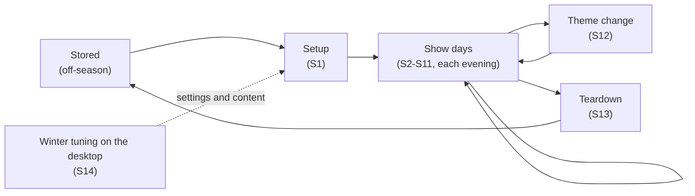
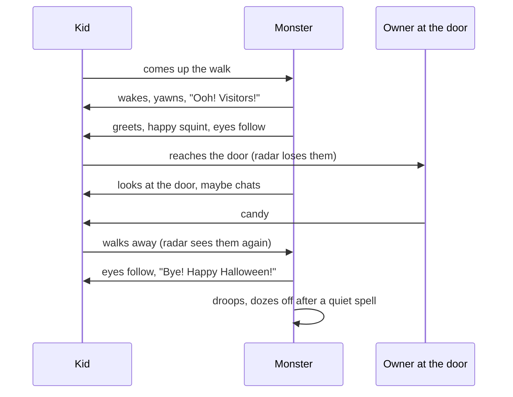

# Concept of operations — Monster House

> **Status:** Draft for the owner to edit (SRR package, item 1) · **Updated:** 2026-11-26 · **Reviews:** [plan](reviews/README.md)

How the monster is used, told as a season and an evening, from the point of view of
the people around it. Each step cites the system requirements (`SYS-NNN`,
[system.yaml](requirements/system.yaml)) it relies on. For SRR, every step must be
covered by requirements, and every requirement must trace to a step here or to a
stated constraint ([§8](#8-coverage)).

Much of this is personality and taste. The owner answered the draft's questions in
gloss comments (2026-11-15); the answers are in [§9](#9-questions-for-the-owner), and ideas
saved for a later phase are in [§10](#10-saved-for-later).

## 1. What it is, in one paragraph

For a few evenings a year the front of the house becomes a friendly, goofy monster face.
The two upstairs bedroom windows are its eyes, the porch is its mouth, and it notices
trick-or-treaters coming up the walk. It wakes up, says hello, watches the kids, chats a
little while they get candy at the door, and waves them off. The rest of the time it
snoozes. It is never scary (SYS-036), never shows an error (SYS-037), and when a part
fails it just looks sleepy (SYS-017).

## 2. The people around it

| Who | What they want | What they do |
|---|---|---|
| **Trick-or-treaters** (kids, often in groups) | Something fun and surprising that notices *them* | Walk up the path in a steady trickle (lines are rare), stop at the door for candy, walk away |
| **Grown-ups with them** | A friendly show, nothing too scary for little ones | Usually wait on the sidewalk; some walk up with the kids |
| **The owner** | A show that runs itself, small tweaks from a phone, easy setup and teardown, little to store | Sets it up, picks the theme, presses buttons now and then; someone in the household hands out candy at the door |
| **Whoever sleeps in the bedroom** | A livable room: no light spill, quiet at night | Lives with the eye pods for the season |
| **Neighbors** | Not too loud, not too bright, not too late | Hear and see it from next door and the street |
| **Passers-by** | Nothing; some will enjoy it | Walk or drive past without coming up the path |

## 3. Where it operates

- **The house front:** two upstairs windows of different sizes (left is smaller), the
  porch with its roof edge and railing, the walkway and steps, the sidewalk, the street.
- **Inside:** the eye pods in the bedroom; from Stage 3 a small computer just inside the
  front door, wired to the porch amp; in Stages 0-2 the owner's desktop.
- **When:** evenings, from dusk, during show hours (TBD-024; architecture's example is
  5:30-9:30 pm), on Halloween and other holidays with their own themes.
- **Conditions:** dark or dusk with street lights; cold, rain or snow possible on the
  porch; the home Wi-Fi.

## 4. The season at a glance

## 5. A Halloween evening, hour by hour

Times are examples (show hours: TBD-024).

| When | What's happening | What the monster does |
|---|---|---|
| Afternoon | Power is already on from setup; the eye pods were off overnight | Asleep once the pods are on: eyes closed, silent until show hours (owner: Q10) |
| Show hours begin (example 5:30) | Dusk; few visitors yet | Asleep: eyes closed, lips breathing, a quiet snore now and then |
| Early evening | Small groups, gaps between them | Wakes for each group, greets, watches, chats at the door, waves goodbye, dozes off again |
| Busiest stretch | A steady trickle; now and then a group arrives while another is still leaving | Stays awake; says goodbye to leavers and glances at newcomers without yawning again |
| Show hours end (example 9:30) | A few late visitors | Stays asleep and silent, whatever the radar sees |
| Bedtime | The household goes to bed | The eye pods switch off (TBD-025) |

## 6. Scenarios

Each step lists the system requirements it relies on.

### S1 — Season setup (each fall, and for other holidays)

| Step | What happens | Requirements |
|---|---|---|
| S1.1 | The owner hangs each screen in its window with removable fittings, rolls in the stand, attaches the shroud, plugs in the power strip | SYS-035, SYS-034, SYS-044, SYS-045 |
| S1.2 | The owner snaps the lip channels onto the year-round clips, puts the porch boxes in place, runs the cords | SYS-045, SYS-046, SYS-034 |
| S1.3 | Everything joins the home Wi-Fi under its usual name; nothing is reachable from the internet | SYS-033, SYS-038 |
| S1.4 | The owner powers on: each Pi boots straight into its eye, the projector shows it, no keyboard needed | SYS-045, SYS-039, SYS-037 |
| S1.5 | (First season, Stage 2) The owner walks the path while watching the radar's live values on the phone, and records the zones and positions | SYS-026, SYS-047 |
| S1.6 | (First season, Stage 3) The owner plays a few clips and listens from the sidewalk and from the near neighbor's side, ideally with that neighbor, then sets the volume cap | SYS-030 |

### S2 — Show day begins

| Step | What happens | Requirements |
|---|---|---|
| S2.1 | The eye pods come back on for the show day | SYS-018 |
| S2.2 | At the start of show hours the monster is asleep: eyes closed, lips breathing, snoring now and then | SYS-014, SYS-001, SYS-031 |

### S3 — One visitor, start to finish (the main thread)

| Step | What happens | Requirements |
|---|---|---|
| S3.1 | A kid turns up the walk toward the house. The monster notices and starts to wake: eyes blink open, look around, lock on; a long yawn, then "Ooh! Visitors!" | SYS-002, SYS-020, SYS-026, SYS-010 |
| S3.2 | It greets the kid with one line, a happy squint, lips moving with the words | SYS-003, SYS-011, SYS-022, SYS-021 |
| S3.3 | As the kid walks up, both eyes follow, converging as the kid gets close; they blink now and then | SYS-004, SYS-019, SYS-028, SYS-024, SYS-009 |
| S3.4 | While watching, the monster makes the odd comment or giggle, never chattering | SYS-006, SYS-027, SYS-015 |
| S3.5 | The kid reaches the door; the radar loses them. The monster keeps them "at the door", looks at the door, and may say a door line | SYS-047, SYS-048 |
| S3.6 | The kid turns and walks away; the radar picks them up again. The monster follows them with its eyes and says goodbye | SYS-049 |
| S3.7 | With nobody left, it droops; after a quiet spell it goes back to sleep | SYS-007, SYS-008, SYS-001 |

### S4 — A group

| Step | What happens | Requirements |
|---|---|---|
| S4.1 | Three kids come up together; the monster tracks all three | SYS-025 |
| S4.2 | Its gaze moves between them, holding on each for a few seconds | SYS-005 |
| S4.3 | A grown-up waits on the sidewalk, outside the approach zone; the monster doesn't count them. Among those inside it, the ones coming toward the house get its attention first (owner: Q3) | SYS-026, SYS-005 |
| S4.4 | The group leaves together; one goodbye covers them (the gap rule stops a goodbye per kid) | SYS-049, SYS-027 |

### S5 — A busy stretch

| Step | What happens | Requirements |
|---|---|---|
| S5.1 | Now and then (lines are rare) a new group comes up while the last is still at the door | SYS-050, SYS-047 |
| S5.2 | The monster glances at the newcomers with a happy or surprised look, without yawning again | SYS-050, SYS-008 |
| S5.3 | It says goodbye to the leavers and keeps watching the newcomers | SYS-049, SYS-005 |
| S5.4 | Over a long evening clips start repeating, but never twice in a row within a pool | SYS-015 |

### S6 — Passers-by

| Step | What happens | Requirements |
|---|---|---|
| S6.1 | People walk past on the sidewalk or cars pass in the street; the monster stays asleep (owner: Q4; a sleepy peek is saved for later, §10) | SYS-002, SYS-026 |

### S7 — The owner on the phone

| Step | What happens | Requirements |
|---|---|---|
| S7.1 | The owner opens the phone page on the home Wi-Fi; it shows the current mood | SYS-012, SYS-032, SYS-038 |
| S7.2 | A great costume walks up: the owner taps **great costume**; the eyes sparkle and the monster pays a compliment within half a second | SYS-012, SYS-023 |
| S7.3 | For fun, **burp** or **sing** | SYS-012 |
| S7.4 | Talking to a neighbor at the door, the owner taps **mute**: no voice, but the eyes and lips carry on | SYS-013 |
| S7.5 | **Sleep now** and **wake now** put the monster to sleep or wake it on demand, at any hour, for testing and demos (owner: Q5) | SYS-012, SYS-014 |

The buttons either change the mood (sleep now, wake now) or add a one-off action to it
(costume, burp, sing, mute). Controlling the mood is enough for now: pre-coordinated
"scenes" on a button or a mood change aren't wanted yet (owner, 2026-11-19; see §10).

### S8 — End of show hours

| Step | What happens | Requirements |
|---|---|---|
| S8.1 | Show hours end; the monster goes to sleep and stays silent, even if someone walks up (unless the owner wakes it from the phone) | SYS-014 |

### S9 — Bedtime

| Step | What happens | Requirements |
|---|---|---|
| S9.1 | At bedtime the eye pods switch off, so the bedroom is dark and quiet | SYS-018, SYS-044 |

### S10 — Something goes wrong

| Step | What happens | Requirements |
|---|---|---|
| S10.1 | The radar drops off: the eyes wander and blink; no greetings; the phone still works | SYS-017, SYS-029 |
| S10.2 | One eye pod dies: the other carries on | SYS-017 |
| S10.3 | The voice player stops responding: the eyes carry on, no voice, the lips breathe | SYS-017 |
| S10.4 | A Wi-Fi blip: each eye wanders and blinks on its own until the brain is back | SYS-017, SYS-029 |
| S10.5 | A program crashes: it restarts by itself | SYS-017 |
| S10.6 | Whatever happens, the windows never show an error, text or a cursor | SYS-037 |

### S11 — Weather

| Step | What happens | Requirements |
|---|---|---|
| S11.1 | Rain or snow: the porch parts are sheltered or rated for it; the show goes on as normal (owner: Q9) | SYS-046 |
| S11.2 | If the radar has to come in out of the weather, the monster runs without its ears: the eyes wander and blink, no greetings, the phone still works (as S10.1) | SYS-017, SYS-029 |

### S12 — Another holiday

| Step | What happens | Requirements |
|---|---|---|
| S12.1 | The owner picks the Christmas theme on the phone; the eyes, voice, lips and timings change, with no software change | SYS-016, SYS-041 |
| S12.2 | Outside Halloween the visitors are mostly passers-by. Someone walking by on the sidewalk gets a sleepy peek; if they stop, a holiday greeting ("Merry Christmas!") | saved for later (§10, sleepy peek) |
| S12.3 | For a long season (all of December), the monster can run as a quiet decoration: eyes only, slow blinks and glances, no voice, kind to the neighbors | saved for later (§10) |
| S12.4 | Other special days (a birthday, the Fourth of July) get their own themes, chosen the same way | SYS-016 |

The owner chose these three (2026-11-23). Caroling, with songs and the lips singing
along, isn't wanted until the lips can move.

### S13 — Season teardown

| Step | What happens | Requirements |
|---|---|---|
| S13.1 | The owner unplugs everything, takes down the screens, shrouds, stands, channels and boxes; nothing stays in the bedroom, only the lip clips stay on the house | SYS-045 |
| S13.2 | Everything packs into a small, set amount of storage space (TBD-038), following the teardown checklist | SYS-051 |

### S14 — Winter tuning on the desktop (enabling)

| Step | What happens | Requirements |
|---|---|---|
| S14.1 | On the desktop, the owner drags pretend visitors on the fake radar and watches both eyes on the house preview; the fake voice player plays placeholder clips | SYS-043 |
| S14.2 | The owner tunes timings, art and clips in the theme folder and tries them straight away | SYS-041, SYS-016 |
| S14.3 | The same code later runs on the Pis unchanged | SYS-039, SYS-040, SYS-042 |

## 7. What the owner has to do, all season

- **Once a season:** set up (S1) and take down (S13).
- **Each evening:** nothing, ideally: the monster follows show hours and bedtime on its own.
- **During the show:** optional phone taps (S7), and answering the door.
- **When something breaks:** nothing urgent; the monster looks sleepy until it is fixed.

## 8. Coverage

The scenario steps cite **50 of the 51** system requirements. The other one is a
constraint that applies to the whole evening rather than to one step:

| Requirement | Applies to |
|---|---|
| SYS-036, friendly tone | Everything the monster shows and says |

Some cited requirements also apply throughout, beyond the step that cites them: no errors
on the screens (SYS-037), lip brightness (SYS-031), and local-network only (SYS-038).

## 9. Questions for the owner

The draft's questions, with the owner's answers (gloss comments, 2026-11-15) and where
each landed.

| # | Question | Owner's answer | Where it landed |
|---|---|---|---|
| 1 | Who answers the door? | Someone usually hands out candy | §2; no unattended-bowl behavior |
| 2 | How busy does it get? | Rarely lines; a good steady trickle | §2, §5, S5.1 (busy stretches are the exception) |
| 3 | Grown-ups too, or mainly kids? | Prioritize kids and those coming toward the house; adults usually stay at the sidewalk | S4.3, SYS-005, SHW-008. The radar can't tell height, so "coming toward the house" stands in for "kid" |
| 4 | Passers-by: asleep or a sleepy peek? | A peek could be nice, in a later phase | S6.1 stays asleep; peek in §10 |
| 5 | Wake now outside show hours? | Flexible control for testing and demos | S7.5, S8.1, SYS-014, SHW-019 |
| 6 | Crowd mode? | A future add-on, like dogs and passers-by | §10 |
| 7 | Dogs? | A dog action would be nice, after the basics | Greeted like any visitor for now; dog action in §10 |
| 8 | A neighbor step? | Test the audio with the near neighbor | S1.6 |
| 9 | Rain? | Run as normal unless we hit a snag; without the radar if it must come in | S11.1, S11.2 |
| 10 | Before show hours? | Asleep (a holding state) | §5. The "wakes and grunts" idea is in §10 |

## 10. Saved for later

Ideas the owner wants after the basic monster works. They are not requirements yet; each
becomes one when its phase is planned.

- **Sleepy peek:** when the radar sees someone outside the approach zone (a passer-by on
  the sidewalk), or anyone before show hours, the monster opens one eye or grunts, then
  dozes off again (Q4, Q10).
- **Crowd mode:** with three visitors for a while, talk less and look around more (Q6).
- **Dog action:** something special for dogs, if they can be told apart from kids (Q7).
- **Other holidays** (S12, owner 2026-11-23): the sleepy peek and a holiday greeting for
  passers-by; a quiet decoration mode (eyes only, no voice) for a long season; themes for
  other special days. Caroling waits for moving lips.
- **Scenes:** a pre-coordinated mix of eyes, voice and lips played on a button or a mood
  change. Not wanted yet; controlling the mood is enough (S7, owner 2026-11-19).
