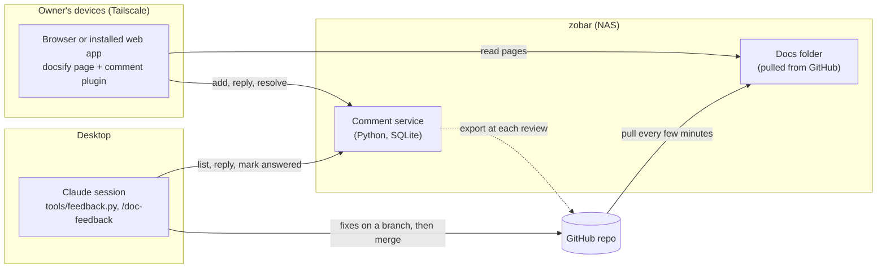
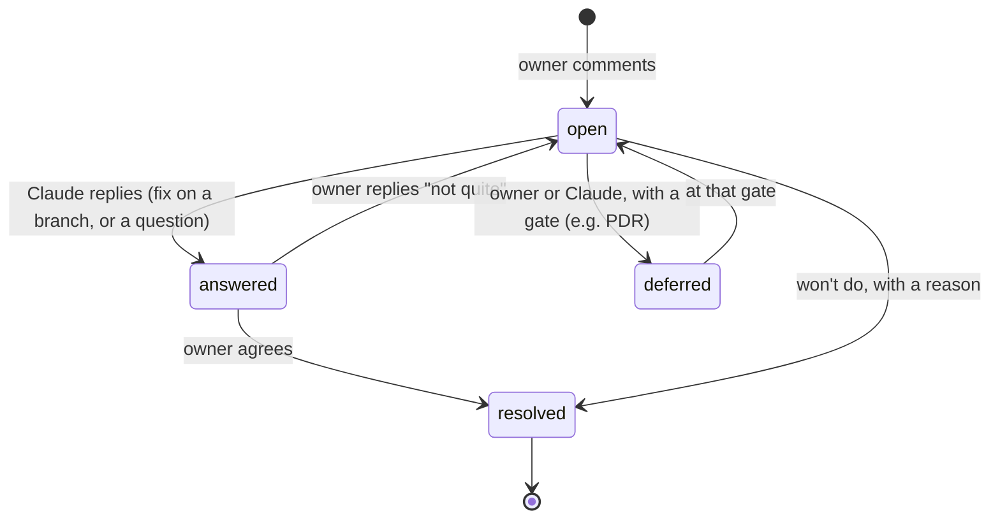

# Doc feedback — design note

> **Status:** Proposed · **Date:** 2026-11-11 · **Kind:** infrastructure (no trade study; owner, 2026-11-11) · **Serves:** the design reviews ([reviews/](../reviews/README.md))

## Summary

A way for the owner to **read the design documents and comment on them** from a phone,
desktop or laptop, with each comment going back to Claude to work and a **resolved**
state that hides it once done. Recommendation: the documents as a docsify site (as in
cairn), our own **comment plugin** in the page, and our own small **comment service**
on the NAS (`zobar`) behind Tailscale, storing comments in SQLite. Claude reads and
answers comments through a small command, on request and on a schedule. At each review
the comments are exported into the repo as that review's record.

## Context

- The documents are Markdown in `docs/` (with generated pages such as
  `docs/requirements/trace.md`) and YAML requirements. The owner has no comfortable way
  to read them on a phone, and no way to comment.
- Cairn (the owner's other project) already turns its `docs/` into a site: docsify in
  the browser, served by the NAS, which pulls from GitHub every 5 minutes, and reached
  over Tailscale ([cairn ADR 0001](https://github.com/goatsnboats/cairn), read-only
  reference). It has no commenting.
- The review plan (SRR, PDR, CDRs) needs review items with a gate and a status
  (`RI-SRR-03`).

## Constraints

- **The repo stays the source.** Comments never change the documents; Claude changes
  them on branches, as now.
- **Private.** Reachable only from the owner's devices (Tailscale); nothing public.
- **Phone first:** usable with a thumb, without selecting text.
- **Light on the NAS** (a DS218j: small, low memory; what it can run is to be checked).
- **No new dependence on GitHub** (owner, 2026-11-11: the long-term plan is to move away
  from GitHub). No GitHub issues, pull requests or Actions in this tool; the docs site
  pulls from wherever the git repository lives, which can change.
- **Claude is not always running.** A comment can't reach Claude instantly; it is picked
  up on request or by a scheduled check (see X6).

## How it works

### What the owner sees

- Each heading shows **💬** with a count of open comments ("💬 2"). Tapping it opens a
  panel (a bottom sheet on a phone, a side panel on a desktop) with that section's
  comments, Claude's replies under each, and a box to add one.
- On a desktop, selecting text shows **Comment on this**, with the text quoted.
- The top of each page shows "3 open comments on this page", a page-level comment
  button, and **Show resolved** (off by default: resolved comments are hidden).
- A comment Claude has answered shows **✓ answered** until the owner resolves it or
  replies.
- The site can be added to the phone's home screen as an app (a web app manifest).

### A comment's life

### What a comment holds

| Field | Meaning |
|---|---|
| `id` | Number, assigned by the service |
| `page` | Document path, e.g. `docs/conops.md` |
| `heading` | Heading anchor and text at the time (empty for a page-level comment) |
| `quote` | Selected text, if any |
| `doc_commit` | The commit the page was built from, so the original text can be found later |
| `body` | The comment |
| `author`, `created` | Who (from Tailscale) and when |
| `status` | `open`, `answered`, `deferred`, `resolved` |
| `gate` | For review items and deferrals: `SRR`, `PDR`, `CDR-1`, ... |
| `review_item` | When promoted: `RI-SRR-03` |
| `replies` | Thread of `{author, body, created}` |

If a heading is renamed or removed, its comments move to the top of the page as
"section changed"; if the quoted text is gone, the comment says so. Nothing is lost.

### How Claude works the comments

- **`tools/feedback.py`** in the repo: `list` (open comments, grouped by document),
  `show <id>`, `reply <id>`, `answer <id>` (reply and mark answered), `defer <id> <gate>`.
  Only the owner resolves (X4).
- **`/doc-feedback`** skill: list the open comments, work each one (fix on a branch,
  reply, or ask), then report.
- **Pickup:** on request, plus a scheduled check (X6).
- **Review record:** `tools/feedback.py export <review>` writes the review's comments and
  review items to `docs/reviews/<review>/comments.yaml`, committed with the review.

## Forks

| # | Question | Options | Recommendation | Decision |
|---|---|---|---|---|
| X1 | Where comments are stored | A GitHub issues · B own service, SQLite · C files in the repo | **B**: no tokens on devices, statuses and review items as we need them, data in the house | **B** — owner, 2026-11-11 (move away from GitHub) |
| X2 | Where the service runs | A `zobar` · B another always-on computer · C the desktop | **A** if the NAS can run it (checks below); else **B** | Owner prefers A, 2026-11-11 |
| X3 | Who may comment, and how they're identified | A Tailscale only, identity from Tailscale · B a password per device | **A**: nothing to type or store | *open* |
| X4 | Who resolves | A owner only · B Claude resolves, owner reopens | **A**: the owner stays in control; Claude marks answered | *open* |
| X5 | Granularity | A headings + desktop text selection · B also text selection on phones | **A** first; B later if missed | *open* |
| X6 | How Claude picks comments up | A only on request · B on request + a scheduled check | **B**, hourly while a review is open (scheduled checks can't run more often than hourly) | *open* |
| X7 | Unmerged review branches | A site shows `main` only · B NAS also serves review branches under `/preview/<branch>/` | **B**: reviews happen before merging | *open* |
| X8 | Updating the service on the NAS | A by hand, as cairn's NAS script · B the NAS runs the version from the repo | **A** to match cairn's rule; B only if updates get tedious | *open* |
| X9 | Scope | A `docs/` pages · B also generated requirement pages, one anchor per requirement | **B**: comment on a single requirement such as EYE-012 | *open* |

### X1 — Storage

- **A, GitHub issues:** least to build, phone notifications through the GitHub app; but
  every device needs a fine-grained GitHub token pasted in, and review items are only
  labels.
- **B, our own service:** a small Python program and one SQLite file. No tokens, any
  statuses we want, data stays home. Costs: we build and maintain it; no phone
  notifications (the page shows "answered" instead); the database must be backed up
  (the per-review export limits any loss).
- **C, files in the repo:** every comment from the phone becomes a commit and needs write
  access to GitHub. Rejected.

Also considered and set aside (owner discussion, 2026-11-11): **Wiki.js** (a second copy
of the documents in its database, page-level comments only, too heavy for the NAS),
**Obsidian** (no real commenting; phone sync through git is fragile), **Claude Docs**
(comments reach Claude directly, but the documents become copies to keep in sync),
**pull-request comments** (only on changed lines; still useful for one-off reviews).

### X6 — Pickup

Claude only acts when a session takes a turn. A comment can't wake a session directly:
the inbound wake-up link available to sessions only accepts deliveries signed by
Anthropic's own service. So the options are on request, or a scheduled check
(hourly at most often), which fires a turn in a chosen session.

## Until the comment service exists: a triage session

The owner gives feedback in a Claude session (phone or desktop), naming the document and
the place: a heading, a scenario step (`S3.5`), a requirement (`EYE-012`), an ICD
(`ICD-004`) or a quoted phrase. The session records each item as a file in the repo,
with the same fields as a comment (see "What a comment holds"), so the comment service
can import them later.

- **Where:** `docs/feedback/FB-<date>-<n>.yaml`, one file per item, so sessions working in
  parallel never edit the same file.
- **Statuses:** the same as comments: `open`, `answered`, `deferred`, `resolved`. Claude
  marks `answered` with what changed (commit) or a question; the owner resolves.
- **A `/feedback` skill** records items (with a read-back for the owner to confirm), lists
  open and answered ones, and works them.
- **Review record:** at each review, the items for that review are listed in its package.

## Checks before building

On `zobar` (the owner runs these, or lets Claude run them over SSH, read-only):
1. `uname -m` and `cat /proc/meminfo | head -3` (CPU type, memory)
2. `python3 --version` (Python 3 available? which version?)
3. Whether DSM's Task Scheduler can start a script at boot and keep it running
4. `tailscale version`, and whether `tailscale serve` can route a path to a local port
   (and passes the user's identity: to check)

The service will use **only Python's standard library** (`http.server`, `sqlite3`,
`json`), so nothing needs installing on the NAS beyond Python itself.

## Phases

1. **Read:** the docsify site for monster-house on the NAS, plus generated requirement
   pages (one per subsystem, a card per requirement). Useful on its own.
2. **Comment:** the comment service and the page plugin; Show resolved; installable app.
3. **Claude's side:** `tools/feedback.py`, the `/doc-feedback` skill, the scheduled check.
4. **Reviews:** review items, gates, and the per-review export.

## Consequences

- New: `docs/index.html` and a sidebar (docsify), `tools/feedback/` (service and plugin),
  `tools/feedback.py`, a `/doc-feedback` skill, NAS setup instructions in `deploy/`.
- Generated requirement pages under `docs/requirements/pages/` (written by the checker).
- `docs/reviews/<review>/comments.yaml` at each review.
- Nothing in the monster's own requirements changes: this is DEV tooling.
