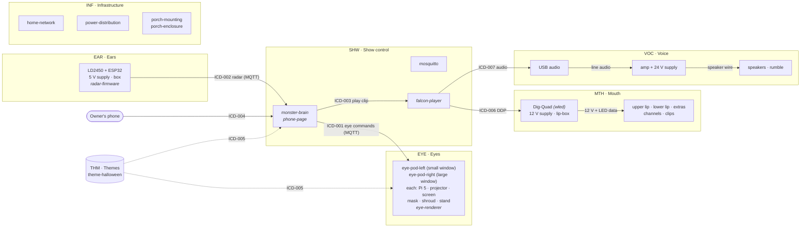
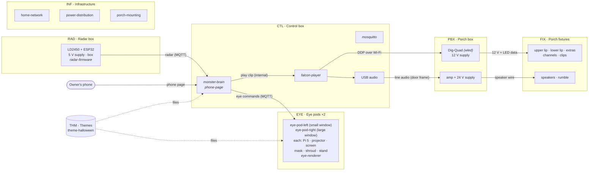

# Spec tree question Q1 — split by function or by physical box?

> **Status:** Decided: option A, by function (owner, 2026-11-09: build stage by stage) · **Updated:** 2026-11-09
>
> Later the same day the owner moved the Raspberry Pis into INF as a compute platform (Q14 in [spec-tree.md](spec-tree.md)); the diagrams below predate that. · **Question:** Q1 in [spec-tree.md](spec-tree.md#boundary-questions-and-decisions)

The same parts and software, grouped two ways. Everything on the house is identical in
both options; only the subsystem boundaries move, and with them the ID prefixes, the
requirement files and which links count as subsystem interfaces (ICDs).

Both options assume the drafts for the other questions (FPP and Mosquitto with the brain,
themes as their own group) so that only Q1 differs. Option B assumes the amp sits in the
porch weatherproof box; architecture §6 also allows "just inside the door" (see
[what moves](#what-depends-on-undecided-placement)).

## Option A — by function (the current draft)

### Spec tree

```text
SYS  Monster House
├── EYE  Eyes ............ eye-pod-left/right: eye-pi · eye-projector · eye-screen · eye-mask
│                          · eye-shroud · eye-stand · eye-power-strip · sw: eye-renderer
├── SHW  Show control .... porch-pi · sw: monster-brain · phone-page · falcon-player · mosquitto
├── EAR  Ears ............ radar-sensor · radar-esp32 · radar-psu · radar-box · sw: radar-firmware
├── MTH  Mouth ........... lip-upper · lip-lower · mouth-extras · lip-channel · lip-clips
│                          · lip-controller · lip-psu · lip-box · sw: wled
├── VOC  Voice ........... usb-audio · amp · amp-psu · speakers · speaker-wire · rumble
├── INF  Infrastructure .. home-network · power-distribution · porch-mounting · porch-enclosure
└── THM  Themes .......... theme-format · theme-halloween
```

### Architecture



All MQTT goes through `mosquitto`; arrows show who talks to whom. Shaded boxes are
subsystems. INF feeds power, network and mounting to every subsystem (arrows left out
to keep the picture readable). The `12 V + LED data`, `line audio` and `speaker wire` links are **inside**
a subsystem here, so they are described on the component pages, not in ICDs.

### N² chart

| from ↓ / to → | EYE | SHW | EAR | MTH | VOC | INF | THM | House | Owner | Visitors | Neighbors |
|---|---|---|---|---|---|---|---|---|---|---|---|
| **EYE** | **Eyes** | D ICD-001 | | | | | | M ICD-011 | | L | |
| **SHW** | D ICD-001 | **Show control** ¹ | | D ICD-006 | A ICD-007 | | | | D ICD-004 | | |
| **EAR** | | D ICD-002 | **Ears** | | | | | | | | |
| **MTH** | | | | **Mouth** | | | | | | L | L |
| **VOC** | | | | | **Voice** | | | | | S | S |
| **INF** | P · N | P · N · M | P · N · M | P · N · M | P · M | **Infra** | | | | | |
| **THM** | D ICD-005 | D ICD-005 | | | | | **Themes** | | | | |
| **House** | M ICD-011 | | | | | P · N · M | | *external* | | | |
| **Owner** | | D ICD-004 | | | | | | | *external* | | |
| **Visitors** | | | R | | | | | | | *external* | |

¹ Internal: brain ↔ FPP, ICD-003. INF's P, N and M cells are ICD-008, ICD-009 and ICD-010.

**12 ICDs.** Legend: D data · A audio · P power · N network · M mechanical · L light ·
S sound · R radar sensing.

## Option B — by physical box

### Spec tree

```text
SYS  Monster House
├── EYE  Eye pods ×2 ........ (bedroom windows) eye-pi · eye-projector · eye-screen · eye-mask
│                             · eye-shroud · eye-stand · eye-power-strip · sw: eye-renderer
├── CTL  Control box ........ (inside the front door) porch-pi · usb-audio
│                             · sw: monster-brain · phone-page · falcon-player · mosquitto
├── RAD  Radar box .......... (under the porch roof) radar-sensor · radar-esp32 · radar-psu
│                             · radar-box · sw: radar-firmware
├── PBX  Porch box .......... (weatherproof, on the porch) lip-controller · lip-psu · amp
│                             · amp-psu · enclosure · sw: wled
├── FIX  Porch fixtures ..... (on the house) lip-upper · lip-lower · mouth-extras · lip-channel
│                             · lip-clips · speakers · speaker-wire · rumble
├── INF  Infrastructure ..... home-network · power-distribution · porch-mounting
└── THM  Themes ............. theme-format · theme-halloween   (not a box: see note)
```

**Note:** themes have no box. They are files loaded onto the control box and the eye
pods. Option B either keeps THM as the one non-physical group (shown), or splits theme
requirements between CTL and EYE.

### Architecture



INF feeds power, network and mounting to every box (arrows left out). Here the `line audio`, `12 V + LED data` and `speaker wire` links cross box boundaries,
so each becomes an ICD. The FPP → USB audio link is now inside one box.

### N² chart

| from ↓ / to → | EYE | CTL | RAD | PBX | FIX | INF | THM | House | Owner | Visitors | Neighbors |
|---|---|---|---|---|---|---|---|---|---|---|---|
| **EYE** | **Eye pods** | D (status) | | | | | | M (window) | | L | |
| **CTL** | D (eye commands) | **Control box** ¹ | | D (DDP) · A (line audio) | | | | | D (phone page) | | |
| **RAD** | | D (radar) | **Radar box** | | | | | | | | |
| **PBX** | | | | **Porch box** | P + D (12 V, LED data) · A (speaker wire) | | | | | | |
| **FIX** | | | | | **Fixtures** | | | | | L · S | L · S |
| **INF** | P · N | P · N · M | P · N · M | P · N · M | M | **Infra** | | | | | |
| **THM** | D (files) | D (files) | | | | | **Themes** | | | | |
| **House** | M (window) | | | | | P · N · M | | *external* | | | |
| **Owner** | | D (phone) | | | | | | | *external* | | |
| **Visitors** | | | R | | | | | | | *external* | |

¹ Internal: brain ↔ FPP, and FPP → USB audio.

**14 ICDs:** the 12 of option A (with ICD-007 now the line-audio cable rather than USB),
plus *porch box → lip strips* (12 V power and LED data) and *porch box → speakers*.

## How they compare

| | A — by function | B — by physical box |
|---|---|---|
| **Reads like** | The monster: what the eyes, ears, mouth and voice must do | The install: what each box must do |
| **Example: "the lips move in sync with the voice"** | Children in SHW (FPP), MTH, VOC | Children in CTL (FPP), PBX, FIX |
| **Example: "the volume stays neighbor-friendly"** | SHW (FPP and OS cap), VOC (amp gain) | CTL (FPP and OS cap), PBX (amp gain) |
| **Build stages** | One stage, one subsystem: Eyes 1, Ears 2, Voice 3, Mouth 4 | Stage 3 touches CTL, PBX and FIX; Stage 4 touches PBX and FIX |
| **Wiring that crosses boxes** (line audio, LED runs, speaker wire) | Inside MTH or VOC: on component pages, not ICDs | Subsystem ICDs: easier to see for install |
| **Setup and teardown, weatherproofing, power budget** | Per component, by a `location` field | Per subsystem: one checklist per box |
| **Undecided placement** | Not affected | Boundaries move if the amp goes inside the door (TBD-010, Q8) |
| **Themes** | Natural home (THM) | No box; kept as an exception |
| **ICDs** | 12 | 14 |

### What depends on undecided placement

In option B, the amp's location decides its subsystem:
- **Amp in the porch box** (shown): line audio crosses the door frame (CTL → PBX), and the
  speaker wire runs on the porch.
- **Amp just inside the door:** the amp moves to CTL, PBX holds only the lip controller,
  and the cable through the door frame carries speaker-level audio instead.

Option A doesn't change either way: the amp is in VOC wherever it sits.

### Getting both views

Whichever option sets the IDs, the other view can be generated. If each `part` in
`components.yaml` gets a `location` (bedroom-left, bedroom-right, front-door, porch-box,
porch-roof, railing), the checker can print a "by box" listing for install checklists,
power budgets and weatherproofing. That gives option A the main strength of option B
without moving any IDs when a box changes.
