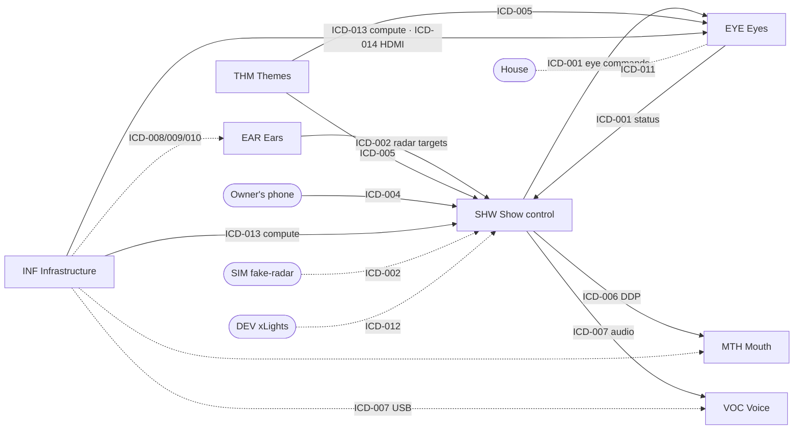

# Spec tree — Monster House

> **Status:** Draft, waiting for owner approval (STOP 0; Q1, Q2 and Q14 answered) · **Updated:** 2026-11-09 · **Format rules:** [ADR 0001](../decisions/0001-requirements-and-architecture-format.md)

The spec tree fixes the **subsystem boundaries**. From them come the requirement ID
prefixes (`EYE-012`), one requirements file per subsystem, and the components that
requirements are allocated to. IDs are permanent, so this page is approved before any
requirement is written.

Nothing here is decided until the owner approves it. The open boundary questions, each
with a recommendation, are at the [end of this page](#open-questions-for-the-owner).

## 1. The tree

Subsystems are split by **function** (the parts of the monster's face), not by physical
box (Q1). Hardware and software are **components** inside a subsystem. The
general-purpose computers (both eye Pis and the porch Pi) form a **compute platform** in
Infrastructure (Q14). Software stays in its functional subsystem and records which
computer it runs on at each stage (`deployed_on`), so one computer can host software
from more than one subsystem.

```text
SYS  Monster House system specification
├── EYE  Eyes ............. ×2: projector · screen · mask · shroud · stand · power strip · eye renderer
├── SHW  Show control ..... (software only) monster brain · phone page · Falcon Player · Mosquitto
├── EAR  Ears ............. LD2450 radar · ESP32 · ESPHome config
├── MTH  Mouth ............ LED strips + channels · Dig-Quad/WLED · 12 V supply
├── VOC  Voice ............ USB audio · amp · speakers · (rumble)
├── INF  Infrastructure ... compute (eye Pis, porch Pi) · Wi-Fi/addresses · power · mounting · weatherproofing
└── THM  Themes ........... theme folder format (data: eye art, clips, settings)

ENB  Enabling systems (not on the house)
├── SIM  Simulators ....... fake radar · fake FPP · house preview
├── DEV  Desktop tooling .. desktop · xLights · dev environment
└── DEP  Deployment ....... Pi setup scripts · services · install checklists
```

```mermaid
flowchart TB
  SYS["SYS · Monster House"]
  SYS --> EYE["EYE · Eyes"]
  SYS --> SHW["SHW · Show control"]
  SYS --> EAR["EAR · Ears"]
  SYS --> MTH["MTH · Mouth"]
  SYS --> VOC["VOC · Voice"]
  SYS --> INF["INF · Infrastructure"]
  SYS --> THM["THM · Themes"]
  EYE --> EYEc["×2: eye-projector · eye-screen<br/>eye-mask · eye-shroud · eye-stand · eye-power-strip<br/><i>sw:</i> eye-renderer"]
  SHW --> SHWc["<i>sw:</i> monster-brain · phone-page<br/>falcon-player · mosquitto"]
  EAR --> EARc["radar-sensor · radar-esp32<br/>radar-psu · radar-box<br/><i>sw:</i> radar-firmware"]
  MTH --> MTHc["lip-upper · lip-lower · mouth-extras<br/>lip-channel · lip-clips<br/>lip-controller · lip-psu · lip-box<br/><i>sw:</i> wled"]
  VOC --> VOCc["usb-audio · amp · amp-psu<br/>speakers · speaker-wire · rumble"]
  INF --> INFc["eye-pi-left · eye-pi-right · porch-pi<br/>home-network · power-distribution<br/>porch-mounting · porch-enclosure"]
  THM --> THMc["theme-format · theme-halloween"]

  ENB["ENB · Enabling systems"]
  ENB --> SIM["SIM · Simulators"]
  ENB --> DEV["DEV · Desktop tooling"]
  ENB --> DEP["DEP · Deployment"]
  SIM --> SIMc["<i>sw:</i> fake-radar · fake-fpp · house-preview"]
  DEV --> DEVc["desktop<br/><i>sw:</i> xlights · content-tools · dev-env"]
  DEP --> DEPc["<i>sw:</i> pi-setup · service-units<br/>install-checklists"]
```



> If the diagram shows as code, the text tree above and the tables below hold the same
> information.

## 2. Subsystems and their components

Component IDs below are proposals. They become permanent with this page's approval and
then live in `docs/architecture/components.yaml`. **Kind** follows ADR 0001: `part`
(hardware) or `software`. **From** is the stage in which the component first exists.

### EYE — Eyes
Draws a big cartoon eye in each upstairs bedroom window that opens, blinks, emotes and
looks at visitors (architecture §2). Left (from the street) is the smaller window.
There is one set of the parts below per window; together with that window's Pi (in INF)
they make an **eye pod**. The Pis themselves are INF's compute platform (Q14).

| Component | Kind | What it is | From |
|---|---|---|---|
| `eye-projector` | part | Short-throw LED projector (AAXA P400 class; model TBD-012) | 1 |
| `eye-screen` | part | Rear-projection screen cut to the window glass | 1 |
| `eye-mask` | part | Black fabric mask with an eye-shaped hole | 1 |
| `eye-shroud` | part | Blackout shroud on a light frame, projector to window | 1 |
| `eye-stand` | part | Stand or small cart that sets the projector height | 1 |
| `eye-power-strip` | part | One plug per pod for the Pi and the projector | 1 |
| `eye-renderer` | software | GPU-drawn eye (Python + moderngl + pygame-ce, ADR 0002); desktop windows in Stage 0, full-screen KMS/DRM on `eye-pi-left` and `eye-pi-right` from Stage 1 | 0 |

### SHW — Show control
The one place that decides and coordinates (architecture §3). Software only: it runs on
the desktop (DEV) in Stages 0–2 and on `porch-pi` (INF) from Stage 3. Falcon Player
stays here (Q2).

| Component | Kind | What it is | From |
|---|---|---|---|
| `monster-brain` | software | Moods, gaze math, blinks, clip pools, failure handling | 0 |
| `phone-page` | software | Small web page served by the brain: buttons and current mood | 0 |
| `falcon-player` | software | Falcon Player: plays voice + lip sequences together, schedule, DDP output. Faked in Stages 0–2 (`fake-fpp`, SIM) | 3 |
| `mosquitto` | software | MQTT broker that all MQTT traffic passes through | 0 |

### EAR — Ears
Notices people approaching and reports where they are (architecture §4).

| Component | Kind | What it is | From |
|---|---|---|---|
| `radar-sensor` | part | HLK-LD2450 24 GHz radar (firmware V2.02.23090617 or newer) | 2 |
| `radar-esp32` | part | ESP32 dev board, the `monster-radar` network node | 2 |
| `radar-psu` | part | 5 V USB supply | 2 |
| `radar-box` | part | Small enclosure under the porch roof | 2 |
| `radar-firmware` | software | Our ESPHome configuration (`esphome/`): sensors, zones, MQTT | 2 |

### MTH — Mouth
The lips: two lines of light along the porch that breathe while the monster sleeps and
move with its voice (architecture §5).

| Component | Kind | What it is | From |
|---|---|---|---|
| `lip-upper` | part | WS2815 12 V strip under the porch roof edge | 4 |
| `lip-lower` | part | WS2815 12 V strip along the railing | 4 |
| `mouth-extras` | part | Spare outputs: teeth uplight, throat glow, tongue | 4 |
| `lip-channel` | part | Aluminum channel + diffuser | 4 |
| `lip-clips` | part | Year-round mounting clips | 4 |
| `lip-controller` | part | QuinLED Dig-Quad, the `monster-lips` network node | 4 |
| `lip-psu` | part | 12 V ~350 W supply | 4 |
| `lip-box` | part | Weatherproof box for the controller and supply (see Q8) | 4 |
| `wled` | software | WLED firmware and its settings: segments, fallback "breathe", brightness limit | 4 |

### VOC — Voice
The monster's voice, snores, giggles and the felt rumble (architecture §6). The clips
themselves are theme content (THM).

| Component | Kind | What it is | From |
|---|---|---|---|
| `usb-audio` | part | USB audio adapter on the porch Pi (the Pi 5 has no headphone jack) | 3 |
| `amp` | part | Class-D stereo amp board (TPA3116 class) | 3 |
| `amp-psu` | part | 24 V supply for the amp | 3 |
| `speakers` | part | Pair of 5.25" weatherproof speakers under the porch ceiling | 3 |
| `speaker-wire` | part | 16 AWG speaker wire | 3 |
| `rumble` | part | Optional tactile transducer or small sub under the porch floor | 5 |

### INF — Infrastructure
What the other subsystems plug into or run on: the compute platform (the Raspberry Pis),
the network, mains power, and the shared mounting and weatherproofing on the porch
(architecture §8). The house itself, its outlets and the home Wi-Fi router are
**external** (see §3).

**Rule (Q14):** general-purpose computers that host our software and are built by our
setup scripts belong here. Embedded controllers that come with their own firmware for
one job stay with that job: the ESP32 (ESPHome) in EAR, the Dig-Quad (WLED) in MTH. The
desktop is DEV.

| Component | Kind | What it is | From |
|---|---|---|---|
| `eye-pi-left` | part | Raspberry Pi 5, 1GB, with supply and microSD, in the left (small) window's pod; hosts `eye-renderer` | 1 |
| `eye-pi-right` | part | The same, in the right (large) window's pod | 1 |
| `porch-pi` | part | Raspberry Pi 5, official supply, case with fan, 32 GB microSD, inside the front door; hosts Show control software; `usb-audio` plugs into it | 3 |
| `home-network` | part | Our setup of the home network: 2.4 GHz coverage on the porch, reserved addresses, the five friendly names, clock sync, nothing exposed to the internet | 1 |
| `power-distribution` | part | Outdoor-rated cords and outlets, which circuit feeds what | 1 |
| `porch-mounting` | part | Brackets and cable routes on the house, e.g. porch Pi to amp through the door frame | 2 |
| `porch-enclosure` | part | Shared weatherproof box, if more than one subsystem uses it (see Q8) | 3 |

### THM — Themes
A theme is a folder of data that gives the same hardware a holiday personality
(architecture §9; CLAUDE.md "Themes are data").

| Component | Kind | What it is | From |
|---|---|---|---|
| `theme-format` | software (data, see Q4) | The folder layout and `settings.yaml` contents every theme follows | 0 |
| `theme-halloween` | software (data, see Q4) | The first theme: settings, eye art, voice clips, lip sequences | 0 |

Later themes (`theme-christmas`, `theme-valentines`) are added as components when they
are made.

### ENB — Enabling systems (not on the house)
They have real requirements but are not part of the delivered monster.

| Prefix | Component | Kind | What it is | From |
|---|---|---|---|---|
| SIM | `fake-radar` | software | Drag up to 3 pretend visitors; publishes exactly what the radar would | 0 |
| SIM | `fake-fpp` | software | Logs clip triggers, plays placeholder audio, reports "clip finished" like FPP | 0 |
| SIM | `house-preview` | software | Live eyes composited on the house photo, plus a lip line | 0 |
| DEV | `desktop` | part | The owner's Ubuntu desktop; hosts SHW and EYE software in Stages 0–2 (see Q7) | 0 |
| DEV | `xlights` | software | Lip models and Singing Faces sequences; uploads to FPP | 3 |
| DEV | `content-tools` | software | Audacity, Inkscape/Krita for voice and eye art | 0 |
| DEV | `dev-env` | software | Repository, Python virtual environment, tests, debug tools, the requirements checker | 0 |
| DEP | `pi-setup` | software | Scripts that turn a fresh Raspberry Pi OS Lite install into an eye pod or the porch Pi | 0 (written), 1 (used) |
| DEP | `service-units` | software | System services that start the renderer, brain and broker at boot | 1 |
| DEP | `install-checklists` | software (documents) | Install, setup and teardown checklists | 1 |

## 3. N² interface chart

Read across a row: what the row's subsystem **sends to** the column's. The diagonal is
the subsystem itself. External entities are included because the monster's main outputs
(light and sound) go to them.

**Legend:** **D** data (MQTT, HTTP, DDP, files) · **A** audio signal · **P** mains or DC
power · **N** network service (Wi-Fi, addresses, time) · **M** mechanical (mounting,
enclosure) · **C** compute hosting (operating system, runtime, GPU, audio and video
devices, capacity) · **V** video (HDMI) · **L** light the audience sees · **S** sound ·
**R** radar sensing.
ICD numbers are proposals, fixed on approval.

| from ↓ / to → | EYE | SHW | EAR | MTH | VOC | INF | THM | House | Owner | Visitors | Neighbors |
|---|---|---|---|---|---|---|---|---|---|---|---|
| **EYE** | **Eyes** | D ICD-001 | | | | | | M ICD-011 | | L | |
| **SHW** | D ICD-001 | **Show control** ¹ | | D ICD-006 | A ICD-007 | | | | D ICD-004 | | |
| **EAR** | | D ICD-002 | **Ears** | | | | | | | | |
| **MTH** | | | | **Mouth** | | | | | | L | L |
| **VOC** | | | | | **Voice** | | | | | S | S |
| **INF** | C ICD-013 · V ICD-014 · P ICD-008 | C ICD-013 | P ICD-008 · N ICD-009 · M ICD-010 | P ICD-008 · N ICD-009 · M ICD-010 | P ICD-008 · M ICD-010 · USB port ICD-007 | **Infra** ³ | | | | | |
| **THM** | D ICD-005 | D ICD-005 | | | | | **Themes** | | | | |
| **House** | M ICD-011 | | | | | P · N · M ² | | *external* | | | |
| **Owner** | | D ICD-004 | | | | | | | *external* | | |
| **Visitors** | | | R | | | | | | | *external* | |
| **Neighbors** | | | | | | | | | | | *external* |

¹ **Inside Show control:** monster brain ↔ Falcon Player (clip commands and clip status)
is ICD-003. It is internal at subsystem level, but it gets its own ICD because the fake
FPP must swap for the real one (simulator parity). The brain ↔ phone page and brain ↔
Mosquitto links are inside one program or are the MQTT medium itself, so they get no ICD.

² The house's mains outlets, home router and mounting surfaces are what INF builds on.
They are covered inside ICD-008, ICD-009 and ICD-010 rather than in ICDs of their own.

³ **Inside Infrastructure:** the Pis' own power and network (ICD-008, ICD-009 apply to
them too) and the porch Pi's shelf and cable route (ICD-010).

**Cells with no ICD (proposal, Q10):** L, S and R cells are the monster's physical
effect on people (eye light, lip light, voice, radar echo). They are specified by system
requirements (brightness, volume, show hours, tone), not by ICDs.

### Proposed ICD list

One ICD per interface, covering both directions and every cell that shares the same
definition (Q11).

| ICD | Interface | Ends | Medium | Stage 0? | Depth at STOP 2 |
|---|---|---|---|---|---|
| ICD-001 | Eye commands and eye status | SHW `monster-brain` ↔ EYE `eye-renderer` | MQTT | Yes | Full |
| ICD-002 | Radar targets | EAR `radar-firmware` → SHW `monster-brain` (also SIM `fake-radar`) | MQTT, ESPHome LD2450 topics | Yes | Full |
| ICD-003 | Clip commands and clip status | SHW `monster-brain` ↔ SHW `falcon-player` (also SIM `fake-fpp`) | MQTT and/or HTTP (TBD-015) | Yes | Full |
| ICD-004 | Phone buttons and current mood | Owner's phone ↔ SHW `phone-page` | HTTP on the home network | Yes | Full |
| ICD-005 | Theme folder | THM `theme-format` → SHW `monster-brain`, `falcon-player`; EYE `eye-renderer` | Files | Yes | Full |
| ICD-006 | Lip light frames | SHW `falcon-player` → MTH `lip-controller` | DDP over Wi-Fi | No | Skeleton |
| ICD-007 | Voice audio | SHW `falcon-player` via INF `porch-pi` USB port → VOC `usb-audio` → `amp` | USB audio, line level | No | Skeleton |
| ICD-008 | Power | INF `power-distribution` → each subsystem's hardware, and INF's own Pis | Mains, DC | No | Skeleton |
| ICD-009 | Network service | INF `home-network` → each networked node | Wi-Fi, DHCP, DNS names, time | No | Skeleton |
| ICD-010 | Porch mounting and enclosures | INF `porch-mounting`, `porch-enclosure` ↔ EAR, MTH, VOC | Mechanical | No | Skeleton |
| ICD-011 | Eye pod in the window | EYE projector, screen, mask, shroud, stand ↔ house window and bedroom | Mechanical, optical | No | Skeleton |
| ICD-012 | Sequence and audio upload | DEV `xlights` → SHW `falcon-player` | Wi-Fi, FPP upload | No | Skeleton |
| ICD-013 | Compute platform | INF `eye-pi-left`, `eye-pi-right`, `porch-pi` (and DEV `desktop` in Stages 0–2) → EYE and SHW software | Operating system, Python, OpenGL ES 3.0, KMS/DRM display, audio device, services; capacities for the budget check | Yes (portability rules apply now) | Partial: Pi details wait for hardware (TBD-013) |
| ICD-014 | Eye video | INF `eye-pi-left`/`eye-pi-right` → EYE `eye-projector` | HDMI | No | Skeleton |

### Enabling-system interfaces

| From | To | What | ICD |
|---|---|---|---|
| SIM `fake-radar` | SHW `monster-brain` | The same topics and units as the real radar | ICD-002 (parity) |
| SIM `fake-fpp` | SHW `monster-brain` | The same commands and status as the real FPP | ICD-003 (parity) |
| SHW `monster-brain` | SIM `house-preview` | Proposal: the preview listens to the same eye commands as a pod and draws both eyes with the eye renderer's code | ICD-001 (a third listener) |
| DEV `xlights` | SHW `falcon-player` | `.fseq` sequences and audio, before the show | ICD-012 |
| DEV `desktop` | SHW, EYE software | Hosts them in Stages 0–2, as a stand-in for the Pis | ICD-013 (same platform rules) |
| DEP `pi-setup` | INF Pis | Builds each Pi and installs EYE or SHW software (deployment, not an interface) | — |



## Open questions for the owner

Each has a recommendation. None is decided until the owner answers.

**From the planning session**

1. **Split by function or by physical box?** **Decided 2026-11-09 (owner): by function,**
   because each build stage then maps to one subsystem. The comparison is in
   [spec-tree-q1-options.md](spec-tree-q1-options.md). Original recommendation:
   *function* (Eyes, Ears, Mouth, Voice), as drafted. It matches the
   monster-face idea and how you talk about the project. Physical boxes still appear,
   as `part` components with locations and `deployed_on`. The cost: one box can hold
   parts of two subsystems (the porch Pi runs SHW software and feeds VOC's USB adapter).
2. **Where does Falcon Player go?** **Decided 2026-11-09 (owner): Show control.**
   Original recommendation: *keep it in Show control*, with the brain ↔ FPP link as its own ICD
   (ICD-003) even though it is internal. It runs on the same Pi, takes orders only from
   the brain, and would carry only 4–6 requirements on its own. Splitting into Brain
   (`BRN`) and Sequencer (`SEQ`) would make the seam visible in the N² chart, at the cost
   of one more subsystem, file and row.
3. **Mosquitto: Show control or Infrastructure?**
   *Recommend: Show control.* It runs on the same machine as the brain in every stage,
   and the show stops without it. Infrastructure stays "things you plug into"
   (network, power, mounting). ICDs show publisher → subscriber, with the broker as the
   medium.
4. **Themes: a subsystem, or only constraints on others?**
   *Recommend: a subsystem (THM).* The theme folder format needs an owner for its ICD
   (ICD-005), and theme content has its own requirements: clip pool sizes, loudness,
   48 kHz audio, clip names that match FPP playlists, friendly tone. ADR 0001 allows
   only `part` and `software` as component kinds. *Recommend treating theme folders as
   `software`* (configuration data is software in systems-engineering usage), which
   needs no ADR change. The alternative is adding a third kind, `data`, which amends
   ADR 0001.
5. **Do the enabling systems get requirements now?**
   *Recommend:* **SIM yes** (3–6 requirements; Stage 0 Steps 3–5 depend on simulator
   parity now), **DEP a few** (2–3, for Stage 0 Step 8's setup script), **DEV a place
   in the tree only** for now.

**Raised by the docs**

6. **Site settings vs theme settings.** Architecture §3b puts the eye and radar
   positions in each theme's `settings.yaml`, but those describe the house, not the
   holiday, and would have to be copied into every theme. *Recommend:* a separate site
   (installation) config file for positions, window sizes and addresses, owned by INF,
   with themes holding only holiday content. This changes the theme folder format
   (ICD-005), so it is your call.
7. **Where does the desktop sit?** It runs the brain, Mosquitto and both eyes in Stages
   0–2. *Recommend:* a DEV node (enabling system) that SHW and EYE software is deployed
   on in those stages, rather than a temporary part of Show control.
8. **Boxes and power supplies.** *Recommend this rule:* a box or supply used by one
   subsystem belongs to it (`radar-box`, `lip-psu`, `amp-psu`, `lip-box`); one shared by
   several belongs to INF (`porch-enclosure`). Architecture §6 puts the amp "in the porch
   weatherproof box or just inside the door", so whether `lip-box` and `porch-enclosure`
   are one box is open. The USB audio adapter stays in VOC although it plugs into the
   porch Pi.
9. **Fog and other extras.** Stage 5 adds fog, and Stage 4 adds teeth and a tongue.
   *Recommend:* teeth, throat glow and tongue in MTH (`mouth-extras`, the Dig-Quad's spare
   outputs); fog gets no place until it is designed (a later `FOG` subsystem, or part of
   MTH as the monster's breath).
10. **External cells.** *Recommend:* the light, sound and radar cells with visitors and
    neighbors are covered by system requirements, not ICDs.
11. **One ICD per cell, or per interface?** *Recommend: per interface.* Both directions
    of a link share one ICD (ICD-001 carries commands one way and status the other), and
    INF's power, network and mounting each get one ICD covering every subsystem. That is
    14 ICDs (after Q14) instead of about 30.
12. **Turning the eye pods off at bedtime.** Architecture §2 says "the schedule turns
    pods off at bedtime", but no component does it (a smart plug, a Pi command to the
    projector, or FPP's schedule). *Recommend:* add it as a TBD at STOP 1 and decide when
    the pods are built; if it ends up as switched power, it lands in INF.
13. **`shared/` (topic names, MQTT helper).** *Recommend:* not a component of its own. It
    is the ICDs in code form, used by every Python component; the checker will keep it in
    step with the ICDs.

14. **Should the Raspberry Pis sit in Infrastructure?** (raised by the owner, 2026-11-09)
    **Decided 2026-11-09 (owner): yes, all three.** Original recommendation: yes, as a **compute platform** inside INF: `eye-pi-left`, `eye-pi-right`
    and `porch-pi`. The rule would be: general-purpose computers that host our software
    and are built by our setup scripts belong to INF. Embedded controllers that come with
    their own firmware for one job stay with that job: the ESP32 with ESPHome in EAR,
    the Dig-Quad with WLED in MTH. The desktop stays in DEV. Software stays in its
    functional subsystem and records which computer it runs on (`deployed_on`).
    The eye pod's other parts (projector, screen, mask, shroud, stand) stay in EYE.

**Owner answers so far (2026-11-09)**
- **Q1:** by function (see above).
- **Q2:** Falcon Player stays in Show control; brain ↔ FPP keeps its own ICD (ICD-003).
- **Q14:** all three Pis move to INF as the compute platform (rule in §2, INF). Show
  control becomes software only. New ICDs: ICD-013 (compute platform) and ICD-014 (eye
  video over HDMI).
- **Budgets:** yes. Each component declares what it needs (power, memory, ports, space
  in a box), and each host or supply declares what it has, per stage. The checker adds
  them up deterministically and becomes the verification tool for the requirements
  that set those limits (`verify: analysis`).
- **Timing:** a system performance requirement for each end-to-end information path at
  STOP 1, with a TBD wherever the owner hasn't chosen a number; per-hop timing budgets,
  allocated to subsystems and written into the ICDs' timing sections, at STOP 2.

**Noted for later (allocation, not boundaries):** show hours are set by FPP's scheduler
in architecture §3a and by the theme's `show_hours` in §3b; who owns the schedule is
settled at STOP 2. The trial IDs in `trials/ts-001/` (BRN-001 and so on) are not part of
this baseline; numbering starts fresh at SYS-001, EYE-001, and so on.
