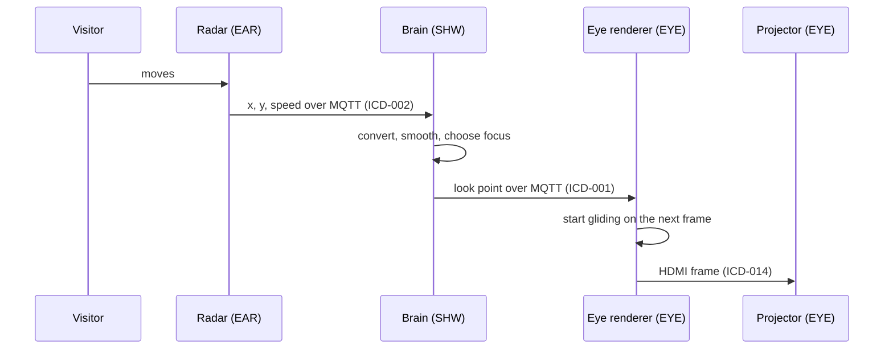
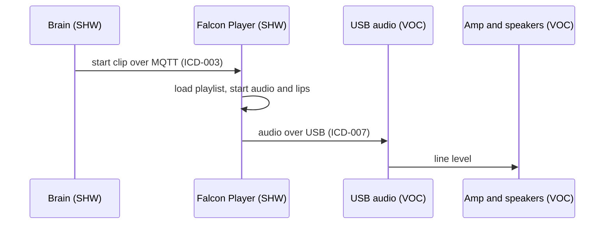
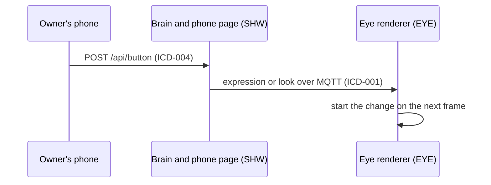

# Timing budgets: the information paths

> **Status:** Draft · **Updated:** 2026-11-09 · **Process:** agreed with the owner 2026-11-09 (spec tree, "Owner answers")

Each end-to-end time in the system requirements is a path through several parts. This
page lists the hops on each path, who owns each hop, and what is already known. How each
end-to-end time is shared out between its hops is **TBD-034**: decided by analysis, then
measured in the Stage 0 simulator, and again on hardware. The ICDs' timing sections point
here.

A latency model (each hop's estimated or measured delay, added up per path, like the
budget check) will be built while burning down these TBDs (owner, 2026-11-09). It becomes
the `basis` of the timing requirements, which the checker lists as gaps until then.

## P1 — Visitor moves → eyes follow (SYS-019, total TBD-020)

| Hop | Owner | Requirement | Known so far |
|---|---|---|---|
| Radar sees the move and publishes | EAR | EAR-004 | About 10 updates/s, so up to ~0.1 s old; ESPHome's default throttle (1 s) must be overridden |
| Wi-Fi and broker to the brain | INF, SHW | INF-009, SHW-039 | Not measured |
| Brain converts, smooths and publishes | SHW | SHW-007, SHW-009 | Publishes about 10/s, so up to ~0.1 s wait; the smoothing filter adds delay |
| Broker and Wi-Fi to the eye | SHW, INF | SHW-039 | Not measured |
| Eye starts moving | EYE | EYE-009 | Next frame: up to 16.7 ms at 60 fps (EYE-008) |
| HDMI and projector show it | EYE | EYE-019 | Projector input lag unknown (model TBD-012) |

## P2 — Visitor enters the approach zone → monster starts to wake (SYS-020, total TBD-021)

Same hops as P1 up to the brain; the brain then commands the eyes open (SHW-003), and the
eye starts its expression change on the next frame (EYE-002).

## P3 — Brain decides to speak → voice starts (SYS-021, total TBD-022)

| Hop | Owner | Requirement | Known so far |
|---|---|---|---|
| Brain to FPP | SHW | SHW-026 | Not measured |
| FPP starts the clip | SHW | SHW-033 | Not measured; FPP topics TBD-015 |
| USB audio and amp | VOC | VOC-001 | Not measured |

## P4 — Phone button → monster changes (SYS-023, total 0.5 s)

| Hop | Owner | Requirement | Known so far |
|---|---|---|---|
| Phone to the page over Wi-Fi | INF | SHW-031 | Not measured |
| Brain acts on the button | SHW | SHW-023 | Not measured |
| Broker to the eye, next frame | SHW, EYE | EYE-009 | Up to 16.7 ms at 60 fps |
| Projector shows it | EYE | EYE-019 | Projector lag unknown (TBD-012) |

## P5 — Lips vs voice (SYS-022: lips no more than 45 ms late or 125 ms early)

Both start from the same FPP playlist (SHW-032), so the skew is the difference between
the two output paths: DDP over Wi-Fi to WLED (ICD-006) vs USB audio to the amp
(ICD-007). Measure it in Stage 4 with the real lips; xLights can shift a sequence if one
path is consistently slower.

## P6 — Something fails → fallback begins (SYS-029, total TBD-023)

| Failure | Noticed by | How | Requirement |
|---|---|---|---|
| Brain silent | Each eye | No message for the fallback time | EYE-006 |
| Eye pod drops | Brain | Broker sends the eye's last-will | SHW-018 |
| Radar drops or goes quiet | Brain | Last-will, or no values for the fallback time | SHW-018 |
| FPP not responding | Brain | No `playing` after a start command | SHW-018 |

The last-will arrives after the broker's keep-alive timeout, so the MQTT keep-alive
setting is part of this budget (TBD-023).
