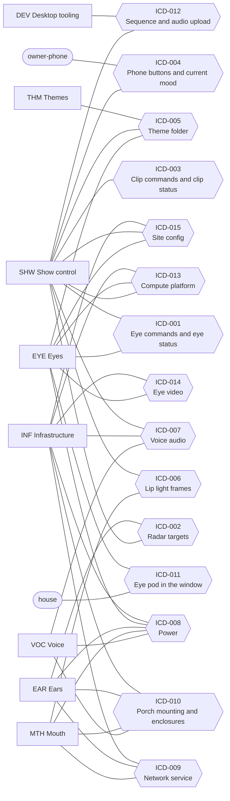

# Traceability (generated, do not edit)

> Generated by `tools/reqs/check.py` from `docs/requirements/*.yaml`,
> `docs/architecture/components.yaml` and `docs/interfaces/`. To regenerate, run
> `.venv/bin/python -m tools.reqs.check` from the repository root.

## Summary

| Subsystem | functional | performance | interface | constraint | Total |
|---|---|---|---|---|---|
| SYS Monster House system specification | 18 | 13 | 4 | 11 | 46 |
| **All** | 18 | 13 | 4 | 11 | **46** |

**Components:** 51 (32 parts, 19 software). **ICDs:** 15 (15 stub).

## Coverage

| Check | Result |
|---|---|
| System requirements with children | 0 of 46 |
| Subsystem requirements allocated to a component | 0 of 0 |
| Interface requirements with an ICD | 4 of 4 |
| ICD sides with an interface requirement | 0 of 37 |
| Checker errors | 0 |

**Components with no requirement yet** (51): `amp`, `amp-psu`, `content-tools`, `desktop`, `dev-env`, `eye-mask`, `eye-pi-left`, `eye-pi-right`, `eye-power-strip`, `eye-projector`, `eye-renderer`, `eye-screen`, `eye-shroud`, `eye-stand`, `fake-fpp`, `fake-radar`, `falcon-player`, `home-network`, `house-preview`, `install-checklists`, `lip-box`, `lip-channel`, `lip-clips`, `lip-controller`, `lip-lower`, `lip-psu`, `lip-upper`, `monster-brain`, `mosquitto`, `mouth-extras`, `phone-page`, `pi-setup`, `porch-enclosure`, `porch-mounting`, `porch-pi`, `power-distribution`, `radar-box`, `radar-esp32`, `radar-firmware`, `radar-psu`, `radar-sensor`, `rumble`, `service-units`, `site-config`, `speaker-wire`, `speakers`, `theme-format`, `theme-halloween`, `usb-audio`, `wled`, `xlights`

### Gaps (83)

- SYS-001: system requirement has no children yet (not decomposed)
- SYS-002: system requirement has no children yet (not decomposed)
- SYS-003: system requirement has no children yet (not decomposed)
- SYS-004: system requirement has no children yet (not decomposed)
- SYS-005: system requirement has no children yet (not decomposed)
- SYS-006: system requirement has no children yet (not decomposed)
- SYS-007: system requirement has no children yet (not decomposed)
- SYS-008: system requirement has no children yet (not decomposed)
- SYS-009: system requirement has no children yet (not decomposed)
- SYS-010: system requirement has no children yet (not decomposed)
- SYS-011: system requirement has no children yet (not decomposed)
- SYS-012: system requirement has no children yet (not decomposed)
- SYS-013: system requirement has no children yet (not decomposed)
- SYS-014: system requirement has no children yet (not decomposed)
- SYS-015: system requirement has no children yet (not decomposed)
- SYS-016: system requirement has no children yet (not decomposed)
- SYS-017: system requirement has no children yet (not decomposed)
- SYS-018: system requirement has no children yet (not decomposed)
- SYS-019: system requirement has no children yet (not decomposed)
- SYS-020: system requirement has no children yet (not decomposed)
- SYS-021: system requirement has no children yet (not decomposed)
- SYS-022: system requirement has no children yet (not decomposed)
- SYS-023: system requirement has no children yet (not decomposed)
- SYS-024: system requirement has no children yet (not decomposed)
- SYS-025: system requirement has no children yet (not decomposed)
- SYS-026: system requirement has no children yet (not decomposed)
- SYS-027: system requirement has no children yet (not decomposed)
- SYS-028: system requirement has no children yet (not decomposed)
- SYS-029: system requirement has no children yet (not decomposed)
- SYS-030: system requirement has no children yet (not decomposed)
- SYS-031: system requirement has no children yet (not decomposed)
- SYS-032: system requirement has no children yet (not decomposed)
- SYS-033: system requirement has no children yet (not decomposed)
- SYS-034: system requirement has no children yet (not decomposed)
- SYS-035: system requirement has no children yet (not decomposed)
- SYS-036: system requirement has no children yet (not decomposed)
- SYS-037: system requirement has no children yet (not decomposed)
- SYS-038: system requirement has no children yet (not decomposed)
- SYS-039: system requirement has no children yet (not decomposed)
- SYS-040: system requirement has no children yet (not decomposed)
- SYS-041: system requirement has no children yet (not decomposed)
- SYS-042: system requirement has no children yet (not decomposed)
- SYS-043: system requirement has no children yet (not decomposed)
- SYS-044: system requirement has no children yet (not decomposed)
- SYS-045: system requirement has no children yet (not decomposed)
- SYS-046: system requirement has no children yet (not decomposed)
- ICD-001: no interface requirement on the SHW side
- ICD-001: no interface requirement on the EYE side
- ICD-002: no interface requirement on the EAR side
- ICD-002: no interface requirement on the SHW side
- ICD-003: no interface requirement on the monster-brain side
- ICD-003: no interface requirement on the falcon-player side
- ICD-004: no interface requirement on the SHW side
- ICD-005: no interface requirement on the THM side
- ICD-005: no interface requirement on the SHW side
- ICD-005: no interface requirement on the EYE side
- ICD-006: no interface requirement on the SHW side
- ICD-006: no interface requirement on the MTH side
- ICD-007: no interface requirement on the SHW side
- ICD-007: no interface requirement on the INF side
- ICD-007: no interface requirement on the VOC side
- ICD-008: no interface requirement on the INF side
- ICD-008: no interface requirement on the EYE side
- ICD-008: no interface requirement on the EAR side
- ICD-008: no interface requirement on the MTH side
- ICD-008: no interface requirement on the VOC side
- ICD-009: no interface requirement on the INF side
- ICD-009: no interface requirement on the EAR side
- ICD-009: no interface requirement on the MTH side
- ICD-010: no interface requirement on the INF side
- ICD-010: no interface requirement on the EAR side
- ICD-010: no interface requirement on the MTH side
- ICD-010: no interface requirement on the VOC side
- ICD-011: no interface requirement on the EYE side
- ICD-012: no interface requirement on the SHW side
- ICD-013: no interface requirement on the INF side
- ICD-013: no interface requirement on the EYE side
- ICD-013: no interface requirement on the SHW side
- ICD-014: no interface requirement on the INF side
- ICD-014: no interface requirement on the EYE side
- ICD-015: no interface requirement on the INF side
- ICD-015: no interface requirement on the SHW side
- ICD-015: no interface requirement on the EYE side

### Warnings (ICD topics vs `shared/topics.py`) (20)

- shared/topics.py: DEBUG_TEST = monster/debug/test is in no ICD
- shared/topics.py: EYES_BLINK = monster/eyes/blink is in no ICD
- shared/topics.py: EYES_EXPRESSION = monster/eyes/expression is in no ICD
- shared/topics.py: EYES_LEFT_STATUS = monster/eyes/left/status is in no ICD
- shared/topics.py: EYES_LOOK = monster/eyes/look is in no ICD
- shared/topics.py: EYES_RIGHT_STATUS = monster/eyes/right/status is in no ICD
- shared/topics.py: RADAR_STATUS = monster-radar/status is in no ICD
- shared/topics.py: RADAR_TARGET_COUNT = monster-radar/sensor/target_count/state is in no ICD
- shared/topics.py: STATE = monster/state is in no ICD
- shared/topics.py: THEME = monster/theme is in no ICD
- shared/topics.py: fpp_playlist_start(<name>) = falcon/player/FPP/set/playlist/{name}/start is in no ICD
- shared/topics.py: radar_target(1, 'speed') = monster-radar/sensor/target_1_speed/state is in no ICD
- shared/topics.py: radar_target(1, 'x') = monster-radar/sensor/target_1_x/state is in no ICD
- shared/topics.py: radar_target(1, 'y') = monster-radar/sensor/target_1_y/state is in no ICD
- shared/topics.py: radar_target(2, 'speed') = monster-radar/sensor/target_2_speed/state is in no ICD
- shared/topics.py: radar_target(2, 'x') = monster-radar/sensor/target_2_x/state is in no ICD
- shared/topics.py: radar_target(2, 'y') = monster-radar/sensor/target_2_y/state is in no ICD
- shared/topics.py: radar_target(3, 'speed') = monster-radar/sensor/target_3_speed/state is in no ICD
- shared/topics.py: radar_target(3, 'x') = monster-radar/sensor/target_3_x/state is in no ICD
- shared/topics.py: radar_target(3, 'y') = monster-radar/sensor/target_3_y/state is in no ICD

### TBDs cited by requirements

- TBD-012: SYS-024
- TBD-016: SYS-026
- TBD-020: SYS-019
- TBD-021: SYS-020
- TBD-022: SYS-021
- TBD-023: SYS-029
- TBD-024: SYS-014
- TBD-025: SYS-018
- TBD-026: SYS-030
- TBD-027: SYS-031

## Requirements

### SYS — Monster House system specification

| ID | Type | Stage | Status | Requirement | Children | Verify |
|---|---|---|---|---|---|---|
| SYS-001 | functional | 0 | proposed | When no visitor is in range, the monster shall show its asleep behavior: eyes closed, lips glowing slowly in and out, and a quiet snore at intervals set in the theme (default about 30 s). | — | demonstration |
| SYS-002 | functional | 0 | proposed | When a visitor enters the approach zone heading toward the house, the monster shall wake: open its eyes, look around, lock on to the visitor and yawn. | — | demonstration |
| SYS-003 | functional | 0 | proposed | When the wake clip ends with a visitor still in range, the monster shall greet the visitor with one greeting line, with a happy squint. | — | demonstration |
| SYS-004 | functional | 0 | proposed | While visitors are in range, both eyes shall look toward the focus visitor's head, each eye aiming from its own window's position, so that the eyes converge on a near visitor and look parallel at a far one. | — | test |
| SYS-005 | functional | 0 | proposed | When more than one visitor is in range, the monster shall move its gaze between them, giving a newly arrived visitor the focus first. | — | demonstration |
| SYS-006 | functional | 0 | proposed | While watching visitors, the monster shall say a comment or giggle at intervals set in the theme (default 10–20 s, chosen at random within that range). | — | test |
| SYS-007 | functional | 0 | proposed | When no visitor has been in range for the time set in the theme (default 5 s), the monster shall look toward where they left, say a goodbye line and droop its eyes. | — | test |
| SYS-008 | functional | 0 | proposed | After a goodbye, the monster shall go back to sleep when no visitor has arrived for the time set in the theme (default 20 s), or greet a newly arrived visitor without yawning first. | — | test |
| SYS-009 | functional | 0 | proposed | While awake, the monster shall blink both eyes together, at intervals set in the theme. | — | demonstration |
| SYS-010 | functional | 0 | proposed | The eyes shall be able to show at least the expressions neutral, happy, sparkle, surprised, sleepy and asleep, easing from one to the next without jumps. | — | demonstration |
| SYS-011 | functional | 4 | proposed | Whenever the monster speaks, its lips shall move in time with its voice. | — | demonstration |
| SYS-012 | functional | 0 | proposed | The owner shall be able to trigger great costume (sparkle eyes and a compliment), burp, sing, mute voice, sleep now and wake now from a phone, and see the monster's current mood there. | — | demonstration |
| SYS-013 | functional | 0 | proposed | While muted, the monster shall make no voice sound and shall keep its eyes and lip lights working. | — | demonstration |
| SYS-014 | functional | 0 | proposed | Outside show hours (TBD-024), the monster shall stay asleep and make no voice sound, whatever the radar reports. | — | test |
| SYS-015 | functional | 0 | proposed | Within each clip pool (greetings, comments, goodbyes, and so on), the monster shall not repeat a clip until every clip in that pool has played. | — | test |
| SYS-016 | functional | 0 | proposed | When the owner chooses a theme, the monster shall change to that theme's eye art, voice clips, lip sequences and timings without a software change. | — | demonstration |
| SYS-017 | functional | 0 | proposed | If any one component stops working (an eye pod, the radar, Falcon Player, the brain or the Wi-Fi), the remaining components shall keep running and the monster shall fall back to a sleepy or idle look: eyes wandering and blinking on their own, no greetings without the radar, no voice or lip movement without Falcon Player. | — | test |
| SYS-018 | functional | 1 | proposed | The eye pods shall switch off at bedtime (time and method TBD-025) and stay off until the next show day. | — | demonstration |
| SYS-019 | performance | 0 | proposed | The eyes shall begin turning toward a visitor's new position within TBD-020 of the visitor moving. | — | test |
| SYS-020 | performance | 0 | proposed | The monster shall begin to wake within TBD-021 of a visitor entering the approach zone. | — | test |
| SYS-021 | performance | 3 | proposed | The voice shall begin within TBD-022 of the brain deciding to say a line. | — | test |
| SYS-022 | performance | 4 | proposed | Each lip shape shall appear no more than 45 ms after, and no more than 125 ms before, the matching sound. | — | test |
| SYS-023 | performance | 0 | proposed | A button pressed on the phone page shall visibly change the monster within 0.5 s. | — | test |
| SYS-024 | performance | 0 | proposed | Each eye shall be drawn at a steady 60 frames per second, at its projector's native resolution (projector model TBD-012). | — | test |
| SYS-025 | performance | 2 | proposed | The monster shall track up to 3 visitors at the same time. | — | test |
| SYS-026 | performance | 2 | proposed | The monster shall detect visitors anywhere in the approach zone, which covers the walkway and the steps (whether it reaches the sidewalk: TBD-016). | — | test |
| SYS-027 | performance | 0 | proposed | The monster shall leave at least 10 s (theme setting) between the end of one spoken line and the start of the next, except for lines the owner triggers from the phone. | — | test |
| SYS-028 | performance | 0 | proposed | While a visitor is tracked, the visitor's position shall be updated at about 10 times per second from the radar through to the eyes. | — | test |
| SYS-029 | performance | 0 | proposed | Each fallback in SYS-017 shall begin within TBD-023 of the failure. | — | test |
| SYS-030 | performance | 3 | proposed | The monster's sound shall never exceed TBD-026 at the sidewalk. | — | test |
| SYS-031 | performance | 4 | proposed | The lip lights shall never exceed the brightness cap TBD-027. | — | test |
| SYS-032 | interface | 0 | proposed | The owner's controls (SYS-012) shall work in an ordinary phone web browser on the home network, with no app to install, as specified in ICD-004. | — | demonstration |
| SYS-033 | interface | 1 | proposed | Every networked part of the monster shall use the home Wi-Fi, with a reserved address and a friendly name, as specified in ICD-009. | — | inspection |
| SYS-034 | interface | 1 | proposed | Each box on the house shall need only one plug in an ordinary household outlet, as specified in ICD-008, and no data cable other than the audio cable to the amp. | — | inspection |
| SYS-035 | interface | 1 | proposed | Each eye pod shall fit its bedroom window and floor space using only removable fittings, as specified in ICD-011. | — | inspection |
| SYS-036 | constraint | 0 | proposed | Everything the monster shows and says shall be friendly and goofy: big round pupils, smiles made with the lower lid, no slit pupils, no horror imagery and no horror sounds. | — | inspection |
| SYS-037 | constraint | 0 | proposed | The eye screens shall never show an error message, text, a desktop or a cursor. | — | test |
| SYS-038 | constraint | 0 | proposed | No part of the monster shall be reachable from the internet; the phone page shall work only on the home network. | — | inspection |
| SYS-039 | constraint | 0 | proposed | All monster software that runs on the house shall run on Raspberry Pi OS (64-bit, Bookworm) with Python 3.11, and on the Ubuntu desktop for development. | — | test |
| SYS-040 | constraint | 0 | proposed | The eyes shall be drawn on the GPU, with shaders that are compatible with OpenGL ES 3.0 (GLSL ES 3.00), and no per-frame drawing on the CPU. | — | inspection |
| SYS-041 | constraint | 0 | proposed | Timings, clip pools, colors and eye art shall come from the theme folder, not from code. | — | inspection |
| SYS-042 | constraint | 0 | proposed | All messages between the monster's parts, except lip light data and audio, shall pass through one MQTT broker, with every topic name and payload format defined in one place in the code (shared/). | — | inspection |
| SYS-043 | constraint | 0 | proposed | Every hardware part that sends or receives messages shall have a desktop simulator that sends or receives exactly the same messages. | — | test |
| SYS-044 | constraint | 1 | proposed | With an eye pod running, no projector light shall reach the bedroom outside the shroud. | — | inspection |
| SYS-045 | constraint | 1 | proposed | The monster shall be installed and removed each season with nothing left in the bedroom and nothing left on the house except the year-round lip clips. | — | demonstration |
| SYS-046 | constraint | 2 | proposed | Every outdoor part shall be rated for outdoor use or sheltered from rain and snow. | — | inspection |

## Allocation

System requirement → subsystem requirement → component, one diagram per subsystem.

No subsystem requirements yet.

## Interfaces

Each ICD joins the subsystems (or outside entities) at its ends.

