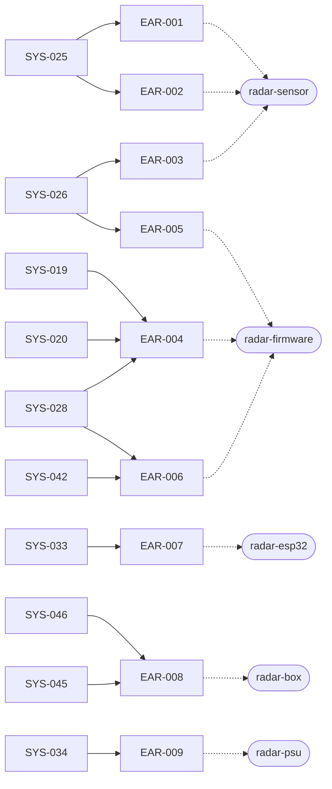
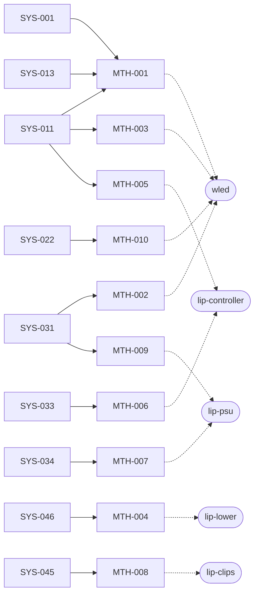
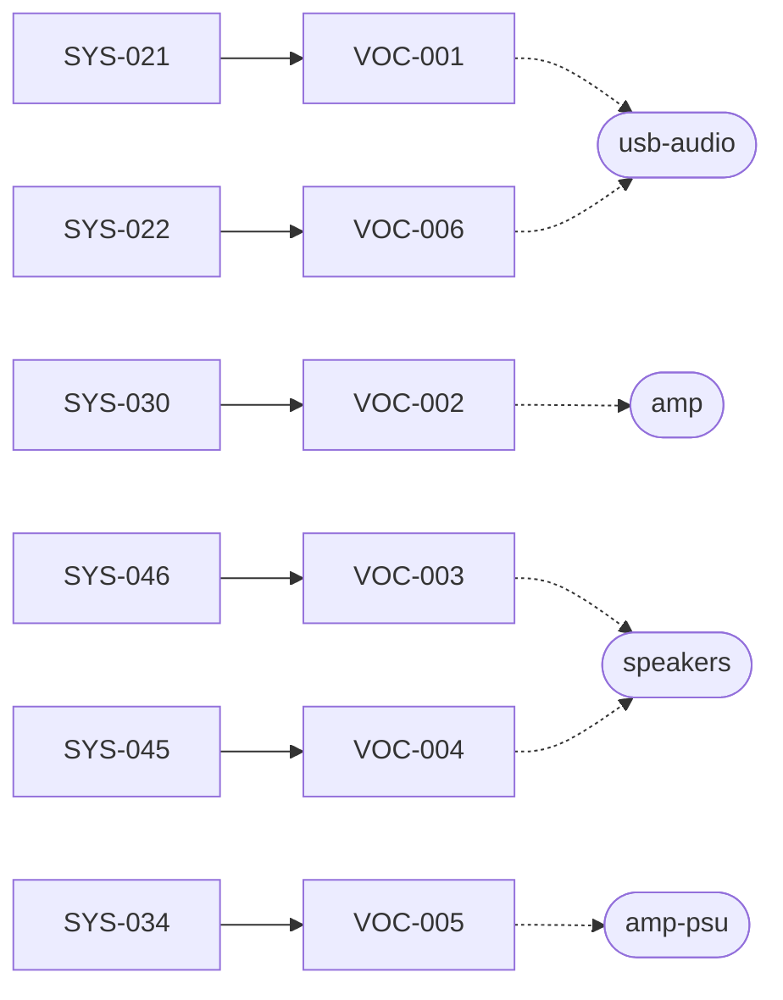

```mermaid
flowchart LR
  SYS_010[SYS-010] --> EYE_001[EYE-001]
  SYS_036[SYS-036] --> EYE_001[EYE-001]
  EYE_001 -.-> c_eye_renderer([eye-renderer])
  SYS_010[SYS-010] --> EYE_002[EYE-002]
  EYE_002 -.-> c_eye_renderer([eye-renderer])
  SYS_004[SYS-004] --> EYE_003[EYE-003]
  EYE_003 -.-> c_eye_renderer([eye-renderer])
  SYS_004[SYS-004] --> EYE_004[EYE-004]
  EYE_004 -.-> c_eye_renderer([eye-renderer])
  SYS_009[SYS-009] --> EYE_005[EYE-005]
  EYE_005 -.-> c_eye_renderer([eye-renderer])
  SYS_017[SYS-017] --> EYE_006[EYE-006]
  SYS_029[SYS-029] --> EYE_006[EYE-006]
  EYE_006 -.-> c_eye_renderer([eye-renderer])
  SYS_017[SYS-017] --> EYE_007[EYE-007]
  EYE_007 -.-> c_eye_renderer([eye-renderer])
  SYS_024[SYS-024] --> EYE_008[EYE-008]
  EYE_008 -.-> c_eye_renderer([eye-renderer])
  SYS_019[SYS-019] --> EYE_009[EYE-009]
  EYE_009 -.-> c_eye_renderer([eye-renderer])
  SYS_040[SYS-040] --> EYE_010[EYE-010]
  EYE_010 -.-> c_eye_renderer([eye-renderer])
  SYS_036[SYS-036] --> EYE_011[EYE-011]
  EYE_011 -.-> c_eye_renderer([eye-renderer])
  SYS_037[SYS-037] --> EYE_012[EYE-012]
  EYE_012 -.-> c_eye_renderer([eye-renderer])
  SYS_035[SYS-035] --> EYE_013[EYE-013]
  SYS_024[SYS-024] --> EYE_013[EYE-013]
  EYE_013 -.-> c_eye_renderer([eye-renderer])
  SYS_016[SYS-016] --> EYE_014[EYE-014]
  EYE_014 -.-> c_eye_renderer([eye-renderer])
  SYS_042[SYS-042] --> EYE_015[EYE-015]
  EYE_015 -.-> c_eye_renderer([eye-renderer])
  SYS_041[SYS-041] --> EYE_016[EYE-016]
  EYE_016 -.-> c_eye_renderer([eye-renderer])
  SYS_004[SYS-004] --> EYE_017[EYE-017]
  SYS_035[SYS-035] --> EYE_017[EYE-017]
  EYE_017 -.-> c_eye_renderer([eye-renderer])
  SYS_039[SYS-039] --> EYE_018[EYE-018]
  EYE_018 -.-> c_eye_renderer([eye-renderer])
  SYS_024[SYS-024] --> EYE_019[EYE-019]
  SYS_045[SYS-045] --> EYE_019[EYE-019]
  EYE_019 -.-> c_eye_projector([eye-projector])
  SYS_034[SYS-034] --> EYE_020[EYE-020]
  EYE_020 -.-> c_eye_power_strip([eye-power-strip])
  SYS_035[SYS-035] --> EYE_021[EYE-021]
  SYS_045[SYS-045] --> EYE_021[EYE-021]
  EYE_021 -.-> c_eye_screen([eye-screen])
  SYS_044[SYS-044] --> EYE_022[EYE-022]
  EYE_022 -.-> c_eye_shroud([eye-shroud])
  SYS_035[SYS-035] --> EYE_023[EYE-023]
  EYE_023 -.-> c_eye_stand([eye-stand])
  SYS_020[SYS-020] --> EYE_024[EYE-024]
  SYS_023[SYS-023] --> EYE_024[EYE-024]
  EYE_024 -.-> c_eye_renderer([eye-renderer])
```

```mermaid
flowchart LR
  SYS_002[SYS-002] --> SHW_001[SHW-001]
  SYS_003[SYS-003] --> SHW_001[SHW-001]
  SYS_007[SYS-007] --> SHW_001[SHW-001]
  SYS_008[SYS-008] --> SHW_001[SHW-001]
  SHW_001 -.-> c_monster_brain([monster-brain])
  SYS_001[SYS-001] --> SHW_002[SHW-002]
  SHW_002 -.-> c_monster_brain([monster-brain])
  SYS_002[SYS-002] --> SHW_003[SHW-003]
  SYS_020[SYS-020] --> SHW_003[SHW-003]
  SHW_003 -.-> c_monster_brain([monster-brain])
  SYS_003[SYS-003] --> SHW_004[SHW-004]
  SHW_004 -.-> c_monster_brain([monster-brain])
  SYS_006[SYS-006] --> SHW_005[SHW-005]
  SHW_005 -.-> c_monster_brain([monster-brain])
  SYS_004[SYS-004] --> SHW_006[SHW-006]
  SHW_006 -.-> c_monster_brain([monster-brain])
  SYS_004[SYS-004] --> SHW_007[SHW-007]
  SYS_019[SYS-019] --> SHW_007[SHW-007]
  SHW_007 -.-> c_monster_brain([monster-brain])
  SYS_005[SYS-005] --> SHW_008[SHW-008]
  SHW_008 -.-> c_monster_brain([monster-brain])
  SYS_028[SYS-028] --> SHW_009[SHW-009]
  SYS_019[SYS-019] --> SHW_009[SHW-009]
  SHW_009 -.-> c_monster_brain([monster-brain])
  SYS_008[SYS-008] --> SHW_010[SHW-010]
  SYS_049[SYS-049] --> SHW_010[SHW-010]
  SYS_050[SYS-050] --> SHW_010[SHW-010]
  SHW_010 -.-> c_monster_brain([monster-brain])
  SYS_047[SYS-047] --> SHW_011[SHW-011]
  SYS_007[SYS-007] --> SHW_011[SHW-011]
  SHW_011 -.-> c_monster_brain([monster-brain])
  SYS_048[SYS-048] --> SHW_012[SHW-012]
  SHW_012 -.-> c_monster_brain([monster-brain])
  SYS_049[SYS-049] --> SHW_013[SHW-013]
  SHW_013 -.-> c_monster_brain([monster-brain])
  SYS_050[SYS-050] --> SHW_014[SHW-014]
  SYS_005[SYS-005] --> SHW_014[SHW-014]
  SHW_014 -.-> c_monster_brain([monster-brain])
  SYS_009[SYS-009] --> SHW_015[SHW-015]
  SHW_015 -.-> c_monster_brain([monster-brain])
  SYS_015[SYS-015] --> SHW_016[SHW-016]
  SHW_016 -.-> c_monster_brain([monster-brain])
  SYS_027[SYS-027] --> SHW_017[SHW-017]
  SHW_017 -.-> c_monster_brain([monster-brain])
  SYS_017[SYS-017] --> SHW_018[SHW-018]
  SYS_029[SYS-029] --> SHW_018[SHW-018]
  SHW_018 -.-> c_monster_brain([monster-brain])
  SYS_014[SYS-014] --> SHW_019[SHW-019]
  SHW_019 -.-> c_monster_brain([monster-brain])
  SYS_013[SYS-013] --> SHW_020[SHW-020]
  SHW_020 -.-> c_monster_brain([monster-brain])
  SYS_016[SYS-016] --> SHW_021[SHW-021]
  SHW_021 -.-> c_monster_brain([monster-brain])
  SYS_012[SYS-012] --> SHW_022[SHW-022]
  SHW_022 -.-> c_monster_brain([monster-brain])
  SYS_023[SYS-023] --> SHW_023[SHW-023]
  SHW_023 -.-> c_monster_brain([monster-brain])
  SYS_042[SYS-042] --> SHW_024[SHW-024]
  SHW_024 -.-> c_monster_brain([monster-brain])
  SYS_042[SYS-042] --> SHW_025[SHW-025]
  SYS_028[SYS-028] --> SHW_025[SHW-025]
  SHW_025 -.-> c_monster_brain([monster-brain])
  SYS_042[SYS-042] --> SHW_026[SHW-026]
  SYS_043[SYS-043] --> SHW_026[SHW-026]
  SHW_026 -.-> c_monster_brain([monster-brain])
  SYS_041[SYS-041] --> SHW_027[SHW-027]
  SHW_027 -.-> c_monster_brain([monster-brain])
  SYS_004[SYS-004] --> SHW_028[SHW-028]
  SYS_047[SYS-047] --> SHW_028[SHW-028]
  SHW_028 -.-> c_monster_brain([monster-brain])
  SYS_039[SYS-039] --> SHW_029[SHW-029]
  SHW_029 -.-> c_monster_brain([monster-brain])
  SYS_012[SYS-012] --> SHW_030[SHW-030]
  SYS_016[SYS-016] --> SHW_030[SHW-030]
  SHW_030 -.-> c_phone_page([phone-page])
  SYS_032[SYS-032] --> SHW_031[SHW-031]
  SYS_038[SYS-038] --> SHW_031[SHW-031]
  SHW_031 -.-> c_phone_page([phone-page])
  SYS_011[SYS-011] --> SHW_032[SHW-032]
  SYS_022[SYS-022] --> SHW_032[SHW-032]
  SHW_032 -.-> c_falcon_player([falcon-player])
  SYS_021[SYS-021] --> SHW_033[SHW-033]
  SHW_033 -.-> c_falcon_player([falcon-player])
  SYS_030[SYS-030] --> SHW_034[SHW-034]
  SHW_034 -.-> c_falcon_player([falcon-player])
  SYS_042[SYS-042] --> SHW_035[SHW-035]
  SHW_035 -.-> c_falcon_player([falcon-player])
  SYS_011[SYS-011] --> SHW_036[SHW-036]
  SHW_036 -.-> c_falcon_player([falcon-player])
  SYS_021[SYS-021] --> SHW_037[SHW-037]
  SHW_037 -.-> c_falcon_player([falcon-player])
  SYS_011[SYS-011] --> SHW_038[SHW-038]
  SHW_038 -.-> c_falcon_player([falcon-player])
  SYS_042[SYS-042] --> SHW_039[SHW-039]
  SYS_038[SYS-038] --> SHW_039[SHW-039]
  SYS_017[SYS-017] --> SHW_039[SHW-039]
  SHW_039 -.-> c_mosquitto([mosquitto])
  SYS_023[SYS-023] --> SHW_040[SHW-040]
  SHW_040 -.-> c_phone_page([phone-page])
```

# Traceability (generated, do not edit)

> Generated by `tools/reqs/check.py` from `docs/requirements/*.yaml`,
> `docs/architecture/components.yaml` and `docs/interfaces/`. To regenerate, run
> `.venv/bin/python -m tools.reqs.check` from the repository root.

## Summary

| Subsystem | functional | performance | interface | constraint | Total |
|---|---|---|---|---|---|
| SYS Monster House system specification | 22 | 13 | 4 | 11 | 50 |
| EYE Eyes | 10 | 3 | 7 | 4 | 24 |
| SHW Show control | 23 | 6 | 11 | 0 | 40 |
| EAR Ears | 1 | 3 | 4 | 1 | 9 |
| MTH Mouth | 2 | 3 | 4 | 1 | 10 |
| VOC Voice | 0 | 2 | 3 | 1 | 6 |
| INF Infrastructure | 1 | 3 | 8 | 1 | 13 |
| THM Themes | 3 | 0 | 1 | 3 | 7 |
| SIM Simulators | 3 | 0 | 3 | 0 | 6 |
| DEP Deployment | 3 | 0 | 0 | 0 | 3 |
| **All** | 68 | 33 | 45 | 22 | **168** |

**Components:** 51 (32 parts, 19 software). **ICDs:** 15 (7 draft, 8 skeleton).

## Coverage

| Check | Result |
|---|---|
| System requirements with children | 50 of 50 |
| Subsystem requirements allocated to a component | 118 of 118 |
| Interface requirements with an ICD | 45 of 45 |
| ICD sides with an interface requirement | 39 of 39 |
| Performance requirements with a quantitative basis | 7 of 33 |
| Requirements with a verification event | 168 of 168 |
| Checker errors | 0 |

**Components with no requirement yet** (12): `content-tools`, `desktop`, `dev-env`, `eye-mask`, `lip-box`, `lip-channel`, `lip-upper`, `mouth-extras`, `porch-enclosure`, `rumble`, `speaker-wire`, `xlights`

### Gaps (30)

- EAR-003: performance allocation not yet backed by a model, estimate or measurement (basis)
- EAR-004: performance allocation not yet backed by a model, estimate or measurement (basis)
- EYE-009: performance allocation not yet backed by a model, estimate or measurement (basis)
- EYE-024: performance allocation not yet backed by a model, estimate or measurement (basis)
- INF-009: performance allocation not yet backed by a model, estimate or measurement (basis)
- MTH-002: performance allocation not yet backed by a model, estimate or measurement (basis)
- MTH-010: performance allocation not yet backed by a model, estimate or measurement (basis)
- SHW-009: performance allocation not yet backed by a model, estimate or measurement (basis)
- SHW-017: performance allocation not yet backed by a model, estimate or measurement (basis)
- SHW-023: performance allocation not yet backed by a model, estimate or measurement (basis)
- SHW-033: performance allocation not yet backed by a model, estimate or measurement (basis)
- SHW-034: performance allocation not yet backed by a model, estimate or measurement (basis)
- SHW-040: performance allocation not yet backed by a model, estimate or measurement (basis)
- SYS-019: performance decomposition not yet backed by a model, estimate or measurement (basis)
- SYS-020: performance decomposition not yet backed by a model, estimate or measurement (basis)
- SYS-021: performance decomposition not yet backed by a model, estimate or measurement (basis)
- SYS-022: performance decomposition not yet backed by a model, estimate or measurement (basis)
- SYS-023: performance decomposition not yet backed by a model, estimate or measurement (basis)
- SYS-026: performance decomposition not yet backed by a model, estimate or measurement (basis)
- SYS-027: performance decomposition not yet backed by a model, estimate or measurement (basis)
- SYS-028: performance decomposition not yet backed by a model, estimate or measurement (basis)
- SYS-029: performance decomposition not yet backed by a model, estimate or measurement (basis)
- SYS-030: performance decomposition not yet backed by a model, estimate or measurement (basis)
- SYS-031: performance decomposition not yet backed by a model, estimate or measurement (basis)
- VOC-002: performance allocation not yet backed by a model, estimate or measurement (basis)
- VOC-006: performance allocation not yet backed by a model, estimate or measurement (basis)
- budget eye-pi-left: memory_mb, stage 1–5: waiting for TBD-032
- budget eye-pi-right: memory_mb, stage 1–5: waiting for TBD-032
- budget lip-psu: power_w, stage 4–5: waiting for TBD-033
- budget porch-pi: memory_mb, stage 3–5: waiting for TBD-031, TBD-032

### Warnings (ICD topics vs `shared/topics.py`) (3)

- ICD-003: topic falcon/player/FPP/playlist/name/status is in the ICD but not in shared/topics.py
- ICD-003: topic falcon/player/FPP/status is in the ICD but not in shared/topics.py
- shared/topics.py: DEBUG_TEST = monster/debug/test is in no ICD

### TBDs cited by requirements

- TBD-008: INF-009
- TBD-012: SYS-024
- TBD-016: EAR-003, SYS-026
- TBD-020: SYS-019
- TBD-021: SYS-020
- TBD-022: SHW-033, SYS-021
- TBD-023: EYE-006, SHW-018, SYS-029
- TBD-024: SHW-019, SYS-014
- TBD-025: INF-012, SYS-018
- TBD-026: SYS-030, VOC-002
- TBD-027: MTH-002, SYS-031
- TBD-028: SHW-011, SYS-047
- TBD-029: SIM-003
- TBD-031: INF-004
- TBD-033: MTH-009
- TBD-034: EYE-009, EYE-024, MTH-010, SHW-003, SHW-007, SHW-023, SHW-033, SHW-040, VOC-006
- TBD-035: MTH-001
- TBD-036: INF-002

## Budgets

What each host provides vs what is deployed on or supplied by it, per stage (`tools/reqs/budget.py`).

| Host | Resource | Stages | Need | Have | Status | Needed by |
|---|---|---|---|---|---|---|
| eye-pi-left | memory_mb | 1–5 | ? | 1024 | waiting for TBD-032 | eye-pi-left (TBD-032), eye-renderer (153) |
| eye-pi-right | memory_mb | 1–5 | ? | 1024 | waiting for TBD-032 | eye-pi-right (TBD-032), eye-renderer (153) |
| lip-psu | power_w | 4–5 | ? | 350 | waiting for TBD-033 | lip-controller (TBD-033), lip-lower (TBD-033), lip-upper (TBD-033), mouth-extras (TBD-033) |
| porch-pi | memory_mb | 3–5 | ? | TBD-031 | waiting for TBD-031, TBD-032 | falcon-player (TBD-032), monster-brain (TBD-032), mosquitto (TBD-032), phone-page (0), porch-pi (TBD-032) |
| porch-pi | usb_ports | 3–5 | 1 | 4 | OK | usb-audio (1) |

## Verification plan

Events from `docs/requirements/verification.yaml`, by stage.

| Event | Stage | Method | Name | Where | Requirements |
|---|---|---|---|---|---|
| VE-001 | 0 | test | Brain tests | desktop, automated (pytest) | 26: SHW-001, SHW-003, SHW-004, SHW-005, SHW-006, SHW-007, SHW-008, SHW-009, SHW-010, SHW-011, SHW-013, SHW-014, SHW-015, SHW-016, SHW-017, SHW-018, SHW-019, SHW-020, SHW-021, SHW-022, SHW-023, SHW-024, SHW-025, SHW-026, SHW-028, SHW-029 |
| VE-002 | 0 | test | Eye renderer tests | desktop, automated (pytest, offscreen rendering) | 13: EYE-002, EYE-003, EYE-005, EYE-006, EYE-008, EYE-009, EYE-012, EYE-013, EYE-015, EYE-016, EYE-017, EYE-018, EYE-024 |
| VE-003 | 0 | test | Simulator and broker tests | desktop, automated (pytest with Mosquitto running) | 5: SIM-002, SIM-004, SIM-006, SHW-039, SHW-040 |
| VE-004 | 0 | test | Scripted pretend visits | desktop, automated (brain, eyes, fake radar, fake FPP together) | 19: SYS-004, SYS-006, SYS-007, SYS-008, SYS-014, SYS-015, SYS-017, SYS-019, SYS-020, SYS-023, SYS-024, SYS-027, SYS-028, SYS-029, SYS-037, SYS-039, SYS-043, SYS-047, SYS-049 |
| VE-005 | 0 | demonstration | Pretend-visit demonstration with the owner | desktop, the owner watching the house preview | 22: SYS-001, SYS-002, SYS-003, SYS-005, SYS-009, SYS-010, SYS-012, SYS-013, SYS-016, SYS-032, SYS-048, SYS-050, SHW-002, SHW-012, SHW-030, SHW-031, EYE-004, EYE-007, EYE-014, SIM-001, SIM-003, SIM-005 |
| VE-006 | 0 | inspection | Design inspection | desktop, code and content review | 14: EYE-001, EYE-010, EYE-011, SHW-027, INF-007, THM-001, THM-002, THM-005, THM-007, SYS-036, SYS-038, SYS-040, SYS-041, SYS-042 |
| VE-007 | 1 | analysis | Budget analysis | desktop, tools/reqs/budget.py, repeated before each CDR | 4: INF-003, INF-004, INF-005, MTH-009 |
| VE-101 | 1 | test | Eye pod bench test | an eye Pi and projector on a desk | 5: INF-001, INF-006, EYE-019, DEP-002, SYS-024 |
| VE-102 | 1 | demonstration | Pi setup demonstration | a fresh Raspberry Pi OS Lite card | 1: DEP-001 |
| VE-103 | 1 | inspection | First window install inspection | the small (left) window, at night | 9: EYE-020, EYE-021, EYE-022, EYE-023, INF-011, DEP-003, SYS-034, SYS-035, SYS-044 |
| VE-104 | 1 | inspection | Network inspection | the home router and each node | 3: INF-008, INF-010, SYS-033 |
| VE-105 | 1 | demonstration | Bedtime demonstration | an installed eye pod, overnight | 2: INF-012, SYS-018 |
| VE-106 | 1 | demonstration | Setup and teardown demonstration | the house, repeated as each stage is installed | 1: SYS-045 |
| VE-201 | 2 | test | Radar walk test | the house, people walking the path | 8: EAR-001, EAR-003, EAR-004, EAR-005, EAR-006, INF-009, SYS-025, SYS-026 |
| VE-202 | 2 | inspection | Radar install inspection | the porch | 6: EAR-002, EAR-007, EAR-008, EAR-009, INF-013, SYS-046 |
| VE-301 | 3 | test | Voice bench test on the porch Pi | the porch Pi with FPP, the USB adapter and the amp | 8: SHW-032, SHW-033, SHW-034, SHW-035, SHW-037, INF-002, VOC-001, SYS-021 |
| VE-302 | 3 | test | Sound level at the sidewalk | the sidewalk, at night | 2: VOC-002, SYS-030 |
| VE-303 | 3 | analysis | Clip loudness analysis | desktop, the theme's audio files | 1: THM-004 |
| VE-304 | 3 | inspection | Content and voice install inspection | the theme folder, FPP and the porch | 5: THM-003, THM-006, VOC-003, VOC-004, VOC-005 |
| VE-305 | 3 | demonstration | Sequence upload demonstration | desktop and porch Pi | 1: SHW-038 |
| VE-401 | 4 | test | Lip bench test | the lip controller and a strip, with FPP and the audio chain | 7: MTH-002, MTH-005, MTH-010, SHW-036, VOC-006, SYS-022, SYS-031 |
| VE-402 | 4 | demonstration | Lip demonstration | the porch, at night | 3: MTH-001, MTH-008, SYS-011 |
| VE-403 | 4 | inspection | Lip install inspection | the porch | 4: MTH-003, MTH-004, MTH-006, MTH-007 |
| VE-501 | 5 | demonstration | Dress rehearsal | the house, at night, with helpers as visitors | 11: SYS-001, SYS-002, SYS-003, SYS-005, SYS-009, SYS-011, SYS-012, SYS-013, SYS-045, SYS-048, SYS-050 |

## Requirements

### SYS — Monster House system specification

| ID | Type | Stage | Status | Requirement | Children | Decomposition | Basis | Verify | Events |
|---|---|---|---|---|---|---|---|---|---|
| SYS-001 | functional | 0 | approved | When no visitor is in range, the monster shall show its asleep behavior: eyes closed, lips glowing slowly in and out, and a quiet snore at intervals set in the theme (default about 30 s). | MTH-001, SHW-002 | By face part: the brain chooses the asleep look and the snores (SHW-002); the lips breathe on WLED's own fallback, with no command needed (MTH-001). | — | demonstration | VE-005, VE-501 |
| SYS-002 | functional | 0 | approved | When a visitor enters the approach zone heading toward the house, the monster shall wake: open its eyes, look around, lock on to the visitor and yawn. | SHW-001, SHW-003 | Behavior decided in one place: the brain's mood machine (SHW-001) and its wake logic (SHW-003). The eyes and voice only carry out its commands, under their general requirements (EYE-002, SHW-032). | — | demonstration | VE-005, VE-501 |
| SYS-003 | functional | 0 | approved | When the wake clip ends with a visitor still in range, the monster shall greet the visitor with one greeting line, with a happy squint. | SHW-001, SHW-004 | Decided by the brain: the Greeting mood (SHW-001) and its expression and clip choice (SHW-004). | — | demonstration | VE-005, VE-501 |
| SYS-004 | functional | 0 | approved | While visitors are in range, both eyes shall look toward the focus visitor's head, each eye aiming from its own window's position, so that the eyes converge on a near visitor and look parallel at a far one. | EYE-003, EYE-004, EYE-017, INF-007, SHW-006, SHW-007, SHW-028 | Split along the gaze path: the site config holds the positions (INF-007); the brain converts and smooths radar data (SHW-006, SHW-007, SHW-028); each eye aims from its own window (EYE-003, EYE-017) and glides (EYE-004). | — | test | VE-004 |
| SYS-005 | functional | 0 | approved | When more than one visitor is in range, the monster shall move its gaze between them, giving a newly arrived visitor the focus first. | SHW-008, SHW-014 | Decided by the brain: focus choice (SHW-008) and the glance at newcomers (SHW-014). | — | demonstration | VE-005, VE-501 |
| SYS-006 | functional | 0 | approved | While watching visitors, the monster shall say a comment or giggle at intervals set in the theme (default 10–20 s, chosen at random within that range). | SHW-005 | One owner: the brain decides when to comment (SHW-005). | — | test | VE-004 |
| SYS-007 | functional | 0 | approved | When no visitor has been in range for the time set in the theme (default 5 s), not counting visitors at the door (SYS-047), the monster shall look toward where they left, droop its eyes, and say a goodbye line unless the last visitor to leave already got one (SYS-049). | SHW-001, SHW-011 | Decided by the brain: the Goodbye mood (SHW-001), with door-held visitors not counted as gone (SHW-011). | — | test | VE-004 |
| SYS-008 | functional | 0 | approved | After a goodbye, the monster shall go back to sleep when no visitor has arrived for the time set in the theme (default 20 s), or greet a visitor coming toward the house without yawning first. A visitor picked up again on the way out is not a new arrival. | SHW-001, SHW-010 | Decided by the brain: the mood transitions (SHW-001), using its coming/going marks (SHW-010). | — | test | VE-004 |
| SYS-009 | functional | 0 | approved | While awake, the monster shall blink both eyes together, at intervals set in the theme. | EYE-005, SHW-015 | Decide vs draw: the brain sends one blink to both eyes (SHW-015); each eye draws it (EYE-005). | — | demonstration | VE-005, VE-501 |
| SYS-010 | functional | 0 | approved | The eyes shall be able to show at least the expressions neutral, happy, sparkle, surprised, sleepy and asleep, easing from one to the next without jumps. | EYE-001, EYE-002 | Drawing only, so all in the eye renderer: the layered look (EYE-001) and the eased expression values (EYE-002). | — | demonstration | VE-005 |
| SYS-011 | functional | 4 | approved | Whenever the monster speaks, its lips shall move in time with its voice. | MTH-001, MTH-003, MTH-005, SHW-032, SHW-036, SHW-038, THM-006 | Along the voice-and-lips chain: theme content shares names (THM-006); FPP plays audio and sequence together (SHW-032) and streams frames (SHW-036, SHW-038); the lip controller and WLED show them (MTH-005, MTH-001, MTH-003). | — | demonstration | VE-402, VE-501 |
| SYS-012 | functional | 0 | approved | The owner shall be able to trigger great costume (sparkle eyes and a compliment), burp, sing, mute voice, sleep now and wake now from a phone, and see the monster's current mood there. | SHW-022, SHW-030 | The brain publishes the mood (SHW-022); the phone page shows it and offers the buttons (SHW-030). | — | demonstration | VE-005, VE-501 |
| SYS-013 | functional | 0 | approved | While muted, the monster shall make no voice sound and shall keep its eyes and lip lights working. | MTH-001, SHW-020 | The brain stops triggering clips (SHW-020); the lips keep breathing on WLED's fallback (MTH-001). | — | demonstration | VE-005, VE-501 |
| SYS-014 | functional | 0 | approved | Outside show hours (TBD-024), the monster shall stay asleep and make no voice sound, whatever the radar reports. | INF-008, SHW-019 | The brain keeps the schedule (SHW-019), using the network's clock sync (INF-008). | — | test | VE-004 |
| SYS-015 | functional | 0 | approved | Within each clip pool (greetings, comments, goodbyes, and so on), the monster shall not repeat a clip until every clip in that pool has played. | SHW-016, THM-003 | The brain shuffles without repeats (SHW-016); the theme supplies enough clips per pool (THM-003). | — | test | VE-004 |
| SYS-016 | functional | 0 | approved | When the owner chooses a theme, the monster shall change to that theme's eye art, voice clips, lip sequences and timings without a software change. | EYE-014, SHW-021, SHW-030, THM-001 | Chosen on the phone page (SHW-030); the brain loads it and tells the eyes (SHW-021); the eyes swap their art (EYE-014); the format makes themes swappable (THM-001). | — | demonstration | VE-005 |
| SYS-017 | functional | 0 | approved | If any one component stops working (an eye pod, the radar, Falcon Player, the brain or the Wi-Fi), the remaining components shall keep running and the monster shall fall back to a sleepy or idle look: eyes wandering and blinking on their own, no greetings without the radar, no voice or lip movement without Falcon Player. | DEP-002, EYE-006, EYE-007, SHW-018, SHW-039 | Each part keeps going on its own: the brain handles lost parts (SHW-018), the eyes fall back without the brain (EYE-006, EYE-007), the broker reports drop-outs by last-will (SHW-039), and services restart crashed programs (DEP-002). | — | test | VE-004 |
| SYS-018 | functional | 1 | approved | The eye pods shall switch off at bedtime (time and method TBD-025) and stay off until the next show day. | INF-012 | One owner for now: power distribution (INF-012), assuming switched power; revisit when TBD-025 is decided. | — | demonstration | VE-105 |
| SYS-019 | performance | 0 | approved | The eyes shall begin turning toward a visitor's new position within TBD-020 of the visitor moving. | EAR-004, EYE-009, SHW-007, SHW-009 | Timing path P1, one share per hop: radar publish rate (EAR-004), brain smoothing and publish rate (SHW-007, SHW-009), eye start on the next frame (EYE-009). Shares: TBD-034. | needed | test | VE-004 |
| SYS-020 | performance | 0 | approved | The monster shall begin to wake within TBD-021 of a visitor entering the approach zone. | EAR-004, EYE-024, SHW-003 | Timing path P2: radar publish rate (EAR-004), brain wake decision (SHW-003), eye expression start (EYE-024). Shares: TBD-034. | needed | test | VE-004 |
| SYS-021 | performance | 3 | approved | The voice shall begin within TBD-022 of the brain deciding to say a line. | INF-005, SHW-033, SHW-037, VOC-001 | Timing path P3: FPP start-up (SHW-033), audio out of FPP and the porch Pi's USB port (SHW-037, INF-005), USB adapter (VOC-001). Shares: TBD-034. | needed | test | VE-301 |
| SYS-022 | performance | 4 | approved | Each lip shape shall appear no more than 45 ms after, and no more than 125 ms before, the matching sound. | MTH-010, SHW-032, VOC-006 | Timing path P5: both start from one FPP playlist (SHW-032); the skew is the lip path (MTH-010) against the audio path (VOC-006). Shares: TBD-034. | needed | test | VE-401 |
| SYS-023 | performance | 0 | approved | A button pressed on the phone page shall visibly change the monster within 0.5 s. | EYE-024, SHW-023, SHW-040 | Timing path P4: phone page (SHW-040), brain (SHW-023), eye expression start (EYE-024). Shares of 0.5 s: TBD-034. | needed | test | VE-004 |
| SYS-024 | performance | 0 | approved | Each eye shall be drawn at a steady 60 frames per second, at its projector's native resolution (projector model TBD-012). | EYE-008, EYE-013, EYE-019, INF-003, INF-006 | The renderer draws 60 fps (EYE-008) to the window settings (EYE-013); the eye Pi has the memory (INF-003) and the HDMI output (INF-006); the projector shows it (EYE-019). | measurement: docs/trades/results/TS-002/README.md | test | VE-004, VE-101 |
| SYS-025 | performance | 2 | approved | The monster shall track up to 3 visitors at the same time. | EAR-001, EAR-002 | A property of the sensor: 3 targets (EAR-001), with the firmware ESPHome needs (EAR-002). | estimate: docs/interfaces/ICD-002-radar-targets.md | test | VE-201 |
| SYS-026 | performance | 2 | approved | The monster shall detect visitors anywhere in the approach zone, which covers the walkway and the steps (whether it reaches the sidewalk: TBD-016). | EAR-003, EAR-005 | Coverage comes from the sensor's range and mounting (EAR-003); filter zones remove the street (EAR-005). | needed | test | VE-201 |
| SYS-027 | performance | 0 | approved | The monster shall leave at least 10 s (theme setting) between the end of one spoken line and the start of the next, except for lines the owner triggers from the phone. | SHW-017 | One owner: the brain times the clips (SHW-017). | needed | test | VE-004 |
| SYS-028 | performance | 0 | approved | While a visitor is tracked, the visitor's position shall be updated at about 10 times per second from the radar through to the eyes. | EAR-004, EAR-006, SHW-009, SHW-025, SIM-002 | The ~10/s rate must hold on every hop: radar firmware (EAR-004, EAR-006), fake radar (SIM-002), brain in and out (SHW-025, SHW-009). | needed | test | VE-004 |
| SYS-029 | performance | 0 | approved | Each fallback in SYS-017 shall begin within TBD-023 of the failure. | EYE-006, SHW-018 | Each loss is noticed where it can be seen: the eye notices a silent brain (EYE-006); the brain notices everything else (SHW-018). | needed | test | VE-004 |
| SYS-030 | performance | 3 | approved | The monster's sound shall never exceed TBD-026 at the sidewalk. | SHW-034, THM-004, VOC-002 | The volume chain: FPP's cap (SHW-034), the amp's gain (VOC-002), and clips normalized so none jumps out (THM-004). | needed | test | VE-302 |
| SYS-031 | performance | 4 | approved | The lip lights shall never exceed the brightness cap TBD-027. | MTH-002, MTH-009 | WLED caps the brightness (MTH-002); the lip supply must cover the draw at that cap (MTH-009). | needed | test | VE-401 |
| SYS-032 | interface | 0 | approved | The owner's controls (SYS-012) shall work in an ordinary phone web browser on the home network, with no app to install, as specified in ICD-004. | SHW-031 | One owner: the phone page is the only part the phone talks to (SHW-031). | — | demonstration | VE-005 |
| SYS-033 | interface | 1 | approved | Every networked part of the monster shall use the home Wi-Fi, with a reserved address and a friendly name, as specified in ICD-009. | EAR-007, INF-008, INF-009, MTH-006 | The network gives names, addresses and coverage (INF-008, INF-009); each Wi-Fi node joins it (EAR-007, MTH-006). | — | inspection | VE-104 |
| SYS-034 | interface | 1 | approved | Each box on the house shall need only one plug in an ordinary household outlet, as specified in ICD-008, and no data cable other than the audio cable to the amp. | EAR-009, EYE-020, INF-011, MTH-007, VOC-005 | INF provides the outlets (INF-011); each box has one supply or strip that plugs in (EYE-020, EAR-009, MTH-007, VOC-005). | — | inspection | VE-103 |
| SYS-035 | interface | 1 | approved | Each eye pod shall fit its bedroom window and floor space using only removable fittings, as specified in ICD-011. | EYE-013, EYE-017, EYE-021, EYE-023, INF-007 | The screen and stand fit the window and floor (EYE-021, EYE-023); the renderer draws to that window's settings (EYE-013, EYE-017), held in the site config (INF-007). | — | inspection | VE-103 |
| SYS-036 | constraint | 0 | approved | Everything the monster shows and says shall be friendly and goofy: big round pupils, smiles made with the lower lid, no slit pupils, no horror imagery and no horror sounds. | EYE-001, EYE-011, THM-005 | What is drawn (EYE-001, EYE-011) and what is played or shown from the theme (THM-005). | — | inspection | VE-006 |
| SYS-037 | constraint | 0 | approved | The eye screens shall never show an error message, text, a desktop or a cursor. | EYE-012 | One owner: the renderer owns the eye screen (EYE-012). | — | test | VE-004 |
| SYS-038 | constraint | 0 | approved | No part of the monster shall be reachable from the internet; the phone page shall work only on the home network. | INF-010, SHW-031, SHW-039 | The network forwards nothing in (INF-010); the phone page and the broker answer only on the home network (SHW-031, SHW-039). | — | inspection | VE-006 |
| SYS-039 | constraint | 0 | approved | All monster software that runs on the house shall run on Raspberry Pi OS (64-bit, Bookworm) with Python 3.11, and on the Ubuntu desktop for development. | DEP-001, EYE-018, INF-001, INF-002, INF-003, INF-004, SHW-029 | Platform vs software: the Pis provide Pi OS and Python (INF-001, INF-002) and enough memory (INF-003, INF-004); the programs fit it (EYE-018, SHW-029); the setup script builds it (DEP-001). | — | test | VE-004 |
| SYS-040 | constraint | 0 | approved | The eyes shall be drawn on the GPU, with shaders that are compatible with OpenGL ES 3.0 (GLSL ES 3.00), and no per-frame drawing on the CPU. | EYE-010, INF-001 | The renderer's shaders (EYE-010) and the eye Pi's GPU (INF-001). | — | inspection | VE-006 |
| SYS-041 | constraint | 0 | approved | Timings, clip pools, colors and eye art shall come from the theme folder, not from code. | EYE-016, SHW-027, THM-001, THM-002 | The format holds every setting (THM-001, THM-002); the brain and eyes read them instead of code (SHW-027, EYE-016). | — | inspection | VE-006 |
| SYS-042 | constraint | 0 | approved | All messages between the monster's parts, except lip light data and audio, shall pass through one MQTT broker, with every topic name and payload format defined in one place in the code (shared/). | EAR-006, EYE-015, SHW-024, SHW-025, SHW-026, SHW-035, SHW-039 | Every MQTT user follows its ICD: radar (EAR-006), eyes (EYE-015), brain (SHW-024 to SHW-026), FPP (SHW-035); one broker (SHW-039). | — | inspection | VE-006 |
| SYS-043 | constraint | 0 | approved | Every hardware part that sends or receives messages shall have a desktop simulator that sends or receives exactly the same messages. | SHW-026, SIM-001, SIM-002, SIM-003, SIM-004, SIM-005, SIM-006 | One simulator per hardware part that talks: fake radar (SIM-001 to SIM-003), fake FPP (SIM-004), house preview for the eye pods (SIM-005, SIM-006); the brain works the same with either (SHW-026). | — | test | VE-004 |
| SYS-044 | constraint | 1 | approved | With an eye pod running, no projector light shall reach the bedroom outside the shroud. | EYE-022 | One owner: the shroud is the only part between the beam and the room (EYE-022). | — | inspection | VE-103 |
| SYS-045 | constraint | 1 | approved | The monster shall be installed and removed each season with nothing left in the bedroom and nothing left on the house except the year-round lip clips. | DEP-001, DEP-002, DEP-003, EAR-008, EYE-019, EYE-021, INF-013, MTH-008, VOC-004 | Every part that touches the house mounts removably (EYE-021, EAR-008, MTH-008, VOC-004, INF-013), powers up on its own (EYE-019, DEP-002), and is set up and taken down by script and checklist (DEP-001, DEP-003). | — | demonstration | VE-106, VE-501 |
| SYS-046 | constraint | 2 | approved | Every outdoor part shall be rated for outdoor use or sheltered from rain and snow. | EAR-008, INF-011, INF-013, MTH-004, VOC-003 | Each outdoor part is rated or sheltered: radar box, lower lip, speakers, cords, mounting (EAR-008, MTH-004, VOC-003, INF-011, INF-013). | — | inspection | VE-202 |
| SYS-047 | functional | 0 | approved | When the radar loses a visitor inside the door zone, the monster shall keep treating that visitor as present, at the door, until the visitor is detected again or the door hold time (theme setting, TBD-028) passes. | INF-007, SHW-011, SHW-028, SIM-003 | The site config holds the door zone (INF-007); the brain holds visitors there (SHW-011, SHW-028); the fake radar has the same blind spot (SIM-003). | — | test | VE-004 |
| SYS-048 | functional | 0 | approved | While a visitor is at the door, the eyes shall look toward the door, and the monster may say lines from the theme's door pool (an empty pool means no door talk). | SHW-012, THM-007 | The brain looks at the door and may talk (SHW-012); the theme holds the door lines (THM-007). | — | demonstration | VE-005, VE-501 |
| SYS-049 | functional | 0 | approved | When a visitor walks away from the house while the monster is awake, the eyes shall follow that visitor and the monster shall say a goodbye line to them, even if other visitors remain, keeping the minimum gap between lines (SYS-027). | SHW-010, SHW-013 | The brain marks visitors as going (SHW-010) and says goodbye to them (SHW-013). | — | test | VE-004 |
| SYS-050 | functional | 0 | approved | When a new visitor comes toward the house while the monster is awake, the eyes shall glance at them with a happy or surprised look, and the monster may say a line from the theme's arrival pool, keeping the minimum gap between lines (SYS-027). | SHW-010, SHW-014, THM-007 | The brain marks visitors as coming (SHW-010) and glances or greets (SHW-014); the theme's arrival pool starts empty (THM-007). | — | demonstration | VE-005, VE-501 |

### EYE — Eyes

| ID | Type | Stage | Status | Requirement | Parents | Allocated to | Allocation rationale | ICD | Basis | Verify | Events |
|---|---|---|---|---|---|---|---|---|---|---|---|
| EYE-001 | functional | 0 | proposed | The eye renderer shall draw the eye in layers, back to front: sclera, iris and pupil, highlights and sparkles, upper and lower eyelids, and an optional brow, with a bold dark outline and a big catchlight, matching docs/reference/eye-sketch.html. | SYS-010, SYS-036 | eye-renderer | The renderer is the only component that draws the eye. | — | — | inspection | VE-006 |
| EYE-002 | functional | 0 | proposed | The eye renderer shall show each named expression with the open, low, curve, pupil and spark values in the architecture's expression table, easing every value from its current setting to the new one over the duration given in the command. | SYS-010 | eye-renderer | Easing happens frame by frame, so it belongs where frames are drawn; the brain only names the expression. | — | — | test | VE-002 |
| EYE-003 | functional | 0 | proposed | The eye renderer shall aim its pupil from its own window's position (site config) toward the commanded look point in house coordinates. | SYS-004 | eye-renderer | Each eye knows its own window position, so each works out its own angle from the one point the brain sends (architecture §2). | — | — | test | VE-002 |
| EYE-004 | functional | 0 | proposed | The pupil shall glide to each new target with an ease-out curve, with small random movements on top so it never looks frozen. | SYS-004 | eye-renderer | Gliding and micro-movements are frame-by-frame motion, drawn by the renderer. | — | — | demonstration | VE-005 |
| EYE-005 | functional | 0 | proposed | The eye renderer shall start a blink when commanded, closing and opening the lids over the commanded duration. | SYS-009 | eye-renderer | The brain decides when; the renderer draws the blink. | — | — | test | VE-002 |
| EYE-006 | functional | 0 | proposed | If the eye renderer hears nothing from the brain for TBD-023, it shall wander and blink on its own fallback timer until the brain's messages return. | SYS-017, SYS-029 | eye-renderer | Only the eye can tell it has stopped hearing from the brain, so the fallback timer has to live in the eye. | — | — | test | VE-002 |
| EYE-007 | functional | 0 | proposed | On an idle look command, the eye renderer shall wander and look around on its own until it receives a look point. | SYS-017 | eye-renderer | Wandering is frame-by-frame motion; the brain only asks for it. | — | — | demonstration | VE-005 |
| EYE-008 | performance | 0 | proposed | The eye renderer shall draw a steady 60 frames per second at its output resolution. | SYS-024 | eye-renderer | The renderer produces every frame; the eye Pi's capacity is covered by INF-003. | — | measurement: docs/trades/results/TS-002/README.md | test | VE-002 |
| EYE-009 | performance | 0 | proposed | The eye renderer shall start moving the pupil toward a new look point within its share of SYS-019's end-to-end time (TBD-034). | SYS-019 | eye-renderer | The renderer is the hop that turns a received look point into motion (path P1). | — | needed | test | VE-002 |
| EYE-010 | constraint | 0 | proposed | The eye renderer shall draw on the GPU with shaders written for OpenGL ES 3.0 (GLSL ES 3.00), doing no per-frame drawing on the CPU. | SYS-040 | eye-renderer | The shaders are part of the renderer; OpenGL ES 3.0 is what the Pi 5's GPU offers (ADR 0002). | — | — | inspection | VE-006 |
| EYE-011 | constraint | 0 | proposed | The eye renderer shall draw only round pupils and make smiles with the lower lid; it shall not draw slit pupils. | SYS-036 | eye-renderer | Pupil and lid shapes are drawn by the renderer. | — | — | inspection | VE-006 |
| EYE-012 | constraint | 0 | proposed | The eye renderer shall never draw text or an error, and shall hide the mouse cursor; if something goes wrong it shall keep drawing an eye. | SYS-037 | eye-renderer | The renderer owns the screen, so only it can guarantee nothing but an eye appears. | — | — | test | VE-002 |
| EYE-013 | functional | 0 | proposed | The eye renderer shall apply its eye's window settings from the site config: window size, eye placement and size within it, rotation 0° or 90°, horizontal mirroring and brightness. | SYS-035, SYS-024 | eye-renderer | Window settings change what is drawn and where, which only the renderer controls. | — | — | test | VE-002 |
| EYE-014 | functional | 0 | proposed | When told to load a theme, the eye renderer shall switch to that theme's eye art and colors without restarting. | SYS-016 | eye-renderer | The renderer loads and draws the art; the brain only names the theme. | — | — | demonstration | VE-005 |
| EYE-015 | interface | 0 | proposed | The eye renderer shall obey the look, expression, blink and theme messages and publish its online/offline status, as specified in ICD-001, ignoring malformed messages. | SYS-042 | eye-renderer | The renderer is the eye end of ICD-001. | ICD-001 | — | test | VE-002 |
| EYE-016 | interface | 0 | proposed | The eye renderer shall read its eye art and colors from the theme folder as specified in ICD-005. | SYS-041 | eye-renderer | The renderer is the only reader of eye art. | ICD-005 | — | test | VE-002 |
| EYE-017 | interface | 0 | proposed | The eye renderer shall read its window position and window settings from the site config as specified in ICD-015. | SYS-004, SYS-035 | eye-renderer | The renderer needs its own window position and settings for EYE-003 and EYE-013. | ICD-015 | — | test | VE-002 |
| EYE-018 | interface | 0 | proposed | The eye renderer shall run on the compute platform specified in ICD-013: in a desktop window for development, and full-screen on KMS/DRM with no desktop environment on an eye Pi. | SYS-039 | eye-renderer | The renderer is the software that must fit the eye Pi; the Pi's side is INF-001. | ICD-013 | — | test | VE-002 |
| EYE-019 | interface | 1 | proposed | Each projector shall show the eye Pi's HDMI picture as specified in ICD-014, and start showing it when powered on, without a remote. | SYS-024, SYS-045 | eye-projector | The projector turns HDMI into light; starting without a remote is a projector feature to check before buying (TBD-012). | ICD-014 | — | test | VE-101 |
| EYE-020 | interface | 1 | proposed | Each eye pod's power strip shall feed its Pi and projector from one household outlet, as specified in ICD-008. | SYS-034 | eye-power-strip | The power strip is the eye pod's one connection to the mains. | ICD-008 | — | inspection | VE-103 |
| EYE-021 | interface | 1 | proposed | Each screen shall hang in its window from a tension rod or removable hooks, with the black mask over it, as specified in ICD-011, leaving no mark on the window. | SYS-035, SYS-045 | eye-screen | The screen is the part that touches the window; the mask rides on it. | ICD-011 | — | inspection | VE-103 |
| EYE-022 | constraint | 1 | proposed | Each shroud shall enclose the projector's light path from projector to window frame, so that no projector light reaches the bedroom. | SYS-044 | eye-shroud | The shroud is the only part between the projector's beam and the room. | — | — | inspection | VE-103 |
| EYE-023 | functional | 1 | proposed | Each stand shall hold its projector at the height and angle that puts the image square on the screen, with no keystone correction. | SYS-035 | eye-stand | The stand sets the projector's height and angle. | — | — | inspection | VE-103 |
| EYE-024 | performance | 0 | proposed | The eye renderer shall start easing toward a newly commanded expression within its share of SYS-020 and SYS-023 (TBD-034). | SYS-020, SYS-023 | eye-renderer | The renderer is the hop that turns a received expression into motion (paths P2 and P4). | — | needed | test | VE-002 |

### SHW — Show control

| ID | Type | Stage | Status | Requirement | Parents | Allocated to | Allocation rationale | ICD | Basis | Verify | Events |
|---|---|---|---|---|---|---|---|---|---|---|---|
| SHW-001 | functional | 0 | proposed | The brain shall run the mood state machine Asleep → Waking → Greeting → Watching → Goodbye, with the transitions in architecture §3b and the timings from the theme. | SYS-002, SYS-003, SYS-007, SYS-008 | monster-brain | A decision, and all decisions live in the brain (CLAUDE.md, one brain, simple limbs). | — | — | test | VE-001 |
| SHW-002 | functional | 0 | proposed | While Asleep, the brain shall keep the eyes in the asleep expression with an occasional droopy flutter, and trigger a snore clip at the theme's snore interval. | SYS-001 | monster-brain | A decision, and all decisions live in the brain (CLAUDE.md, one brain, simple limbs). | — | — | demonstration | VE-005 |
| SHW-003 | functional | 0 | proposed | When a visitor coming toward the house enters the approach zone, the brain shall start Waking within its share of SYS-020 (TBD-034): open the eyes, look around, lock on and trigger the wake clip. | SYS-002, SYS-020 | monster-brain | A decision (brain), and the brain's hop in path P2. | — | — | test | VE-001 |
| SHW-004 | functional | 0 | proposed | When the wake clip finishes and a visitor is still present, the brain shall command the happy expression and trigger one clip from the greet pool. | SYS-003 | monster-brain | A decision, and all decisions live in the brain (CLAUDE.md, one brain, simple limbs). | — | — | test | VE-001 |
| SHW-005 | functional | 0 | proposed | While Watching, the brain shall trigger a clip from the comment pool at a random interval within the theme's comment range. | SYS-006 | monster-brain | A decision, and all decisions live in the brain (CLAUDE.md, one brain, simple limbs). | — | — | test | VE-001 |
| SHW-006 | functional | 0 | proposed | The brain shall convert each radar position (mm, radar-relative) to house coordinates (m) using the radar's mount position from the site config, and set the look height to the site config's head height. | SYS-004 | monster-brain | Gaze math lives in the brain (architecture §3b); the radar only reports raw positions. | — | — | test | VE-001 |
| SHW-007 | functional | 0 | proposed | The brain shall smooth each visitor's position to remove radar jitter, adding no more delay than its share of SYS-019 (TBD-034). | SYS-004, SYS-019 | monster-brain | Filtering goes with the gaze math in the brain, so the radar stays a simple limb; the brain's hop in path P1. | — | — | test | VE-001 |
| SHW-008 | functional | 0 | proposed | The brain shall choose one focus visitor: a new arrival wins; otherwise it holds on one visitor for a random 3-6 s, then switches; the closest visitor breaks ties. | SYS-005 | monster-brain | A decision, and all decisions live in the brain (CLAUDE.md, one brain, simple limbs). | — | — | test | VE-001 |
| SHW-009 | performance | 0 | proposed | While a visitor is tracked, the brain shall publish the focus visitor's look point at about 10 times per second. | SYS-028, SYS-019 | monster-brain | The brain is the only publisher of look points; this is its hop rate in path P1. | — | needed | test | VE-001 |
| SHW-010 | functional | 0 | proposed | The brain shall follow each visitor across radar updates as the same visitor, and mark each newly seen visitor as coming toward the house or going away from it. | SYS-008, SYS-049, SYS-050 | monster-brain | Who is who and which way they're heading is a decision built from raw radar slots (brain). | — | — | test | VE-001 |
| SHW-011 | functional | 0 | proposed | When a visitor is lost inside the door zone (site config), the brain shall keep them as a visitor at the door until they are seen again or the theme's door hold time (TBD-028) passes, and shall not count them as gone for the goodbye timer. | SYS-047, SYS-007 | monster-brain | A decision, and all decisions live in the brain (CLAUDE.md, one brain, simple limbs). | — | — | test | VE-001 |
| SHW-012 | functional | 0 | proposed | While a visitor is at the door, the brain shall aim the eyes at the door point from the site config, and may trigger clips from the theme's door pool. | SYS-048 | monster-brain | A decision, and all decisions live in the brain (CLAUDE.md, one brain, simple limbs). | — | — | demonstration | VE-005 |
| SHW-013 | functional | 0 | proposed | When a visitor is marked as going, the brain shall make that visitor the focus until they leave range and trigger one clip from the bye pool, keeping the minimum gap. | SYS-049 | monster-brain | A decision, and all decisions live in the brain (CLAUDE.md, one brain, simple limbs). | — | — | test | VE-001 |
| SHW-014 | functional | 0 | proposed | When a visitor is marked as coming while the monster is awake, the brain shall glance the eyes at them with the happy or surprised expression, and trigger a clip from the arrival pool if the pool has any, keeping the minimum gap. | SYS-050, SYS-005 | monster-brain | A decision, and all decisions live in the brain (CLAUDE.md, one brain, simple limbs). | — | — | test | VE-001 |
| SHW-015 | functional | 0 | proposed | While awake, the brain shall command blinks for both eyes with one message at a random interval within the theme's blink range. | SYS-009 | monster-brain | The brain owns blinks so that both eyes blink together (architecture §2). | — | — | test | VE-001 |
| SHW-016 | functional | 0 | proposed | The brain shall pick clips from each pool in a shuffled order and not repeat a clip until every clip in that pool has played. | SYS-015 | monster-brain | A decision, and all decisions live in the brain (CLAUDE.md, one brain, simple limbs). | — | — | test | VE-001 |
| SHW-017 | performance | 0 | proposed | The brain shall not start a clip until the theme's minimum gap has passed since the previous clip ended, except for clips the owner triggers from the phone. | SYS-027 | monster-brain | When clips play is a decision (brain); FPP only plays what it is told. | — | needed | test | VE-001 |
| SHW-018 | functional | 0 | proposed | The brain shall handle failures as in architecture §3b: with the radar offline or silent for TBD-023, stay in an ambient mode (eyes idle, no greetings); with an eye pod offline, log it and carry on; with Falcon Player not responding, keep the eyes going without voice. | SYS-017, SYS-029 | monster-brain | Only the brain sees every component's status, so it decides the fallback. | — | — | test | VE-001 |
| SHW-019 | functional | 0 | proposed | Outside the theme's show hours (TBD-024), the brain shall stay Asleep and trigger no voice clips. | SYS-014 | monster-brain | One schedule, in the brain, so moods and voice follow it together. | — | — | test | VE-001 |
| SHW-020 | functional | 0 | proposed | While muted, the brain shall trigger no voice clips and shall keep commanding the eyes. | SYS-013 | monster-brain | The brain is the only thing that triggers clips, so muting means not triggering. | — | — | test | VE-001 |
| SHW-021 | functional | 0 | proposed | When a theme is chosen, the brain shall load its settings and clip pools and publish the theme's name to the eyes. | SYS-016 | monster-brain | The brain holds the pools and publishes the theme to the eyes. | — | — | test | VE-001 |
| SHW-022 | functional | 0 | proposed | The brain shall publish its current mood whenever it changes, retained. | SYS-012 | monster-brain | Only the brain knows the mood. | — | — | test | VE-001 |
| SHW-023 | performance | 0 | proposed | The brain shall act on a phone button within its share of SYS-023's 0.5 s (TBD-034). | SYS-023 | monster-brain | The brain's hop in path P4: turning a button into a command. | — | needed | test | VE-001 |
| SHW-024 | interface | 0 | proposed | The brain shall send look, expression, blink and theme messages and watch the eyes' status as specified in ICD-001. | SYS-042 | monster-brain | The brain is the sending end of ICD-001. | ICD-001 | — | test | VE-001 |
| SHW-025 | interface | 0 | proposed | The brain shall read visitor positions and the radar's status as specified in ICD-002. | SYS-042, SYS-028 | monster-brain | The brain is the receiving end of ICD-002. | ICD-002 | — | test | VE-001 |
| SHW-026 | interface | 0 | proposed | The brain shall start clips by name and learn when they finish as specified in ICD-003, working the same with the fake FPP and the real one. | SYS-042, SYS-043 | monster-brain | The brain is the commanding end of ICD-003. | ICD-003 | — | test | VE-001 |
| SHW-027 | interface | 0 | proposed | The brain shall read its timings, clip pools and show hours from the theme folder as specified in ICD-005, with none of them written in code. | SYS-041 | monster-brain | The brain reads the timings and pools it uses. | ICD-005 | — | inspection | VE-006 |
| SHW-028 | interface | 0 | proposed | The brain shall read the radar mount, eye positions, head height and zones from the site config as specified in ICD-015. | SYS-004, SYS-047 | monster-brain | The brain needs the radar mount, positions and zones for gaze and door hold. | ICD-015 | — | test | VE-001 |
| SHW-029 | interface | 0 | proposed | The brain shall run on the compute platform specified in ICD-013 (the desktop in Stages 0-2, the porch Pi from Stage 3), with no desktop-only dependencies. | SYS-039 | monster-brain | The brain is software that must fit the platform; the porch Pi's side is INF-002. | ICD-013 | — | test | VE-001 |
| SHW-030 | functional | 0 | proposed | The phone page shall offer great costume, burp, sing, mute and unmute, sleep now, wake now and a theme choice, and show the current mood. | SYS-012, SYS-016 | phone-page | The phone page is the brain's user interface, kept as its own component so the web page stays apart from the decisions. | — | — | demonstration | VE-005 |
| SHW-031 | interface | 0 | proposed | The phone page shall work in an ordinary phone browser and answer only on the home network, as specified in ICD-004. | SYS-032, SYS-038 | phone-page | The phone page is the HTTP end of ICD-004. | ICD-004 | — | demonstration | VE-005 |
| SHW-032 | functional | 3 | proposed | Falcon Player shall play each clip's audio and lip sequence together, from one playlist named after the clip. | SYS-011, SYS-022 | falcon-player | FPP plays the audio and the lip sequence from one playlist, which is what keeps them in step (architecture §1, principle 3). | — | — | test | VE-301 |
| SHW-033 | performance | 3 | proposed | Falcon Player shall start a clip within its share of SYS-021 (TBD-034, TBD-022). | SYS-021 | falcon-player | FPP's start-up is a hop in path P3. | — | needed | test | VE-301 |
| SHW-034 | performance | 3 | proposed | Falcon Player's volume shall be capped at the theme's volume_cap, below the operating system's hard cap. | SYS-030 | falcon-player | FPP sets the playback volume; the OS cap and the amp's gain (VOC-002) complete the chain. | — | needed | test | VE-301 |
| SHW-035 | interface | 3 | proposed | Falcon Player shall accept clip commands and report clip status as specified in ICD-003. | SYS-042 | falcon-player | FPP is the player end of ICD-003. | ICD-003 | — | test | VE-301 |
| SHW-036 | interface | 4 | proposed | Falcon Player shall send the lip frames to the lip controller as specified in ICD-006. | SYS-011 | falcon-player | FPP generates the lip frames (the DDP sender). | ICD-006 | — | test | VE-401 |
| SHW-037 | interface | 3 | proposed | Falcon Player shall send the voice to the USB audio adapter as specified in ICD-007. | SYS-021 | falcon-player | FPP is the source of the voice audio. | ICD-007 | — | test | VE-301 |
| SHW-038 | interface | 3 | proposed | Falcon Player shall accept sequences and audio uploaded from xLights as specified in ICD-012. | SYS-011 | falcon-player | FPP stores the sequences it plays. | ICD-012 | — | demonstration | VE-305 |
| SHW-039 | functional | 0 | proposed | Mosquitto shall be the single MQTT broker for the monster, keep retained messages and deliver last-will messages, and accept connections only from the home network. | SYS-042, SYS-038, SYS-017 | mosquitto | Every MQTT message passes through the broker, so retained messages, last-wills and who may connect are set there. | — | — | test | VE-003 |
| SHW-040 | performance | 0 | proposed | The phone page shall hand a button press to the brain within its share of SYS-023's 0.5 s (TBD-034). | SYS-023 | phone-page | The phone page's hop in path P4: taking the press and handing it to the brain. | — | needed | test | VE-003 |

### EAR — Ears

| ID | Type | Stage | Status | Requirement | Parents | Allocated to | Allocation rationale | ICD | Basis | Verify | Events |
|---|---|---|---|---|---|---|---|---|---|---|---|
| EAR-001 | performance | 2 | proposed | The radar shall report the position (x, y in mm) and speed of up to 3 people at once. | SYS-025 | radar-sensor | Tracking capacity is a property of the sensor (LD2450: up to 3 targets). | — | estimate: docs/interfaces/ICD-002-radar-targets.md | test | VE-201 |
| EAR-002 | constraint | 2 | proposed | The radar's firmware shall be V2.02.23090617 or later. | SYS-025 | radar-sensor | The firmware version is a property of the sensor module. | — | — | inspection | VE-202 |
| EAR-003 | performance | 2 | proposed | Mounted under the porch roof, about 1-1.5 m high and aimed down the walkway, the radar shall see visitors anywhere on the walkway and steps (the sidewalk: TBD-016). | SYS-026 | radar-sensor | Coverage comes from the sensor's range (about 6 m) and where it is mounted. | — | needed | test | VE-201 |
| EAR-004 | performance | 2 | proposed | The radar firmware shall publish each target's x, y and speed and the target count at about 10 times per second, overriding ESPHome's default one-per-second throttle. | SYS-028, SYS-019, SYS-020 | radar-firmware | The publish rate is set in our ESPHome config: the radar's hop in paths P1 and P2. | — | needed | test | VE-201 |
| EAR-005 | functional | 2 | proposed | The radar firmware shall use filter zones so that passing cars, the street and moving branches are not reported as visitors. | SYS-026 | radar-firmware | Zones are set in the firmware, which configures the sensor. | — | — | test | VE-201 |
| EAR-006 | interface | 2 | proposed | The radar firmware shall publish to MQTT (not Home Assistant's API) as specified in ICD-002. | SYS-042, SYS-028 | radar-firmware | The firmware is the publishing end of ICD-002. | ICD-002 | — | test | VE-201 |
| EAR-007 | interface | 2 | proposed | The radar node shall join the home Wi-Fi (2.4 GHz) with the name monster-radar, as specified in ICD-009. | SYS-033 | radar-esp32 | The ESP32 holds the radar node's Wi-Fi connection. | ICD-009 | — | inspection | VE-202 |
| EAR-008 | interface | 2 | proposed | The radar's box shall mount under the porch roof, sheltered from rain, as specified in ICD-010. | SYS-046, SYS-045 | radar-box | The box is the part that mounts and shelters the radar. | ICD-010 | — | inspection | VE-202 |
| EAR-009 | interface | 2 | proposed | The radar's 5 V supply shall plug into one household outlet as specified in ICD-008. | SYS-034 | radar-psu | The 5 V supply is the radar node's one connection to the mains. | ICD-008 | — | inspection | VE-202 |

### MTH — Mouth

| ID | Type | Stage | Status | Requirement | Parents | Allocated to | Allocation rationale | ICD | Basis | Verify | Events |
|---|---|---|---|---|---|---|---|---|---|---|---|
| MTH-001 | functional | 4 | proposed | While Falcon Player is streaming, the lips shall show its frames; when it stops, WLED shall fall back on its own to a slow breathe effect (color per theme: TBD-035). | SYS-001, SYS-011, SYS-013 | wled | Only WLED sees both FPP's stream and its own effect, so it does the switching. | — | — | demonstration | VE-402 |
| MTH-002 | performance | 4 | proposed | WLED shall limit the lips' brightness to the cap TBD-027. | SYS-031 | wled | WLED's limiter caps the brightness whatever the source. | — | needed | test | VE-401 |
| MTH-003 | functional | 4 | proposed | WLED shall map segment 1 to the upper lip, segment 2 to the lower lip, and segments 3 and 4 to the extras. | SYS-011 | wled | Segments are a WLED setting. | — | — | inspection | VE-403 |
| MTH-004 | constraint | 4 | proposed | The lower lip (on the railing) shall be IP65 strip in a closed channel, with sealed end caps and connectors. | SYS-046 | lip-lower | The lower lip on the railing gets the most weather (architecture §5). | — | — | inspection | VE-403 |
| MTH-005 | interface | 4 | proposed | The lip controller shall take lip frames from Falcon Player as specified in ICD-006. | SYS-011 | lip-controller | The controller is the DDP receiver. | ICD-006 | — | test | VE-401 |
| MTH-006 | interface | 4 | proposed | The lip controller shall join the home Wi-Fi (2.4 GHz) with the name monster-lips, as specified in ICD-009. | SYS-033 | lip-controller | The controller holds the lips' Wi-Fi connection. | ICD-009 | — | inspection | VE-403 |
| MTH-007 | interface | 4 | proposed | The lip supply shall plug into one household outlet as specified in ICD-008. | SYS-034 | lip-psu | The 12 V supply is the lips' one connection to the mains. | ICD-008 | — | inspection | VE-403 |
| MTH-008 | interface | 4 | proposed | The lip clips shall stay up all year, with the channels snapping on and off each season, as specified in ICD-010. | SYS-045 | lip-clips | The clips are the only lip part that stays up all year. | ICD-010 | — | demonstration | VE-402 |
| MTH-009 | performance | 4 | proposed | The lip supply shall provide at least the power the strips, extras and controller draw at the brightness cap (TBD-033). | SYS-031 | lip-psu | The supply must cover the summed draw of everything it feeds (budget model). | — | model: tools/reqs/budget.py | analysis | VE-007 |
| MTH-010 | performance | 4 | proposed | WLED shall show each lip frame within the lip path's share of SYS-022's limits (TBD-034). | SYS-022 | wled | WLED's display delay is the lip path's hop in path P5. | — | needed | test | VE-401 |

### VOC — Voice

| ID | Type | Stage | Status | Requirement | Parents | Allocated to | Allocation rationale | ICD | Basis | Verify | Events |
|---|---|---|---|---|---|---|---|---|---|---|---|
| VOC-001 | interface | 3 | proposed | The USB audio adapter shall turn the porch Pi's audio into a line-level signal for the amp, as specified in ICD-007. | SYS-021 | usb-audio | The adapter turns USB audio into line level (the Pi 5 has no headphone jack). | ICD-007 | — | test | VE-301 |
| VOC-002 | performance | 3 | proposed | The amp's gain shall be set so that at Falcon Player's capped volume the sound at the sidewalk does not exceed TBD-026. | SYS-030 | amp | For a given input level, the amp's gain sets the loudness at the sidewalk. | — | needed | test | VE-302 |
| VOC-003 | constraint | 3 | proposed | The speakers shall be weatherproof and hang under the porch ceiling, aimed down the walkway. | SYS-046 | speakers | The speakers are the voice's outdoor part. | — | — | inspection | VE-304 |
| VOC-004 | interface | 3 | proposed | The speakers shall mount on removable brackets as specified in ICD-010. | SYS-045 | speakers | The speakers are the voice part that mounts on the house. | ICD-010 | — | inspection | VE-304 |
| VOC-005 | interface | 3 | proposed | The amp's 24 V supply shall plug into one household outlet as specified in ICD-008. | SYS-034 | amp-psu | The 24 V supply is the voice's one connection to the mains. | ICD-008 | — | inspection | VE-304 |
| VOC-006 | performance | 4 | proposed | The USB audio adapter shall delay the voice by no more than the audio path's share of SYS-022's limits (TBD-034). | SYS-022 | usb-audio | The adapter's buffering is the audio path's main delay in path P5; the analog amp adds almost none. | — | needed | test | VE-401 |

### INF — Infrastructure

| ID | Type | Stage | Status | Requirement | Parents | Allocated to | Allocation rationale | ICD | Basis | Verify | Events |
|---|---|---|---|---|---|---|---|---|---|---|---|
| INF-001 | interface | 1 | proposed | Each eye Pi shall provide the platform specified in ICD-013: Raspberry Pi OS Lite (64-bit, Bookworm), Python 3.11, OpenGL ES 3.0 or later, and full-screen KMS/DRM output with no desktop environment. | SYS-039, SYS-040 | eye-pi-left, eye-pi-right | The eye Pis are the computers the renderer runs on; computers belong to INF (spec tree Q14). | ICD-013 | — | test | VE-101 |
| INF-002 | interface | 3 | proposed | The porch Pi shall provide the platform specified in ICD-013 for the brain, Mosquitto and Falcon Player (whether FPP can share it: TBD-036). | SYS-039 | porch-pi | The porch Pi is the computer Show control runs on from Stage 3 (Q14). | ICD-013 | — | test | VE-301 |
| INF-003 | performance | 1 | proposed | Each eye Pi shall have at least the memory that the software deployed on it needs. | SYS-024, SYS-039 | eye-pi-left, eye-pi-right | Memory is the eye Pi's resource; the budget model adds up what runs on it. | — | model: tools/reqs/budget.py | analysis | VE-007 |
| INF-004 | performance | 3 | proposed | The porch Pi shall have at least the memory that the software deployed on it needs (its size: TBD-031). | SYS-039 | porch-pi | Memory is the porch Pi's resource; the budget model adds up what runs on it. | — | model: tools/reqs/budget.py | analysis | VE-007 |
| INF-005 | interface | 3 | proposed | The porch Pi shall provide a USB port for the USB audio adapter as specified in ICD-007. | SYS-021 | porch-pi | The USB port is on the porch Pi; the budget model counts ports. | ICD-007 | — | analysis | VE-007 |
| INF-006 | interface | 1 | proposed | Each eye Pi shall send its picture to its projector over HDMI as specified in ICD-014. | SYS-024 | eye-pi-left, eye-pi-right | The Pi's HDMI output feeds the projector. | ICD-014 | — | test | VE-101 |
| INF-007 | interface | 0 | proposed | The site config shall hold the house's own settings, the same for every theme: the eye and radar positions in house coordinates, the head height, each eye's window settings, the approach and door zones, and the door point, as specified in ICD-015. | SYS-004, SYS-035, SYS-047 | site-config | House-specific settings belong in INF's site config, not in the themes (Q6). | ICD-015 | — | inspection | VE-006 |
| INF-008 | interface | 1 | proposed | The home network shall give each networked node a reserved address and its friendly name (monster-brain, eye-left, eye-right, monster-lips, monster-radar), and keep its clock in sync, as specified in ICD-009. | SYS-033, SYS-014 | home-network | Addresses, names and clock sync are network services. | ICD-009 | — | inspection | VE-104 |
| INF-009 | performance | 2 | proposed | The home Wi-Fi shall reach the porch at 2.4 GHz well enough for the radar and lip nodes to stay connected (signal: TBD-008). | SYS-033 | home-network | Coverage is a property of how the home network is set up. | — | needed | test | VE-201 |
| INF-010 | constraint | 1 | proposed | The home network shall forward nothing from the internet to any part of the monster. | SYS-038 | home-network | Only the network decides what reaches in from the internet. | — | — | inspection | VE-104 |
| INF-011 | interface | 1 | proposed | Power distribution shall give each box an outlet, using outdoor-rated cords and outlets on the porch, as specified in ICD-008. | SYS-034, SYS-046 | power-distribution | Outlets and cords are shared by several subsystems, so they belong to INF (Q8). | ICD-008 | — | inspection | VE-103 |
| INF-012 | functional | 1 | proposed | The eye pods shall be switched off at bedtime and on for the next show day (time and method TBD-025). | SYS-018 | power-distribution | Assumes the pods are switched off at the power (Q12); moves if TBD-025 decides otherwise. | — | — | demonstration | VE-105 |
| INF-013 | interface | 2 | proposed | The porch mounting shall hold the outdoor boxes and route the audio cable from the porch Pi to the amp, removably, as specified in ICD-010. | SYS-045, SYS-046 | porch-mounting | Shared mounting and cable routes belong to INF (Q8). | ICD-010 | — | inspection | VE-202 |

### THM — Themes

| ID | Type | Stage | Status | Requirement | Parents | Allocated to | Allocation rationale | ICD | Basis | Verify | Events |
|---|---|---|---|---|---|---|---|---|---|---|---|
| THM-001 | interface | 0 | proposed | Every theme shall be a folder with settings.yaml, eyes/, audio/ and sequences/ as specified in ICD-005. | SYS-041, SYS-016 | theme-format | The format is defined once, for every theme. | ICD-005 | — | inspection | VE-006 |
| THM-002 | functional | 0 | proposed | A theme's settings.yaml shall hold every timing, clip pool, color and show-hour setting the brain and eyes use, so that no such value lives in code. | SYS-041 | theme-format | The format is defined once, for every theme. | — | — | inspection | VE-006 |
| THM-003 | functional | 3 | proposed | The Halloween theme shall have 5-10 clips in each of its greet, comment and bye pools. | SYS-015 | theme-halloween | Pool sizes are content of one theme. | — | — | inspection | VE-304 |
| THM-004 | constraint | 3 | proposed | Every audio clip shall be 48 kHz and normalized to the same loudness as the others. | SYS-030 | theme-halloween | Audio files are theme content. | — | — | analysis | VE-303 |
| THM-005 | constraint | 0 | proposed | Every clip and image in the theme shall be friendly: no horror sounds or imagery. | SYS-036 | theme-halloween | Clips and images are theme content. | — | — | inspection | VE-006 |
| THM-006 | constraint | 3 | proposed | Each clip's audio file, lip sequence and Falcon Player playlist shall share one name. | SYS-011 | theme-halloween | Names are set when the content is made. | — | — | inspection | VE-304 |
| THM-007 | functional | 0 | proposed | The Halloween theme's arrival pool shall start empty (eyes only when someone new arrives); its door pool holds the lines for visitors at the door. | SYS-050, SYS-048 | theme-halloween | What a pool holds is theme content. | — | — | inspection | VE-006 |

### SIM — Simulators

| ID | Type | Stage | Status | Requirement | Parents | Allocated to | Allocation rationale | ICD | Basis | Verify | Events |
|---|---|---|---|---|---|---|---|---|---|---|---|
| SIM-001 | functional | 0 | proposed | The fake radar shall show a top-down view of the walk, steps and sidewalk, and let the owner add, remove and drag up to 3 pretend visitors with the mouse. | SYS-043 | fake-radar | The fake radar stands in for the radar until Stage 2. | — | — | demonstration | VE-005 |
| SIM-002 | interface | 0 | proposed | The fake radar shall publish exactly the topics, units (mm, radar-relative) and rate of the real radar, as specified in ICD-002. | SYS-043, SYS-028 | fake-radar | The fake radar must send what the radar sends (simulator parity). | ICD-002 | — | test | VE-003 |
| SIM-003 | functional | 0 | proposed | The fake radar shall have an adjustable blind spot by the door where it stops reporting a visitor, as the real radar will (TBD-029). | SYS-043, SYS-047 | fake-radar | The blind spot is part of behaving like the real radar. | — | — | demonstration | VE-005 |
| SIM-004 | interface | 0 | proposed | The fake FPP shall accept clip commands and report clip status exactly as specified in ICD-003, log each trigger, and play placeholder audio through the desktop speakers. | SYS-043 | fake-fpp | The fake FPP stands in for Falcon Player until Stage 3. | ICD-003 | — | test | VE-003 |
| SIM-005 | functional | 0 | proposed | The house preview shall show the live eyes on docs/reference/house-front.jpg at the two window positions (adjustable by dragging corners), plus a glowing line where the lips will go. | SYS-043 | house-preview | The preview is the tool for judging the look on the house. | — | — | demonstration | VE-005 |
| SIM-006 | interface | 0 | proposed | The house preview shall listen to the same eye messages as an eye pod, as specified in ICD-001. | SYS-043 | house-preview | Listening to ICD-001 keeps the preview the same as the real eyes. | ICD-001 | — | test | VE-003 |

### DEP — Deployment

| ID | Type | Stage | Status | Requirement | Parents | Allocated to | Allocation rationale | ICD | Basis | Verify | Events |
|---|---|---|---|---|---|---|---|---|---|---|---|
| DEP-001 | functional | 1 | proposed | One setup script shall turn a fresh Raspberry Pi OS Lite (64-bit) install on a Pi 5 (1GB) into an eye pod: dependencies installed, the renderer as a service, full-screen on KMS/DRM, cursor hidden, starting at boot. | SYS-039, SYS-045 | pi-setup | Building a node from a fresh install is deployment's job. | — | — | demonstration | VE-102 |
| DEP-002 | functional | 1 | proposed | The system services shall start the renderer, brain and broker at boot and restart any of them that stops. | SYS-017, SYS-045 | service-units | Starting and restarting at boot is a system service's job. | — | — | test | VE-101 |
| DEP-003 | functional | 1 | proposed | The install checklists shall cover each season's setup and teardown, and the first one-eye test (projector, screen, mask, shroud, mirroring, rotation). | SYS-045 | install-checklists | Checklists are deployment documents. | — | — | inspection | VE-103 |

## Allocation

System requirement → subsystem requirement → component, one diagram per subsystem.

### EYE — Eyes

### SHW — Show control

### EAR — Ears

### MTH — Mouth

### VOC — Voice

### INF — Infrastructure

### THM — Themes

### SIM — Simulators

### DEP — Deployment

## Interfaces

Each ICD joins the subsystems (or outside entities) at its ends.

