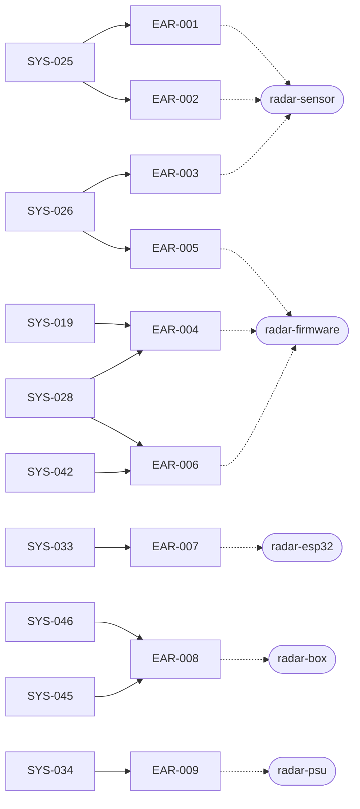
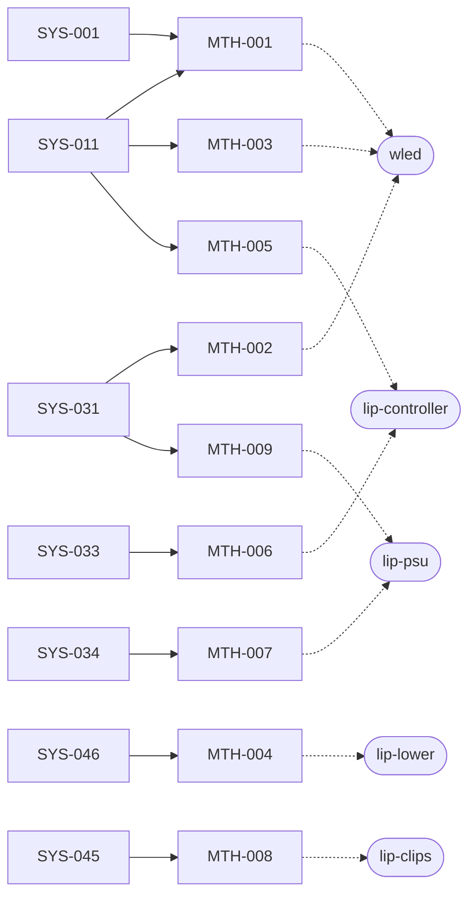
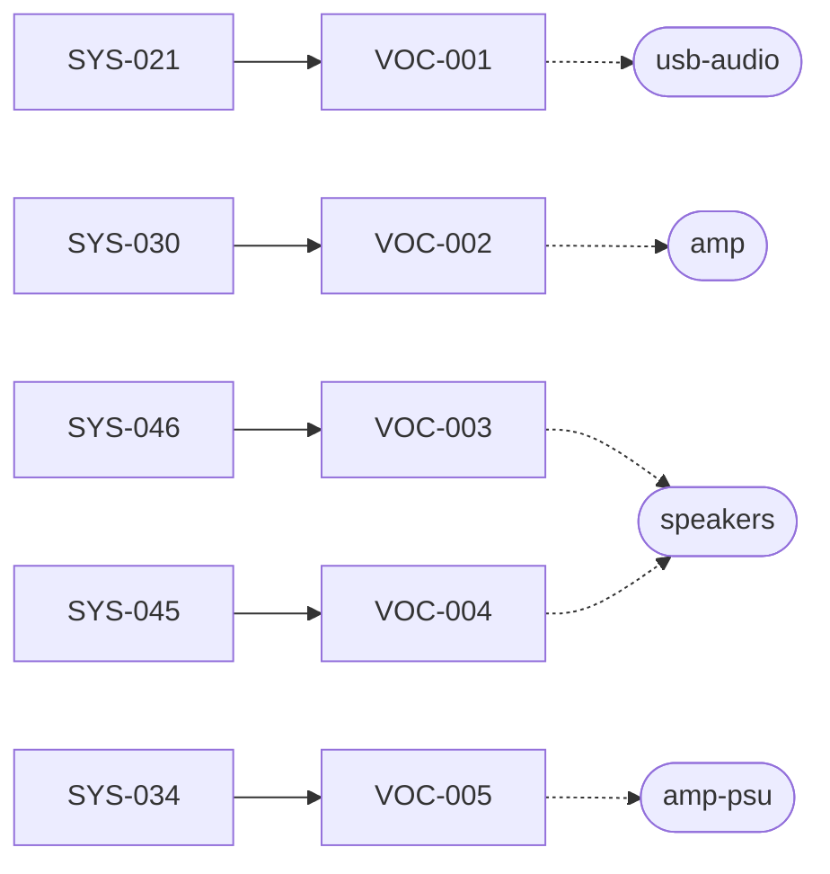
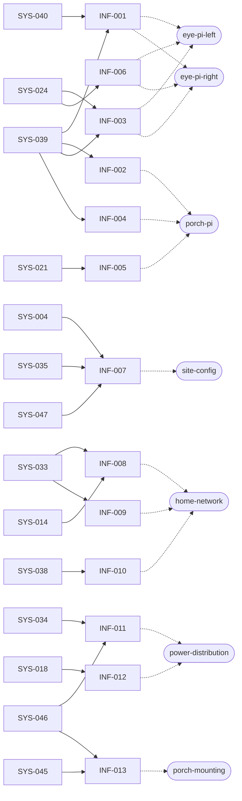
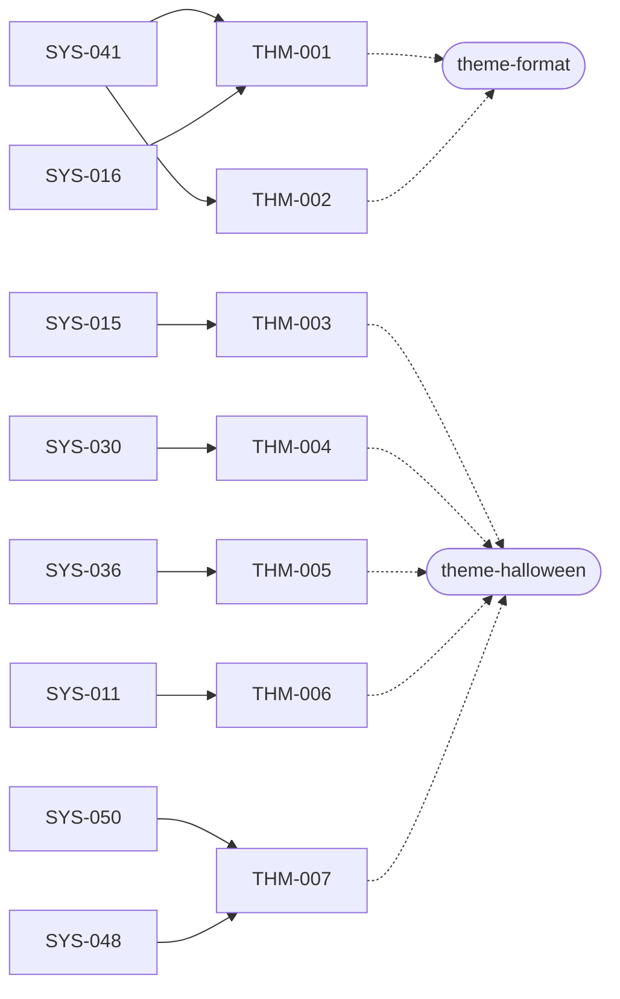
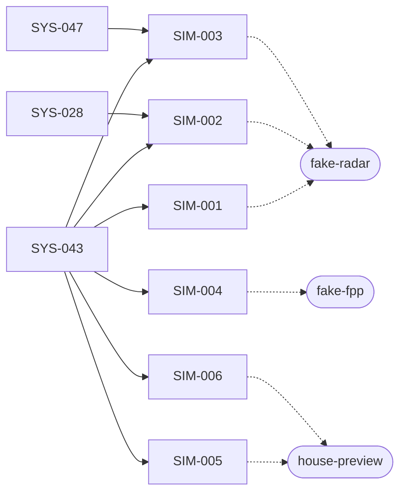
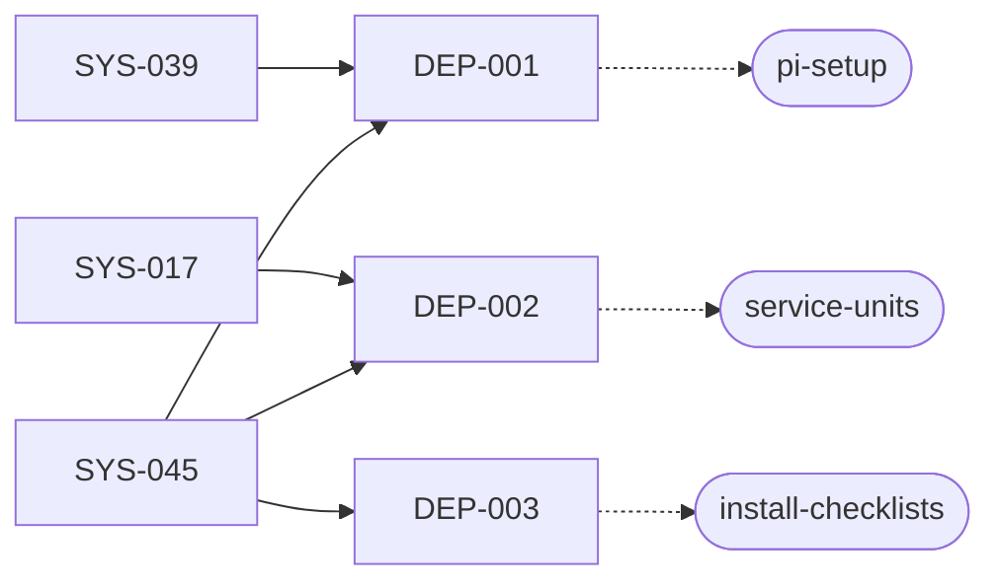
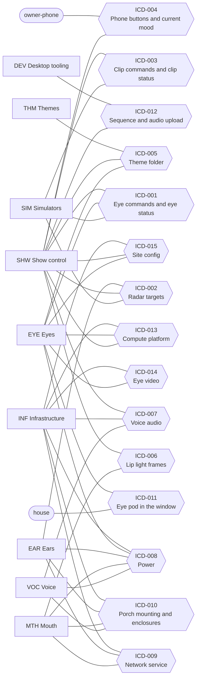

```mermaid
flowchart LR
  SYS_010[SYS-010] --> EYE_001[EYE-001]
  SYS_036[SYS-036] --> EYE_001[EYE-001]
  EYE_001 -.-> c_eye_renderer([eye-renderer])
  SYS_010[SYS-010] --> EYE_002[EYE-002]
  EYE_002 -.-> c_eye_renderer([eye-renderer])
  SYS_004[SYS-004] --> EYE_003[EYE-003]
  EYE_003 -.-> c_eye_renderer([eye-renderer])
  SYS_004[SYS-004] --> EYE_004[EYE-004]
  EYE_004 -.-> c_eye_renderer([eye-renderer])
  SYS_009[SYS-009] --> EYE_005[EYE-005]
  EYE_005 -.-> c_eye_renderer([eye-renderer])
  SYS_017[SYS-017] --> EYE_006[EYE-006]
  SYS_029[SYS-029] --> EYE_006[EYE-006]
  EYE_006 -.-> c_eye_renderer([eye-renderer])
  SYS_017[SYS-017] --> EYE_007[EYE-007]
  EYE_007 -.-> c_eye_renderer([eye-renderer])
  SYS_024[SYS-024] --> EYE_008[EYE-008]
  EYE_008 -.-> c_eye_renderer([eye-renderer])
  SYS_019[SYS-019] --> EYE_009[EYE-009]
  EYE_009 -.-> c_eye_renderer([eye-renderer])
  SYS_040[SYS-040] --> EYE_010[EYE-010]
  EYE_010 -.-> c_eye_renderer([eye-renderer])
  SYS_036[SYS-036] --> EYE_011[EYE-011]
  EYE_011 -.-> c_eye_renderer([eye-renderer])
  SYS_037[SYS-037] --> EYE_012[EYE-012]
  EYE_012 -.-> c_eye_renderer([eye-renderer])
  SYS_035[SYS-035] --> EYE_013[EYE-013]
  SYS_024[SYS-024] --> EYE_013[EYE-013]
  EYE_013 -.-> c_eye_renderer([eye-renderer])
  SYS_016[SYS-016] --> EYE_014[EYE-014]
  EYE_014 -.-> c_eye_renderer([eye-renderer])
  SYS_042[SYS-042] --> EYE_015[EYE-015]
  EYE_015 -.-> c_eye_renderer([eye-renderer])
  SYS_041[SYS-041] --> EYE_016[EYE-016]
  EYE_016 -.-> c_eye_renderer([eye-renderer])
  SYS_004[SYS-004] --> EYE_017[EYE-017]
  SYS_035[SYS-035] --> EYE_017[EYE-017]
  EYE_017 -.-> c_eye_renderer([eye-renderer])
  SYS_039[SYS-039] --> EYE_018[EYE-018]
  EYE_018 -.-> c_eye_renderer([eye-renderer])
  SYS_024[SYS-024] --> EYE_019[EYE-019]
  SYS_045[SYS-045] --> EYE_019[EYE-019]
  EYE_019 -.-> c_eye_projector([eye-projector])
  SYS_034[SYS-034] --> EYE_020[EYE-020]
  EYE_020 -.-> c_eye_power_strip([eye-power-strip])
  SYS_035[SYS-035] --> EYE_021[EYE-021]
  SYS_045[SYS-045] --> EYE_021[EYE-021]
  EYE_021 -.-> c_eye_screen([eye-screen])
  SYS_044[SYS-044] --> EYE_022[EYE-022]
  EYE_022 -.-> c_eye_shroud([eye-shroud])
  SYS_035[SYS-035] --> EYE_023[EYE-023]
  EYE_023 -.-> c_eye_stand([eye-stand])
```

```mermaid
flowchart LR
  SYS_002[SYS-002] --> SHW_001[SHW-001]
  SYS_003[SYS-003] --> SHW_001[SHW-001]
  SYS_007[SYS-007] --> SHW_001[SHW-001]
  SYS_008[SYS-008] --> SHW_001[SHW-001]
  SHW_001 -.-> c_monster_brain([monster-brain])
  SYS_001[SYS-001] --> SHW_002[SHW-002]
  SHW_002 -.-> c_monster_brain([monster-brain])
  SYS_002[SYS-002] --> SHW_003[SHW-003]
  SYS_020[SYS-020] --> SHW_003[SHW-003]
  SHW_003 -.-> c_monster_brain([monster-brain])
  SYS_003[SYS-003] --> SHW_004[SHW-004]
  SHW_004 -.-> c_monster_brain([monster-brain])
  SYS_006[SYS-006] --> SHW_005[SHW-005]
  SHW_005 -.-> c_monster_brain([monster-brain])
  SYS_004[SYS-004] --> SHW_006[SHW-006]
  SHW_006 -.-> c_monster_brain([monster-brain])
  SYS_004[SYS-004] --> SHW_007[SHW-007]
  SYS_019[SYS-019] --> SHW_007[SHW-007]
  SHW_007 -.-> c_monster_brain([monster-brain])
  SYS_005[SYS-005] --> SHW_008[SHW-008]
  SHW_008 -.-> c_monster_brain([monster-brain])
  SYS_028[SYS-028] --> SHW_009[SHW-009]
  SYS_019[SYS-019] --> SHW_009[SHW-009]
  SHW_009 -.-> c_monster_brain([monster-brain])
  SYS_008[SYS-008] --> SHW_010[SHW-010]
  SYS_049[SYS-049] --> SHW_010[SHW-010]
  SYS_050[SYS-050] --> SHW_010[SHW-010]
  SHW_010 -.-> c_monster_brain([monster-brain])
  SYS_047[SYS-047] --> SHW_011[SHW-011]
  SYS_007[SYS-007] --> SHW_011[SHW-011]
  SHW_011 -.-> c_monster_brain([monster-brain])
  SYS_048[SYS-048] --> SHW_012[SHW-012]
  SHW_012 -.-> c_monster_brain([monster-brain])
  SYS_049[SYS-049] --> SHW_013[SHW-013]
  SHW_013 -.-> c_monster_brain([monster-brain])
  SYS_050[SYS-050] --> SHW_014[SHW-014]
  SYS_005[SYS-005] --> SHW_014[SHW-014]
  SHW_014 -.-> c_monster_brain([monster-brain])
  SYS_009[SYS-009] --> SHW_015[SHW-015]
  SHW_015 -.-> c_monster_brain([monster-brain])
  SYS_015[SYS-015] --> SHW_016[SHW-016]
  SHW_016 -.-> c_monster_brain([monster-brain])
  SYS_027[SYS-027] --> SHW_017[SHW-017]
  SHW_017 -.-> c_monster_brain([monster-brain])
  SYS_017[SYS-017] --> SHW_018[SHW-018]
  SYS_029[SYS-029] --> SHW_018[SHW-018]
  SHW_018 -.-> c_monster_brain([monster-brain])
  SYS_014[SYS-014] --> SHW_019[SHW-019]
  SHW_019 -.-> c_monster_brain([monster-brain])
  SYS_013[SYS-013] --> SHW_020[SHW-020]
  SHW_020 -.-> c_monster_brain([monster-brain])
  SYS_016[SYS-016] --> SHW_021[SHW-021]
  SHW_021 -.-> c_monster_brain([monster-brain])
  SYS_012[SYS-012] --> SHW_022[SHW-022]
  SHW_022 -.-> c_monster_brain([monster-brain])
  SYS_023[SYS-023] --> SHW_023[SHW-023]
  SHW_023 -.-> c_monster_brain([monster-brain])
  SYS_042[SYS-042] --> SHW_024[SHW-024]
  SHW_024 -.-> c_monster_brain([monster-brain])
  SYS_042[SYS-042] --> SHW_025[SHW-025]
  SYS_028[SYS-028] --> SHW_025[SHW-025]
  SHW_025 -.-> c_monster_brain([monster-brain])
  SYS_042[SYS-042] --> SHW_026[SHW-026]
  SYS_043[SYS-043] --> SHW_026[SHW-026]
  SHW_026 -.-> c_monster_brain([monster-brain])
  SYS_041[SYS-041] --> SHW_027[SHW-027]
  SHW_027 -.-> c_monster_brain([monster-brain])
  SYS_004[SYS-004] --> SHW_028[SHW-028]
  SYS_047[SYS-047] --> SHW_028[SHW-028]
  SHW_028 -.-> c_monster_brain([monster-brain])
  SYS_039[SYS-039] --> SHW_029[SHW-029]
  SHW_029 -.-> c_monster_brain([monster-brain])
  SYS_012[SYS-012] --> SHW_030[SHW-030]
  SYS_016[SYS-016] --> SHW_030[SHW-030]
  SHW_030 -.-> c_phone_page([phone-page])
  SYS_032[SYS-032] --> SHW_031[SHW-031]
  SYS_038[SYS-038] --> SHW_031[SHW-031]
  SHW_031 -.-> c_phone_page([phone-page])
  SYS_011[SYS-011] --> SHW_032[SHW-032]
  SYS_022[SYS-022] --> SHW_032[SHW-032]
  SHW_032 -.-> c_falcon_player([falcon-player])
  SYS_021[SYS-021] --> SHW_033[SHW-033]
  SHW_033 -.-> c_falcon_player([falcon-player])
  SYS_030[SYS-030] --> SHW_034[SHW-034]
  SHW_034 -.-> c_falcon_player([falcon-player])
  SYS_042[SYS-042] --> SHW_035[SHW-035]
  SHW_035 -.-> c_falcon_player([falcon-player])
  SYS_011[SYS-011] --> SHW_036[SHW-036]
  SHW_036 -.-> c_falcon_player([falcon-player])
  SYS_021[SYS-021] --> SHW_037[SHW-037]
  SHW_037 -.-> c_falcon_player([falcon-player])
  SYS_011[SYS-011] --> SHW_038[SHW-038]
  SHW_038 -.-> c_falcon_player([falcon-player])
  SYS_042[SYS-042] --> SHW_039[SHW-039]
  SYS_038[SYS-038] --> SHW_039[SHW-039]
  SYS_017[SYS-017] --> SHW_039[SHW-039]
  SHW_039 -.-> c_mosquitto([mosquitto])
```

# Traceability (generated, do not edit)

> Generated by `tools/reqs/check.py` from `docs/requirements/*.yaml`,
> `docs/architecture/components.yaml` and `docs/interfaces/`. To regenerate, run
> `.venv/bin/python -m tools.reqs.check` from the repository root.

## Summary

| Subsystem | functional | performance | interface | constraint | Total |
|---|---|---|---|---|---|
| SYS Monster House system specification | 22 | 13 | 4 | 11 | 50 |
| EYE Eyes | 10 | 2 | 7 | 4 | 23 |
| SHW Show control | 23 | 5 | 11 | 0 | 39 |
| EAR Ears | 1 | 3 | 4 | 1 | 9 |
| MTH Mouth | 2 | 2 | 4 | 1 | 9 |
| VOC Voice | 0 | 1 | 3 | 1 | 5 |
| INF Infrastructure | 1 | 3 | 8 | 1 | 13 |
| THM Themes | 3 | 0 | 1 | 3 | 7 |
| SIM Simulators | 3 | 0 | 3 | 0 | 6 |
| DEP Deployment | 3 | 0 | 0 | 0 | 3 |
| **All** | 68 | 29 | 45 | 22 | **164** |

**Components:** 51 (32 parts, 19 software). **ICDs:** 15 (7 draft, 8 skeleton).

## Coverage

| Check | Result |
|---|---|
| System requirements with children | 50 of 50 |
| Subsystem requirements allocated to a component | 114 of 114 |
| Interface requirements with an ICD | 45 of 45 |
| ICD sides with an interface requirement | 39 of 39 |
| Checker errors | 0 |

**Components with no requirement yet** (12): `content-tools`, `desktop`, `dev-env`, `eye-mask`, `lip-box`, `lip-channel`, `lip-upper`, `mouth-extras`, `porch-enclosure`, `rumble`, `speaker-wire`, `xlights`

### Gaps (4)

- budget eye-pi-left: memory_mb, stage 1–5: waiting for TBD-032
- budget eye-pi-right: memory_mb, stage 1–5: waiting for TBD-032
- budget lip-psu: power_w, stage 4–5: waiting for TBD-033
- budget porch-pi: memory_mb, stage 3–5: waiting for TBD-031, TBD-032

### Warnings (ICD topics vs `shared/topics.py`) (3)

- ICD-003: topic falcon/player/FPP/playlist/name/status is in the ICD but not in shared/topics.py
- ICD-003: topic falcon/player/FPP/status is in the ICD but not in shared/topics.py
- shared/topics.py: DEBUG_TEST = monster/debug/test is in no ICD

### TBDs cited by requirements

- TBD-008: INF-009
- TBD-012: SYS-024
- TBD-016: EAR-003, SYS-026
- TBD-020: SYS-019
- TBD-021: SYS-020
- TBD-022: SHW-033, SYS-021
- TBD-023: EYE-006, SHW-018, SYS-029
- TBD-024: SHW-019, SYS-014
- TBD-025: INF-012, SYS-018
- TBD-026: SYS-030, VOC-002
- TBD-027: MTH-002, SYS-031
- TBD-028: SHW-011, SYS-047
- TBD-029: SIM-003
- TBD-031: INF-004
- TBD-033: MTH-009
- TBD-034: EYE-009, SHW-003, SHW-007, SHW-023, SHW-033
- TBD-035: MTH-001
- TBD-036: INF-002

## Budgets

What each host provides vs what is deployed on or supplied by it, per stage (`tools/reqs/budget.py`).

| Host | Resource | Stages | Need | Have | Status | Needed by |
|---|---|---|---|---|---|---|
| eye-pi-left | memory_mb | 1–5 | ? | 1024 | waiting for TBD-032 | eye-pi-left (TBD-032), eye-renderer (153) |
| eye-pi-right | memory_mb | 1–5 | ? | 1024 | waiting for TBD-032 | eye-pi-right (TBD-032), eye-renderer (153) |
| lip-psu | power_w | 4–5 | ? | 350 | waiting for TBD-033 | lip-controller (TBD-033), lip-lower (TBD-033), lip-upper (TBD-033), mouth-extras (TBD-033) |
| porch-pi | memory_mb | 3–5 | ? | TBD-031 | waiting for TBD-031, TBD-032 | falcon-player (TBD-032), monster-brain (TBD-032), mosquitto (TBD-032), phone-page (0), porch-pi (TBD-032) |
| porch-pi | usb_ports | 3–5 | 1 | 4 | OK | usb-audio (1) |

## Requirements

### SYS — Monster House system specification

| ID | Type | Stage | Status | Requirement | Children | Verify |
|---|---|---|---|---|---|---|
| SYS-001 | functional | 0 | approved | When no visitor is in range, the monster shall show its asleep behavior: eyes closed, lips glowing slowly in and out, and a quiet snore at intervals set in the theme (default about 30 s). | MTH-001, SHW-002 | demonstration |
| SYS-002 | functional | 0 | approved | When a visitor enters the approach zone heading toward the house, the monster shall wake: open its eyes, look around, lock on to the visitor and yawn. | SHW-001, SHW-003 | demonstration |
| SYS-003 | functional | 0 | approved | When the wake clip ends with a visitor still in range, the monster shall greet the visitor with one greeting line, with a happy squint. | SHW-001, SHW-004 | demonstration |
| SYS-004 | functional | 0 | approved | While visitors are in range, both eyes shall look toward the focus visitor's head, each eye aiming from its own window's position, so that the eyes converge on a near visitor and look parallel at a far one. | EYE-003, EYE-004, EYE-017, INF-007, SHW-006, SHW-007, SHW-028 | test |
| SYS-005 | functional | 0 | approved | When more than one visitor is in range, the monster shall move its gaze between them, giving a newly arrived visitor the focus first. | SHW-008, SHW-014 | demonstration |
| SYS-006 | functional | 0 | approved | While watching visitors, the monster shall say a comment or giggle at intervals set in the theme (default 10–20 s, chosen at random within that range). | SHW-005 | test |
| SYS-007 | functional | 0 | approved | When no visitor has been in range for the time set in the theme (default 5 s), not counting visitors at the door (SYS-047), the monster shall look toward where they left, droop its eyes, and say a goodbye line unless the last visitor to leave already got one (SYS-049). | SHW-001, SHW-011 | test |
| SYS-008 | functional | 0 | approved | After a goodbye, the monster shall go back to sleep when no visitor has arrived for the time set in the theme (default 20 s), or greet a visitor coming toward the house without yawning first. A visitor picked up again on the way out is not a new arrival. | SHW-001, SHW-010 | test |
| SYS-009 | functional | 0 | approved | While awake, the monster shall blink both eyes together, at intervals set in the theme. | EYE-005, SHW-015 | demonstration |
| SYS-010 | functional | 0 | approved | The eyes shall be able to show at least the expressions neutral, happy, sparkle, surprised, sleepy and asleep, easing from one to the next without jumps. | EYE-001, EYE-002 | demonstration |
| SYS-011 | functional | 4 | approved | Whenever the monster speaks, its lips shall move in time with its voice. | MTH-001, MTH-003, MTH-005, SHW-032, SHW-036, SHW-038, THM-006 | demonstration |
| SYS-012 | functional | 0 | approved | The owner shall be able to trigger great costume (sparkle eyes and a compliment), burp, sing, mute voice, sleep now and wake now from a phone, and see the monster's current mood there. | SHW-022, SHW-030 | demonstration |
| SYS-013 | functional | 0 | approved | While muted, the monster shall make no voice sound and shall keep its eyes and lip lights working. | SHW-020 | demonstration |
| SYS-014 | functional | 0 | approved | Outside show hours (TBD-024), the monster shall stay asleep and make no voice sound, whatever the radar reports. | INF-008, SHW-019 | test |
| SYS-015 | functional | 0 | approved | Within each clip pool (greetings, comments, goodbyes, and so on), the monster shall not repeat a clip until every clip in that pool has played. | SHW-016, THM-003 | test |
| SYS-016 | functional | 0 | approved | When the owner chooses a theme, the monster shall change to that theme's eye art, voice clips, lip sequences and timings without a software change. | EYE-014, SHW-021, SHW-030, THM-001 | demonstration |
| SYS-017 | functional | 0 | approved | If any one component stops working (an eye pod, the radar, Falcon Player, the brain or the Wi-Fi), the remaining components shall keep running and the monster shall fall back to a sleepy or idle look: eyes wandering and blinking on their own, no greetings without the radar, no voice or lip movement without Falcon Player. | DEP-002, EYE-006, EYE-007, SHW-018, SHW-039 | test |
| SYS-018 | functional | 1 | approved | The eye pods shall switch off at bedtime (time and method TBD-025) and stay off until the next show day. | INF-012 | demonstration |
| SYS-019 | performance | 0 | approved | The eyes shall begin turning toward a visitor's new position within TBD-020 of the visitor moving. | EAR-004, EYE-009, SHW-007, SHW-009 | test |
| SYS-020 | performance | 0 | approved | The monster shall begin to wake within TBD-021 of a visitor entering the approach zone. | SHW-003 | test |
| SYS-021 | performance | 3 | approved | The voice shall begin within TBD-022 of the brain deciding to say a line. | INF-005, SHW-033, SHW-037, VOC-001 | test |
| SYS-022 | performance | 4 | approved | Each lip shape shall appear no more than 45 ms after, and no more than 125 ms before, the matching sound. | SHW-032 | test |
| SYS-023 | performance | 0 | approved | A button pressed on the phone page shall visibly change the monster within 0.5 s. | SHW-023 | test |
| SYS-024 | performance | 0 | approved | Each eye shall be drawn at a steady 60 frames per second, at its projector's native resolution (projector model TBD-012). | EYE-008, EYE-013, EYE-019, INF-003, INF-006 | test |
| SYS-025 | performance | 2 | approved | The monster shall track up to 3 visitors at the same time. | EAR-001, EAR-002 | test |
| SYS-026 | performance | 2 | approved | The monster shall detect visitors anywhere in the approach zone, which covers the walkway and the steps (whether it reaches the sidewalk: TBD-016). | EAR-003, EAR-005 | test |
| SYS-027 | performance | 0 | approved | The monster shall leave at least 10 s (theme setting) between the end of one spoken line and the start of the next, except for lines the owner triggers from the phone. | SHW-017 | test |
| SYS-028 | performance | 0 | approved | While a visitor is tracked, the visitor's position shall be updated at about 10 times per second from the radar through to the eyes. | EAR-004, EAR-006, SHW-009, SHW-025, SIM-002 | test |
| SYS-029 | performance | 0 | approved | Each fallback in SYS-017 shall begin within TBD-023 of the failure. | EYE-006, SHW-018 | test |
| SYS-030 | performance | 3 | approved | The monster's sound shall never exceed TBD-026 at the sidewalk. | SHW-034, THM-004, VOC-002 | test |
| SYS-031 | performance | 4 | approved | The lip lights shall never exceed the brightness cap TBD-027. | MTH-002, MTH-009 | test |
| SYS-032 | interface | 0 | approved | The owner's controls (SYS-012) shall work in an ordinary phone web browser on the home network, with no app to install, as specified in ICD-004. | SHW-031 | demonstration |
| SYS-033 | interface | 1 | approved | Every networked part of the monster shall use the home Wi-Fi, with a reserved address and a friendly name, as specified in ICD-009. | EAR-007, INF-008, INF-009, MTH-006 | inspection |
| SYS-034 | interface | 1 | approved | Each box on the house shall need only one plug in an ordinary household outlet, as specified in ICD-008, and no data cable other than the audio cable to the amp. | EAR-009, EYE-020, INF-011, MTH-007, VOC-005 | inspection |
| SYS-035 | interface | 1 | approved | Each eye pod shall fit its bedroom window and floor space using only removable fittings, as specified in ICD-011. | EYE-013, EYE-017, EYE-021, EYE-023, INF-007 | inspection |
| SYS-036 | constraint | 0 | approved | Everything the monster shows and says shall be friendly and goofy: big round pupils, smiles made with the lower lid, no slit pupils, no horror imagery and no horror sounds. | EYE-001, EYE-011, THM-005 | inspection |
| SYS-037 | constraint | 0 | approved | The eye screens shall never show an error message, text, a desktop or a cursor. | EYE-012 | test |
| SYS-038 | constraint | 0 | approved | No part of the monster shall be reachable from the internet; the phone page shall work only on the home network. | INF-010, SHW-031, SHW-039 | inspection |
| SYS-039 | constraint | 0 | approved | All monster software that runs on the house shall run on Raspberry Pi OS (64-bit, Bookworm) with Python 3.11, and on the Ubuntu desktop for development. | DEP-001, EYE-018, INF-001, INF-002, INF-003, INF-004, SHW-029 | test |
| SYS-040 | constraint | 0 | approved | The eyes shall be drawn on the GPU, with shaders that are compatible with OpenGL ES 3.0 (GLSL ES 3.00), and no per-frame drawing on the CPU. | EYE-010, INF-001 | inspection |
| SYS-041 | constraint | 0 | approved | Timings, clip pools, colors and eye art shall come from the theme folder, not from code. | EYE-016, SHW-027, THM-001, THM-002 | inspection |
| SYS-042 | constraint | 0 | approved | All messages between the monster's parts, except lip light data and audio, shall pass through one MQTT broker, with every topic name and payload format defined in one place in the code (shared/). | EAR-006, EYE-015, SHW-024, SHW-025, SHW-026, SHW-035, SHW-039 | inspection |
| SYS-043 | constraint | 0 | approved | Every hardware part that sends or receives messages shall have a desktop simulator that sends or receives exactly the same messages. | SHW-026, SIM-001, SIM-002, SIM-003, SIM-004, SIM-005, SIM-006 | test |
| SYS-044 | constraint | 1 | approved | With an eye pod running, no projector light shall reach the bedroom outside the shroud. | EYE-022 | inspection |
| SYS-045 | constraint | 1 | approved | The monster shall be installed and removed each season with nothing left in the bedroom and nothing left on the house except the year-round lip clips. | DEP-001, DEP-002, DEP-003, EAR-008, EYE-019, EYE-021, INF-013, MTH-008, VOC-004 | demonstration |
| SYS-046 | constraint | 2 | approved | Every outdoor part shall be rated for outdoor use or sheltered from rain and snow. | EAR-008, INF-011, INF-013, MTH-004, VOC-003 | inspection |
| SYS-047 | functional | 0 | approved | When the radar loses a visitor inside the door zone, the monster shall keep treating that visitor as present, at the door, until the visitor is detected again or the door hold time (theme setting, TBD-028) passes. | INF-007, SHW-011, SHW-028, SIM-003 | test |
| SYS-048 | functional | 0 | approved | While a visitor is at the door, the eyes shall look toward the door, and the monster may say lines from the theme's door pool (an empty pool means no door talk). | SHW-012, THM-007 | demonstration |
| SYS-049 | functional | 0 | approved | When a visitor walks away from the house while the monster is awake, the eyes shall follow that visitor and the monster shall say a goodbye line to them, even if other visitors remain, keeping the minimum gap between lines (SYS-027). | SHW-010, SHW-013 | test |
| SYS-050 | functional | 0 | approved | When a new visitor comes toward the house while the monster is awake, the eyes shall glance at them with a happy or surprised look, and the monster may say a line from the theme's arrival pool, keeping the minimum gap between lines (SYS-027). | SHW-010, SHW-014, THM-007 | demonstration |

### EYE — Eyes

| ID | Type | Stage | Status | Requirement | Parents | Allocated to | ICD | Verify |
|---|---|---|---|---|---|---|---|---|
| EYE-001 | functional | 0 | proposed | The eye renderer shall draw the eye in layers, back to front: sclera, iris and pupil, highlights and sparkles, upper and lower eyelids, and an optional brow, with a bold dark outline and a big catchlight, matching docs/reference/eye-sketch.html. | SYS-010, SYS-036 | eye-renderer | — | inspection |
| EYE-002 | functional | 0 | proposed | The eye renderer shall show each named expression with the open, low, curve, pupil and spark values in the architecture's expression table, easing every value from its current setting to the new one over the duration given in the command. | SYS-010 | eye-renderer | — | test |
| EYE-003 | functional | 0 | proposed | The eye renderer shall aim its pupil from its own window's position (site config) toward the commanded look point in house coordinates. | SYS-004 | eye-renderer | — | test |
| EYE-004 | functional | 0 | proposed | The pupil shall glide to each new target with an ease-out curve, with small random movements on top so it never looks frozen. | SYS-004 | eye-renderer | — | demonstration |
| EYE-005 | functional | 0 | proposed | The eye renderer shall start a blink when commanded, closing and opening the lids over the commanded duration. | SYS-009 | eye-renderer | — | test |
| EYE-006 | functional | 0 | proposed | If the eye renderer hears nothing from the brain for TBD-023, it shall wander and blink on its own fallback timer until the brain's messages return. | SYS-017, SYS-029 | eye-renderer | — | test |
| EYE-007 | functional | 0 | proposed | On an idle look command, the eye renderer shall wander and look around on its own until it receives a look point. | SYS-017 | eye-renderer | — | demonstration |
| EYE-008 | performance | 0 | proposed | The eye renderer shall draw a steady 60 frames per second at its output resolution. | SYS-024 | eye-renderer | — | test |
| EYE-009 | performance | 0 | proposed | The eye renderer shall start moving the pupil toward a new look point within its share of SYS-019's end-to-end time (TBD-034). | SYS-019 | eye-renderer | — | test |
| EYE-010 | constraint | 0 | proposed | The eye renderer shall draw on the GPU with shaders written for OpenGL ES 3.0 (GLSL ES 3.00), doing no per-frame drawing on the CPU. | SYS-040 | eye-renderer | — | inspection |
| EYE-011 | constraint | 0 | proposed | The eye renderer shall draw only round pupils and make smiles with the lower lid; it shall not draw slit pupils. | SYS-036 | eye-renderer | — | inspection |
| EYE-012 | constraint | 0 | proposed | The eye renderer shall never draw text or an error, and shall hide the mouse cursor; if something goes wrong it shall keep drawing an eye. | SYS-037 | eye-renderer | — | test |
| EYE-013 | functional | 0 | proposed | The eye renderer shall apply its eye's window settings from the site config: window size, eye placement and size within it, rotation 0° or 90°, horizontal mirroring and brightness. | SYS-035, SYS-024 | eye-renderer | — | test |
| EYE-014 | functional | 0 | proposed | When told to load a theme, the eye renderer shall switch to that theme's eye art and colors without restarting. | SYS-016 | eye-renderer | — | demonstration |
| EYE-015 | interface | 0 | proposed | The eye renderer shall obey the look, expression, blink and theme messages and publish its online/offline status, as specified in ICD-001, ignoring malformed messages. | SYS-042 | eye-renderer | ICD-001 | test |
| EYE-016 | interface | 0 | proposed | The eye renderer shall read its eye art and colors from the theme folder as specified in ICD-005. | SYS-041 | eye-renderer | ICD-005 | test |
| EYE-017 | interface | 0 | proposed | The eye renderer shall read its window position and window settings from the site config as specified in ICD-015. | SYS-004, SYS-035 | eye-renderer | ICD-015 | test |
| EYE-018 | interface | 0 | proposed | The eye renderer shall run on the compute platform specified in ICD-013: in a desktop window for development, and full-screen on KMS/DRM with no desktop environment on an eye Pi. | SYS-039 | eye-renderer | ICD-013 | test |
| EYE-019 | interface | 1 | proposed | Each projector shall show the eye Pi's HDMI picture as specified in ICD-014, and start showing it when powered on, without a remote. | SYS-024, SYS-045 | eye-projector | ICD-014 | test |
| EYE-020 | interface | 1 | proposed | Each eye pod's power strip shall feed its Pi and projector from one household outlet, as specified in ICD-008. | SYS-034 | eye-power-strip | ICD-008 | inspection |
| EYE-021 | interface | 1 | proposed | Each screen shall hang in its window from a tension rod or removable hooks, with the black mask over it, as specified in ICD-011, leaving no mark on the window. | SYS-035, SYS-045 | eye-screen | ICD-011 | inspection |
| EYE-022 | constraint | 1 | proposed | Each shroud shall enclose the projector's light path from projector to window frame, so that no projector light reaches the bedroom. | SYS-044 | eye-shroud | — | inspection |
| EYE-023 | functional | 1 | proposed | Each stand shall hold its projector at the height and angle that puts the image square on the screen, with no keystone correction. | SYS-035 | eye-stand | — | inspection |

### SHW — Show control

| ID | Type | Stage | Status | Requirement | Parents | Allocated to | ICD | Verify |
|---|---|---|---|---|---|---|---|---|
| SHW-001 | functional | 0 | proposed | The brain shall run the mood state machine Asleep → Waking → Greeting → Watching → Goodbye, with the transitions in architecture §3b and the timings from the theme. | SYS-002, SYS-003, SYS-007, SYS-008 | monster-brain | — | test |
| SHW-002 | functional | 0 | proposed | While Asleep, the brain shall keep the eyes in the asleep expression with an occasional droopy flutter, and trigger a snore clip at the theme's snore interval. | SYS-001 | monster-brain | — | demonstration |
| SHW-003 | functional | 0 | proposed | When a visitor coming toward the house enters the approach zone, the brain shall start Waking within its share of SYS-020 (TBD-034): open the eyes, look around, lock on and trigger the wake clip. | SYS-002, SYS-020 | monster-brain | — | test |
| SHW-004 | functional | 0 | proposed | When the wake clip finishes and a visitor is still present, the brain shall command the happy expression and trigger one clip from the greet pool. | SYS-003 | monster-brain | — | test |
| SHW-005 | functional | 0 | proposed | While Watching, the brain shall trigger a clip from the comment pool at a random interval within the theme's comment range. | SYS-006 | monster-brain | — | test |
| SHW-006 | functional | 0 | proposed | The brain shall convert each radar position (mm, radar-relative) to house coordinates (m) using the radar's mount position from the site config, and set the look height to the site config's head height. | SYS-004 | monster-brain | — | test |
| SHW-007 | functional | 0 | proposed | The brain shall smooth each visitor's position to remove radar jitter, adding no more delay than its share of SYS-019 (TBD-034). | SYS-004, SYS-019 | monster-brain | — | test |
| SHW-008 | functional | 0 | proposed | The brain shall choose one focus visitor: a new arrival wins; otherwise it holds on one visitor for a random 3-6 s, then switches; the closest visitor breaks ties. | SYS-005 | monster-brain | — | test |
| SHW-009 | performance | 0 | proposed | While a visitor is tracked, the brain shall publish the focus visitor's look point at about 10 times per second. | SYS-028, SYS-019 | monster-brain | — | test |
| SHW-010 | functional | 0 | proposed | The brain shall follow each visitor across radar updates as the same visitor, and mark each newly seen visitor as coming toward the house or going away from it. | SYS-008, SYS-049, SYS-050 | monster-brain | — | test |
| SHW-011 | functional | 0 | proposed | When a visitor is lost inside the door zone (site config), the brain shall keep them as a visitor at the door until they are seen again or the theme's door hold time (TBD-028) passes, and shall not count them as gone for the goodbye timer. | SYS-047, SYS-007 | monster-brain | — | test |
| SHW-012 | functional | 0 | proposed | While a visitor is at the door, the brain shall aim the eyes at the door point from the site config, and may trigger clips from the theme's door pool. | SYS-048 | monster-brain | — | demonstration |
| SHW-013 | functional | 0 | proposed | When a visitor is marked as going, the brain shall make that visitor the focus until they leave range and trigger one clip from the bye pool, keeping the minimum gap. | SYS-049 | monster-brain | — | test |
| SHW-014 | functional | 0 | proposed | When a visitor is marked as coming while the monster is awake, the brain shall glance the eyes at them with the happy or surprised expression, and trigger a clip from the arrival pool if the pool has any, keeping the minimum gap. | SYS-050, SYS-005 | monster-brain | — | test |
| SHW-015 | functional | 0 | proposed | While awake, the brain shall command blinks for both eyes with one message at a random interval within the theme's blink range. | SYS-009 | monster-brain | — | test |
| SHW-016 | functional | 0 | proposed | The brain shall pick clips from each pool in a shuffled order and not repeat a clip until every clip in that pool has played. | SYS-015 | monster-brain | — | test |
| SHW-017 | performance | 0 | proposed | The brain shall not start a clip until the theme's minimum gap has passed since the previous clip ended, except for clips the owner triggers from the phone. | SYS-027 | monster-brain | — | test |
| SHW-018 | functional | 0 | proposed | The brain shall handle failures as in architecture §3b: with the radar offline or silent for TBD-023, stay in an ambient mode (eyes idle, no greetings); with an eye pod offline, log it and carry on; with Falcon Player not responding, keep the eyes going without voice. | SYS-017, SYS-029 | monster-brain | — | test |
| SHW-019 | functional | 0 | proposed | Outside the theme's show hours (TBD-024), the brain shall stay Asleep and trigger no voice clips. | SYS-014 | monster-brain | — | test |
| SHW-020 | functional | 0 | proposed | While muted, the brain shall trigger no voice clips and shall keep commanding the eyes. | SYS-013 | monster-brain | — | test |
| SHW-021 | functional | 0 | proposed | When a theme is chosen, the brain shall load its settings and clip pools and publish the theme's name to the eyes. | SYS-016 | monster-brain | — | test |
| SHW-022 | functional | 0 | proposed | The brain shall publish its current mood whenever it changes, retained. | SYS-012 | monster-brain | — | test |
| SHW-023 | performance | 0 | proposed | The brain shall act on a phone button within its share of SYS-023's 0.5 s (TBD-034). | SYS-023 | monster-brain | — | test |
| SHW-024 | interface | 0 | proposed | The brain shall send look, expression, blink and theme messages and watch the eyes' status as specified in ICD-001. | SYS-042 | monster-brain | ICD-001 | test |
| SHW-025 | interface | 0 | proposed | The brain shall read visitor positions and the radar's status as specified in ICD-002. | SYS-042, SYS-028 | monster-brain | ICD-002 | test |
| SHW-026 | interface | 0 | proposed | The brain shall start clips by name and learn when they finish as specified in ICD-003, working the same with the fake FPP and the real one. | SYS-042, SYS-043 | monster-brain | ICD-003 | test |
| SHW-027 | interface | 0 | proposed | The brain shall read its timings, clip pools and show hours from the theme folder as specified in ICD-005, with none of them written in code. | SYS-041 | monster-brain | ICD-005 | inspection |
| SHW-028 | interface | 0 | proposed | The brain shall read the radar mount, eye positions, head height and zones from the site config as specified in ICD-015. | SYS-004, SYS-047 | monster-brain | ICD-015 | test |
| SHW-029 | interface | 0 | proposed | The brain shall run on the compute platform specified in ICD-013 (the desktop in Stages 0-2, the porch Pi from Stage 3), with no desktop-only dependencies. | SYS-039 | monster-brain | ICD-013 | test |
| SHW-030 | functional | 0 | proposed | The phone page shall offer great costume, burp, sing, mute and unmute, sleep now, wake now and a theme choice, and show the current mood. | SYS-012, SYS-016 | phone-page | — | demonstration |
| SHW-031 | interface | 0 | proposed | The phone page shall work in an ordinary phone browser and answer only on the home network, as specified in ICD-004. | SYS-032, SYS-038 | phone-page | ICD-004 | demonstration |
| SHW-032 | functional | 3 | proposed | Falcon Player shall play each clip's audio and lip sequence together, from one playlist named after the clip. | SYS-011, SYS-022 | falcon-player | — | test |
| SHW-033 | performance | 3 | proposed | Falcon Player shall start a clip within its share of SYS-021 (TBD-034, TBD-022). | SYS-021 | falcon-player | — | test |
| SHW-034 | performance | 3 | proposed | Falcon Player's volume shall be capped at the theme's volume_cap, below the operating system's hard cap. | SYS-030 | falcon-player | — | test |
| SHW-035 | interface | 3 | proposed | Falcon Player shall accept clip commands and report clip status as specified in ICD-003. | SYS-042 | falcon-player | ICD-003 | test |
| SHW-036 | interface | 4 | proposed | Falcon Player shall send the lip frames to the lip controller as specified in ICD-006. | SYS-011 | falcon-player | ICD-006 | test |
| SHW-037 | interface | 3 | proposed | Falcon Player shall send the voice to the USB audio adapter as specified in ICD-007. | SYS-021 | falcon-player | ICD-007 | test |
| SHW-038 | interface | 3 | proposed | Falcon Player shall accept sequences and audio uploaded from xLights as specified in ICD-012. | SYS-011 | falcon-player | ICD-012 | demonstration |
| SHW-039 | functional | 0 | proposed | Mosquitto shall be the single MQTT broker for the monster, keep retained messages and deliver last-will messages, and accept connections only from the home network. | SYS-042, SYS-038, SYS-017 | mosquitto | — | test |

### EAR — Ears

| ID | Type | Stage | Status | Requirement | Parents | Allocated to | ICD | Verify |
|---|---|---|---|---|---|---|---|---|
| EAR-001 | performance | 2 | proposed | The radar shall report the position (x, y in mm) and speed of up to 3 people at once. | SYS-025 | radar-sensor | — | test |
| EAR-002 | constraint | 2 | proposed | The radar's firmware shall be V2.02.23090617 or later. | SYS-025 | radar-sensor | — | inspection |
| EAR-003 | performance | 2 | proposed | Mounted under the porch roof, about 1-1.5 m high and aimed down the walkway, the radar shall see visitors anywhere on the walkway and steps (the sidewalk: TBD-016). | SYS-026 | radar-sensor | — | test |
| EAR-004 | performance | 2 | proposed | The radar firmware shall publish each target's x, y and speed and the target count at about 10 times per second, overriding ESPHome's default one-per-second throttle. | SYS-028, SYS-019 | radar-firmware | — | test |
| EAR-005 | functional | 2 | proposed | The radar firmware shall use filter zones so that passing cars, the street and moving branches are not reported as visitors. | SYS-026 | radar-firmware | — | test |
| EAR-006 | interface | 2 | proposed | The radar firmware shall publish to MQTT (not Home Assistant's API) as specified in ICD-002. | SYS-042, SYS-028 | radar-firmware | ICD-002 | test |
| EAR-007 | interface | 2 | proposed | The radar node shall join the home Wi-Fi (2.4 GHz) with the name monster-radar, as specified in ICD-009. | SYS-033 | radar-esp32 | ICD-009 | inspection |
| EAR-008 | interface | 2 | proposed | The radar's box shall mount under the porch roof, sheltered from rain, as specified in ICD-010. | SYS-046, SYS-045 | radar-box | ICD-010 | inspection |
| EAR-009 | interface | 2 | proposed | The radar's 5 V supply shall plug into one household outlet as specified in ICD-008. | SYS-034 | radar-psu | ICD-008 | inspection |

### MTH — Mouth

| ID | Type | Stage | Status | Requirement | Parents | Allocated to | ICD | Verify |
|---|---|---|---|---|---|---|---|---|
| MTH-001 | functional | 4 | proposed | While Falcon Player is streaming, the lips shall show its frames; when it stops, WLED shall fall back on its own to a slow breathe effect (color per theme: TBD-035). | SYS-001, SYS-011 | wled | — | demonstration |
| MTH-002 | performance | 4 | proposed | WLED shall limit the lips' brightness to the cap TBD-027. | SYS-031 | wled | — | test |
| MTH-003 | functional | 4 | proposed | WLED shall map segment 1 to the upper lip, segment 2 to the lower lip, and segments 3 and 4 to the extras. | SYS-011 | wled | — | inspection |
| MTH-004 | constraint | 4 | proposed | The lower lip (on the railing) shall be IP65 strip in a closed channel, with sealed end caps and connectors. | SYS-046 | lip-lower | — | inspection |
| MTH-005 | interface | 4 | proposed | The lip controller shall take lip frames from Falcon Player as specified in ICD-006. | SYS-011 | lip-controller | ICD-006 | test |
| MTH-006 | interface | 4 | proposed | The lip controller shall join the home Wi-Fi (2.4 GHz) with the name monster-lips, as specified in ICD-009. | SYS-033 | lip-controller | ICD-009 | inspection |
| MTH-007 | interface | 4 | proposed | The lip supply shall plug into one household outlet as specified in ICD-008. | SYS-034 | lip-psu | ICD-008 | inspection |
| MTH-008 | interface | 4 | proposed | The lip clips shall stay up all year, with the channels snapping on and off each season, as specified in ICD-010. | SYS-045 | lip-clips | ICD-010 | demonstration |
| MTH-009 | performance | 4 | proposed | The lip supply shall provide at least the power the strips, extras and controller draw at the brightness cap (TBD-033). | SYS-031 | lip-psu | — | analysis |

### VOC — Voice

| ID | Type | Stage | Status | Requirement | Parents | Allocated to | ICD | Verify |
|---|---|---|---|---|---|---|---|---|
| VOC-001 | interface | 3 | proposed | The USB audio adapter shall turn the porch Pi's audio into a line-level signal for the amp, as specified in ICD-007. | SYS-021 | usb-audio | ICD-007 | test |
| VOC-002 | performance | 3 | proposed | The amp's gain shall be set so that at Falcon Player's capped volume the sound at the sidewalk does not exceed TBD-026. | SYS-030 | amp | — | test |
| VOC-003 | constraint | 3 | proposed | The speakers shall be weatherproof and hang under the porch ceiling, aimed down the walkway. | SYS-046 | speakers | — | inspection |
| VOC-004 | interface | 3 | proposed | The speakers shall mount on removable brackets as specified in ICD-010. | SYS-045 | speakers | ICD-010 | inspection |
| VOC-005 | interface | 3 | proposed | The amp's 24 V supply shall plug into one household outlet as specified in ICD-008. | SYS-034 | amp-psu | ICD-008 | inspection |

### INF — Infrastructure

| ID | Type | Stage | Status | Requirement | Parents | Allocated to | ICD | Verify |
|---|---|---|---|---|---|---|---|---|
| INF-001 | interface | 1 | proposed | Each eye Pi shall provide the platform specified in ICD-013: Raspberry Pi OS Lite (64-bit, Bookworm), Python 3.11, OpenGL ES 3.0 or later, and full-screen KMS/DRM output with no desktop environment. | SYS-039, SYS-040 | eye-pi-left, eye-pi-right | ICD-013 | test |
| INF-002 | interface | 3 | proposed | The porch Pi shall provide the platform specified in ICD-013 for the brain, Mosquitto and Falcon Player (whether FPP can share it: TBD-036). | SYS-039 | porch-pi | ICD-013 | test |
| INF-003 | performance | 1 | proposed | Each eye Pi shall have at least the memory that the software deployed on it needs. | SYS-024, SYS-039 | eye-pi-left, eye-pi-right | — | analysis |
| INF-004 | performance | 3 | proposed | The porch Pi shall have at least the memory that the software deployed on it needs (its size: TBD-031). | SYS-039 | porch-pi | — | analysis |
| INF-005 | interface | 3 | proposed | The porch Pi shall provide a USB port for the USB audio adapter as specified in ICD-007. | SYS-021 | porch-pi | ICD-007 | analysis |
| INF-006 | interface | 1 | proposed | Each eye Pi shall send its picture to its projector over HDMI as specified in ICD-014. | SYS-024 | eye-pi-left, eye-pi-right | ICD-014 | test |
| INF-007 | interface | 0 | proposed | The site config shall hold the house's own settings, the same for every theme: the eye and radar positions in house coordinates, the head height, each eye's window settings, the approach and door zones, and the door point, as specified in ICD-015. | SYS-004, SYS-035, SYS-047 | site-config | ICD-015 | inspection |
| INF-008 | interface | 1 | proposed | The home network shall give each networked node a reserved address and its friendly name (monster-brain, eye-left, eye-right, monster-lips, monster-radar), and keep its clock in sync, as specified in ICD-009. | SYS-033, SYS-014 | home-network | ICD-009 | inspection |
| INF-009 | performance | 2 | proposed | The home Wi-Fi shall reach the porch at 2.4 GHz well enough for the radar and lip nodes to stay connected (signal: TBD-008). | SYS-033 | home-network | — | test |
| INF-010 | constraint | 1 | proposed | The home network shall forward nothing from the internet to any part of the monster. | SYS-038 | home-network | — | inspection |
| INF-011 | interface | 1 | proposed | Power distribution shall give each box an outlet, using outdoor-rated cords and outlets on the porch, as specified in ICD-008. | SYS-034, SYS-046 | power-distribution | ICD-008 | inspection |
| INF-012 | functional | 1 | proposed | The eye pods shall be switched off at bedtime and on for the next show day (time and method TBD-025). | SYS-018 | power-distribution | — | demonstration |
| INF-013 | interface | 2 | proposed | The porch mounting shall hold the outdoor boxes and route the audio cable from the porch Pi to the amp, removably, as specified in ICD-010. | SYS-045, SYS-046 | porch-mounting | ICD-010 | inspection |

### THM — Themes

| ID | Type | Stage | Status | Requirement | Parents | Allocated to | ICD | Verify |
|---|---|---|---|---|---|---|---|---|
| THM-001 | interface | 0 | proposed | Every theme shall be a folder with settings.yaml, eyes/, audio/ and sequences/ as specified in ICD-005. | SYS-041, SYS-016 | theme-format | ICD-005 | inspection |
| THM-002 | functional | 0 | proposed | A theme's settings.yaml shall hold every timing, clip pool, color and show-hour setting the brain and eyes use, so that no such value lives in code. | SYS-041 | theme-format | — | inspection |
| THM-003 | functional | 3 | proposed | The Halloween theme shall have 5-10 clips in each of its greet, comment and bye pools. | SYS-015 | theme-halloween | — | inspection |
| THM-004 | constraint | 3 | proposed | Every audio clip shall be 48 kHz and normalized to the same loudness as the others. | SYS-030 | theme-halloween | — | analysis |
| THM-005 | constraint | 0 | proposed | Every clip and image in the theme shall be friendly: no horror sounds or imagery. | SYS-036 | theme-halloween | — | inspection |
| THM-006 | constraint | 3 | proposed | Each clip's audio file, lip sequence and Falcon Player playlist shall share one name. | SYS-011 | theme-halloween | — | inspection |
| THM-007 | functional | 0 | proposed | The Halloween theme's arrival pool shall start empty (eyes only when someone new arrives); its door pool holds the lines for visitors at the door. | SYS-050, SYS-048 | theme-halloween | — | inspection |

### SIM — Simulators

| ID | Type | Stage | Status | Requirement | Parents | Allocated to | ICD | Verify |
|---|---|---|---|---|---|---|---|---|
| SIM-001 | functional | 0 | proposed | The fake radar shall show a top-down view of the walk, steps and sidewalk, and let the owner add, remove and drag up to 3 pretend visitors with the mouse. | SYS-043 | fake-radar | — | demonstration |
| SIM-002 | interface | 0 | proposed | The fake radar shall publish exactly the topics, units (mm, radar-relative) and rate of the real radar, as specified in ICD-002. | SYS-043, SYS-028 | fake-radar | ICD-002 | test |
| SIM-003 | functional | 0 | proposed | The fake radar shall have an adjustable blind spot by the door where it stops reporting a visitor, as the real radar will (TBD-029). | SYS-043, SYS-047 | fake-radar | — | demonstration |
| SIM-004 | interface | 0 | proposed | The fake FPP shall accept clip commands and report clip status exactly as specified in ICD-003, log each trigger, and play placeholder audio through the desktop speakers. | SYS-043 | fake-fpp | ICD-003 | test |
| SIM-005 | functional | 0 | proposed | The house preview shall show the live eyes on docs/reference/house-front.jpg at the two window positions (adjustable by dragging corners), plus a glowing line where the lips will go. | SYS-043 | house-preview | — | demonstration |
| SIM-006 | interface | 0 | proposed | The house preview shall listen to the same eye messages as an eye pod, as specified in ICD-001. | SYS-043 | house-preview | ICD-001 | test |

### DEP — Deployment

| ID | Type | Stage | Status | Requirement | Parents | Allocated to | ICD | Verify |
|---|---|---|---|---|---|---|---|---|
| DEP-001 | functional | 1 | proposed | One setup script shall turn a fresh Raspberry Pi OS Lite (64-bit) install on a Pi 5 (1GB) into an eye pod: dependencies installed, the renderer as a service, full-screen on KMS/DRM, cursor hidden, starting at boot. | SYS-039, SYS-045 | pi-setup | — | demonstration |
| DEP-002 | functional | 1 | proposed | The system services shall start the renderer, brain and broker at boot and restart any of them that stops. | SYS-017, SYS-045 | service-units | — | test |
| DEP-003 | functional | 1 | proposed | The install checklists shall cover each season's setup and teardown, and the first one-eye test (projector, screen, mask, shroud, mirroring, rotation). | SYS-045 | install-checklists | — | inspection |

## Allocation

System requirement → subsystem requirement → component, one diagram per subsystem.

### EYE — Eyes

### SHW — Show control

### EAR — Ears

### MTH — Mouth

### VOC — Voice

### INF — Infrastructure

### THM — Themes

### SIM — Simulators

### DEP — Deployment

## Interfaces

Each ICD joins the subsystems (or outside entities) at its ends.

