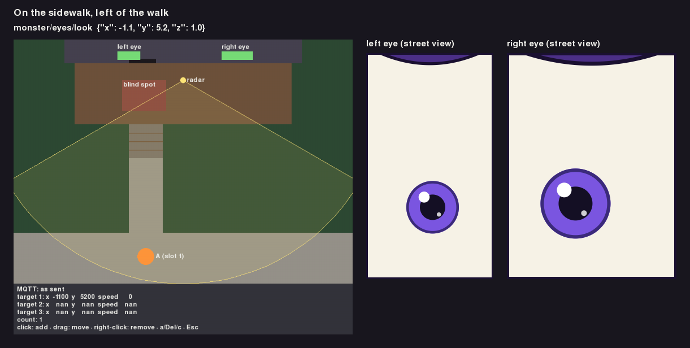
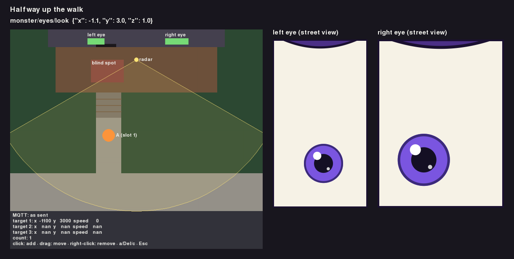
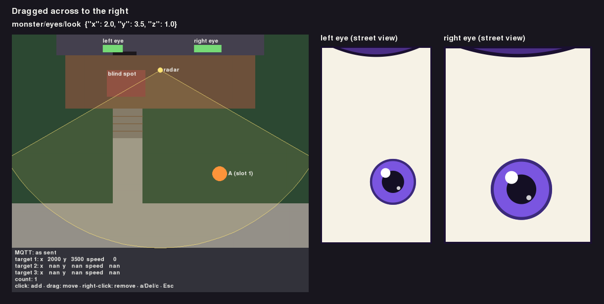
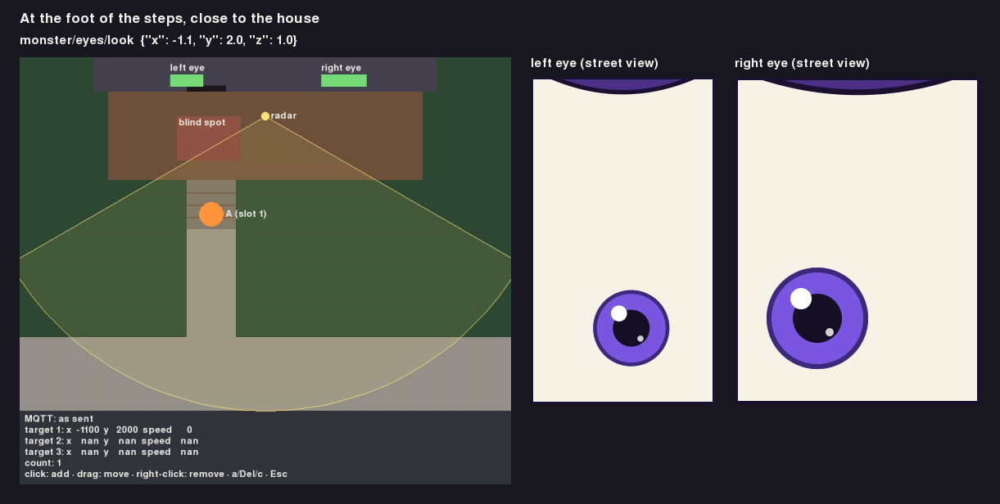

# Stage 0, Step 3: fake radar, and the eyes following a pretend kid

> **Status:** Final · **Date:** 2026-11-23 · **Plan:** [Step 3](../../stage-0-plan.md#step-3--pretend-visitors--fake-radar-december) · **Requirements:** SIM-001, SIM-002, SIM-003 · **Interfaces:** [ICD-002](../../interfaces/ICD-002-radar-targets.md), [ICD-001](../../interfaces/ICD-001-eye-commands.md) · **TBD:** TBD-030 (closed), TBD-039 (new), TBD-029

**Done when:** dragging a kid makes both eyes follow, using placeholder gaze math.

## Summary

**Done in software, 2026-11-23.** A pretend kid placed on the fake radar becomes the
radar's real message format (ICD-002). The placeholder brain turns that into one look
point (ICD-001), and each eye turns that point into its own angle. As the kid moves, both
irises follow. The same trip runs through Mosquitto in an automated test.

**Not yet seen:** the four programs running together in real windows at the desktop
screen. Like Step 2's deferred check, this needs the owner at the desktop (see
[Try it yourself](#try-it-yourself)).

## What it looks like

Each picture shows the fake radar's view on the left: house at the top, street at the
bottom, the radar's field of view in yellow, and its blind spot by the door in red. On
the right are both eyes as seen from the street, drawn by the real eye renderer. Above is
the look message the brain sent. The eyes are in `neutral`, because the placeholder
brain sends no expressions.









### Where the irises went

The iris offset is in the eye sketch's units: x is right, y is down, as seen from the
street, and the limits are ±46 across and ±88 down. The eyes are upstairs, at about 5 m,
and a kid's head is assumed to be at 1.0 m, so the irises look well down. From
[results.json](results.json):

| Kid (house m) | Look sent | Left eye (x, y) | Right eye (x, y) |
|---|---|---|---|
| (-1.1, 5.2) sidewalk | (-1.1, 5.2, 1.0) | (4.6, 58.2) | (-22.7, 54.4) |
| (-1.1, 3.0) walk | (-1.1, 3.0, 1.0) | (7.5, 76.1) | (-32.4, 68.2) |
| (2.0, 3.5) dragged right | (2.0, 3.5, 1.0) | (35.5, 60.6) | (5.3, 71.7) |
| (-1.1, 2.0) steps | (-1.1, 2.0, 1.0) | (10.4, 85.7) | (-39.0, 74.8) |

- **Both eyes follow.** Dragging the kid from (-1.1, 3.0) to (2.0, 3.5) moves the left
  iris from 7.5 to 35.5 and the right from -32.4 to 5.3, both to the right.
- **Each eye has its own angle (parallax).** The left window is at x = -1.6 m and the
  right at +1.6 m (placeholder positions, TBD-018). For a kid at x = -1.1 m the left eye
  looks almost straight out and the right eye looks well to its left. The closer the
  kid, the bigger the difference.
- **Closer means lower.** The kid at the steps is the steepest look down.

## What the fake radar sends

The fake radar sends exactly what ESPHome's LD2450 component will (SIM-002), as
corrected in ICD-002 on 2026-11-23 from ESPHome's source code (its `dev` branch):

| What | Real radar (ESPHome) | Fake radar |
|---|---|---|
| Topics | `monster-radar/sensor/target_{1-3}_{x,y,speed}/state`, `…/target_count/state`, retained | Same, from `shared/topics.py` |
| x, y | Whole mm, relative to the radar (`accuracy_decimals: 0`) | Same |
| speed | Whole mm/s in steps of 10, negative toward the radar (`decode_speed`) | Same, from the change in distance over 0.3 s |
| Empty slot | `nan` for x, y, speed (`publish_state_unknown`) | Same |
| When | Only on change, plus one repeat (the timeout filter), at most 10 a second (our config) | Same, 10 frames a second |
| Status | `monster-radar/status`: `online`, `offline` as the last-will | Same |
| What it can see | About 6 m, ±60° | Same, plus the blind spot by the door (`config/site.yaml`, guessed until TBD-029) |

Coming vs going isn't the radar's job: the brain will work it out from movement (owner,
2026-11-23, TBD-030). Which way the radar's x points as seen from the street is
assumed and gets checked at the Stage 2 install (TBD-039).

## Tests

All 201 tests pass (168 before this step); the requirements checker reports 0 errors.
The three new test files have 29 tests:

| File | What it checks |
|---|---|
| `tests/test_fake_radar.py` | Radar ↔ house coordinates; field of view; first frame clears every slot; whole mm; on change plus one repeat; negative speed toward the radar; `nan` when a kid leaves; door blind spot; kids keep their slots; every payload meets ICD-002; 10 frames a second; up to 3 kids |
| `tests/test_brain_radar.py` | The brain rebuilds targets from the fake radar's own output; `nan` and offline mean nobody; bad messages are ignored; it looks at the closest kid; it says "idle" once when they leave |
| `tests/test_step3_end_to_end.py` | Through Mosquitto: fake radar → `python -m brain` → look messages → both eyes' gaze moves right when the kid is dragged right, each at its own angle; idle when the kid leaves |

## Try it yourself

At the desktop, with the broker running, run each line in its own terminal:

```bash
.venv/bin/python -m eyes --side left
.venv/bin/python -m eyes --side right
.venv/bin/python -m brain
.venv/bin/python -m sim.fake_radar
```

Click to add a kid, drag them, right-click to remove them (more in
`sim/README.md` in the repository).

## Reproduce

```bash
.venv/bin/python -m tools.results.stage_0_step_3              # the figures and results.json (GPU)
.venv/bin/python -m tools.results.stage_0_step_3 --software   # without a GPU
.venv/bin/python -m pytest -q
```

The figures were drawn on the desktop's NVIDIA RTX 5060 Ti through EGL, with no window.
The script runs the real code in one process (fake radar model → brain → each eye's
state → eye renderer). The MQTT trip is covered by the end-to-end test instead.
