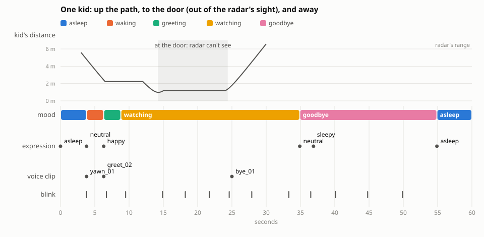
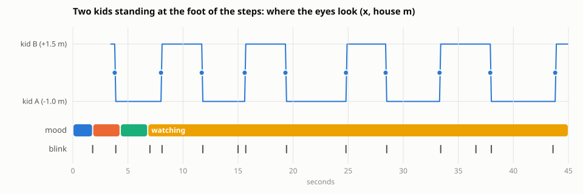

# Stage 0, Step 4: the monster brain, first version

> **Status:** Draft, awaiting the owner's feel check · **Date:** 2026-11-25 · **Plan:** [Step 4](../../stage-0-plan.md#step-4--monster-brain-first-version-december) · **Requirements:** SHW-001 to SHW-018, SHW-020 to SHW-022, SHW-024 to SHW-027, SIM-004 · **Interfaces:** [ICD-001](../../interfaces/ICD-001-eye-commands.md), [ICD-002](../../interfaces/ICD-002-radar-targets.md), [ICD-003](../../interfaces/ICD-003-clips.md), [ICD-004](../../interfaces/ICD-004-phone-page.md), [ICD-005](../../interfaces/ICD-005-theme-folder.md), [ICD-015](../../interfaces/ICD-015-site-config.md) · **TBD:** TBD-023, TBD-024, TBD-028, TBD-029, TBD-030 (closed), TBD-034

**Done when:** a pretend visit plays through from asleep to goodbye and back to sleep,
and it *feels* right to the owner.

## Summary

**The visit plays through in software, 2026-11-25.** A pretend kid walks up the path,
waits, goes to the door out of the radar's sight, comes back and walks away. The monster
wakes, yawns, greets, watches, waves them off, says goodbye, droops and falls asleep.
It uses the owner's starting values from `themes/halloween/settings.yaml`.
With two kids it switches between them every 3.6–5.9 s and blinks on each switch.
Radar offline, an eye offline and Falcon Player silent all leave it working.

**Not yet judged:** whether it *feels* right. That needs the owner at the desktop, watching
the real eye windows (see [Try it yourself](#try-it-yourself)). The voice clips are
silent placeholders until recordings exist (Step 7).

## What it looks like

### One kid, from asleep back to asleep



The top line is the kid's distance from the radar. In the grey band the kid is at the
door, where the radar can't see them. The brain holds them as "at the door" (door hold
15 s, TBD-028), so the visit doesn't end and the eyes look at the door point. From
[results.json](results.json):

| Time (s) | What happened |
|---|---|
| 3.8 | The kid is seen **coming** (0.5 s of walking toward the house): **Waking**. Eyes open (`neutral`) with a blink, look around for 1.5 s, then lock on. `yawn_01` |
| 6.3 | The yawn ends: **Greeting**, `happy`, `greet_02`, straight after the yawn |
| 8.8 | The greeting ends: **Watching**, following the kid 10 times a second |
| 15–24 | At the door, out of sight: held, eyes on the door point |
| 25.0 | Back in sight and walking away (**going**): watched until they leave; `bye_01` |
| 34.9 | Nobody for 5 s: **Goodbye**. The eyes stay where the kid left, then droop (`sleepy`) after 2 s. No second "bye": the 10 s gap since `bye_01` holds it back |
| 54.9 | 20 quiet seconds: **Asleep**, `asleep` |

Blinks come every 2.5–6 s while the eyes are open, and none while asleep.

### Two kids: the eyes switch between them



Two kids stand at the foot of the steps. The eyes hold each one for a random 3–6 s,
then switch. Measured holds: 4.2, 3.7, 3.9, 3.7, 5.5, 3.6, 4.9, 4.6 and 5.9 s. Every
switch has a blink with it: either the switch blink, or a timed blink in the half-second
before, so the eyes never blink twice in a row.

### When things fail (SHW-018)

| Failure | What the brain did ([results.json](results.json)) |
|---|---|
| Radar goes offline in the middle of a visit | Mood back to `asleep` with eyes open (`neutral`), wandering (`idle`), 8 blinks in 30 s, no clips, no waking for anyone |
| An eye drops out | Logged; nothing else changes. When it's back, it's sent the current expression and look so it matches the other eye (test) |
| No Falcon Player | Each clip counts as finished after 2 s without "playing" (TBD-023), so the visit still plays through: asleep → waking → greeting → watching |

## What to judge (matters of taste)

These are first guesses in code or settings, for the owner to tune by watching:

1. **Faces per mood:** Waking `neutral`, Greeting and Watching `happy`, Goodbye `neutral`
   then `sleepy`. A new kid coming gets a 0.8 s `surprised` glance (SHW-014).
2. **No comment in this visit.** The first comment is due 10–20 s into Watching. Here
   the kid's "bye" took that slot, and the 10 s gap held the comment back. Longer
   visits get comments every 10–20 s (test).
3. **Asleep:** a droopy flutter (`sleepy` for 1.2 s) comes with each snore, every 30 s.
   ICD-005 has no separate flutter timing.
4. **Radar offline:** the phone page will show the mood as `asleep` while the eyes are
   open. ICD-004 has no "ambient" mood.

## Tests

All 255 tests pass (205 before this step); the requirements checker reports 0 errors.
52 tests are new or rewritten:

| File | What it checks |
|---|---|
| `tests/test_brain_moods.py` (15) | Every mood change and its timing; waiting for the yawn; moving on without a clip; a visitor who leaves while it wakes; nobody standing still wakes it; no yawn for someone new in Goodbye; droop; comment spacing; blink spacing and none asleep; snore with flutter; ambient; show hours (also past midnight); the theme loads |
| `tests/test_brain_gaze.py` (15) | Smoothing takes out jitter and catches up in about 0.5 s; the same visitor across a slot swap; coming / going / still from 0.5 s of movement; lost away from the door → gone; held at the door, then let go; back from the door is the same kid; focus: new arrival wins, holds of 3–6 s, prefer coming then closest, watch a leaving kid off; look point at the door |
| `tests/test_brain_clips.py` (11) | Every clip before a repeat; no repeat across rounds; empty pools; minimum gap from the end of the last clip; the greeting skips the gap; mute; FPP not answering; a stale "idle"; the fake FPP's answers and clip length; brain and fake FPP together |
| `tests/test_brain_core.py` (10) | The story above; a visit from asleep to asleep; switching with blinks; the door; the surprised glance; radar offline; an eye dropping out and coming back; no FPP; theme published retained; never two blinks in a row |
| `tests/test_brain_end_to_end.py` (1) | Through Mosquitto: a kid walking up wakes `python -m brain`, both eyes follow, goodbye when the kid leaves |

## Try it yourself

**Where:** on the desktop `lighthouse`, as user `dev`, in `~/dev/monster-house`. The windows need a `dev` desktop session on the monitor (the owner starts one); the broker is the Mosquitto service already running there (localhost:1883).

At the desktop, with the broker running, run each line in its own terminal, then drag a
kid from the sidewalk up the path in the fake radar:

```bash
.venv/bin/python -m eyes --side left
.venv/bin/python -m eyes --side right
.venv/bin/python -m sim.fake_fpp
.venv/bin/python -m brain --any-time
.venv/bin/python -m sim.fake_radar
```

`--any-time` ignores the show hours (17:30–21:30, TBD-024). The mood is printed in the
brain's terminal and the clips in the fake FPP's. Without windows,
`.venv/bin/python -m sim.pretend_visit` prints the scripted visit above.

## Reproduce

**Where:** on `lighthouse`, as `dev`, in `~/dev/monster-house`. No desktop session is needed (it draws offscreen), so it also works over SSH.

```bash
.venv/bin/python -m tools.results.stage_0_step_4   # the figures and results.json
.venv/bin/python -m pytest -q
```

The script runs the real brain, the radar model and the fake FPP in one process on a
pretend clock (`sim/pretend_visit.py`). The MQTT trip is covered by the end-to-end test.
The figures are plain SVG; hover a mark to see its exact time.

## Calls made without asking

Technical calls Claude made during the step. Overturn any of them with a gloss comment.

- **The greeting skips the 10 s gap** after the yawn. Otherwise the gap would block the
  greeting completely.
- **A kid going away gets "bye"** when they turn to leave (SHW-013). The 10 s gap then
  stops a second "bye" when Goodbye starts.
- **Every switch between kids blinks**, unless the eyes blinked in the last 0.5 s.
- **`door_point` in `config/site.yaml`** is a guess (the middle of the door zone, at a
  kid's head height) until it's measured at install (TBD-029).
- **Constants in code**, not the theme, because they are how the face moves, not show
  timings: expression ease 0.4 s, look-around 1.5 s, droop after 2 s, flutter 1.2 s,
  glance 0.8 s, look re-sent every 2 s (inside the eyes' 5 s fallback), smoothing
  0.15 s, coming/going over 0.5 s at 0.25 m/s or more, door margin 0.5 m, FPP answer
  2 s (TBD-023).
- **ICD-003's status topic names** were added to `shared/topics.py`. No message format
  changed.
- **The figures are plain SVG**, so no plotting library was added.

## Updates

- **2026-11-25:** The owner's feel check is filed as
  [UT-003](../../user-tests.md#ut-003).
- **2026-11-26:** Added where to run the commands (gloss #24, #25).
