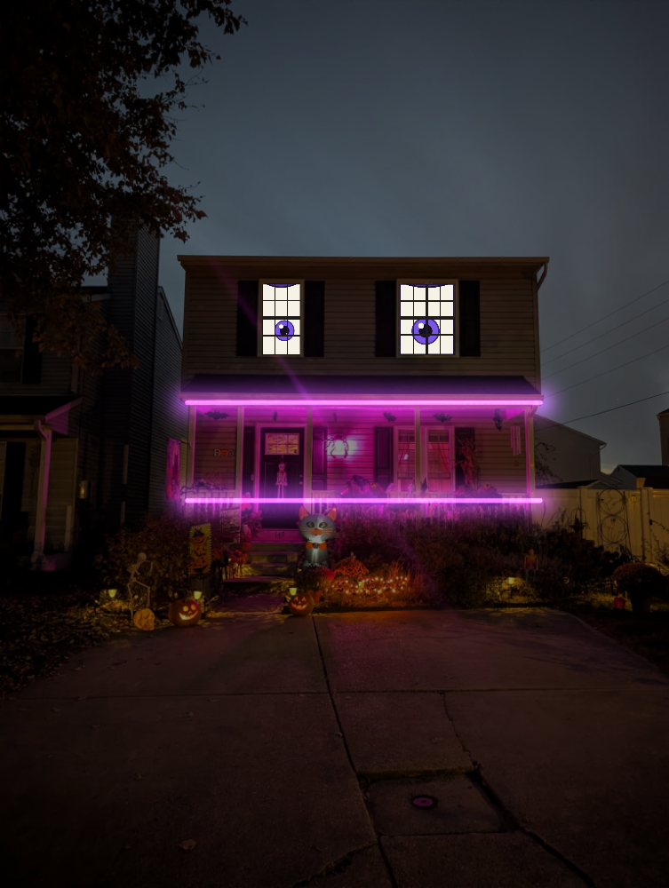
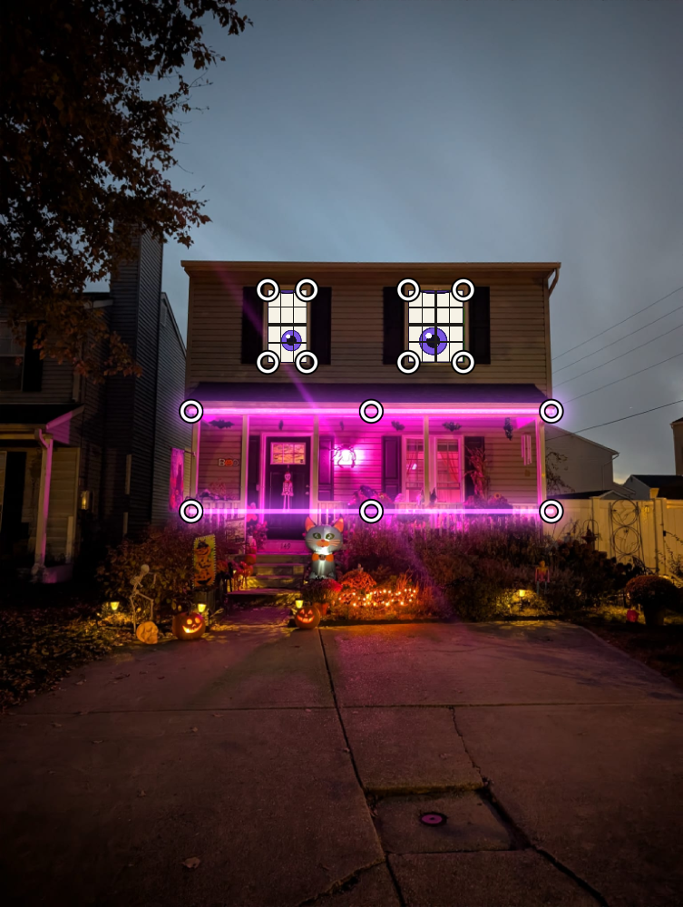
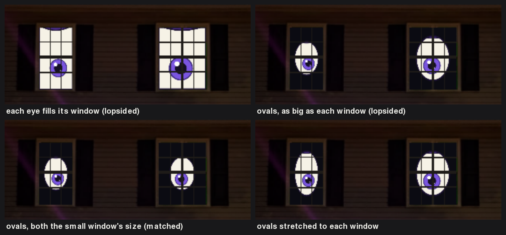
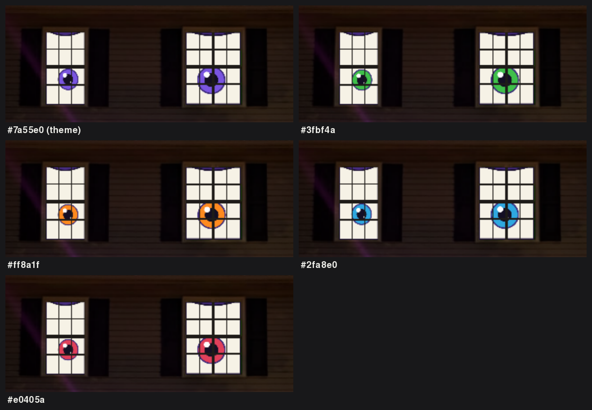
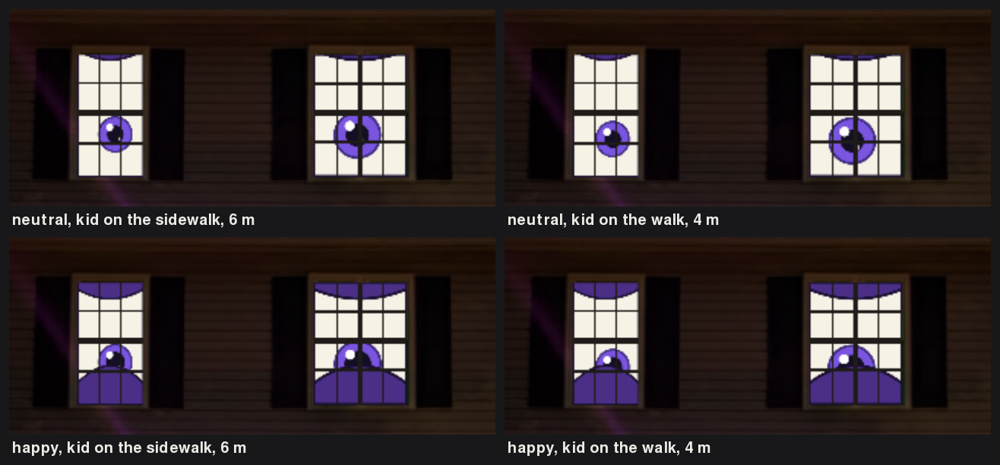
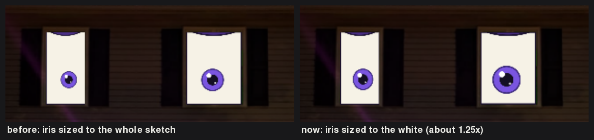
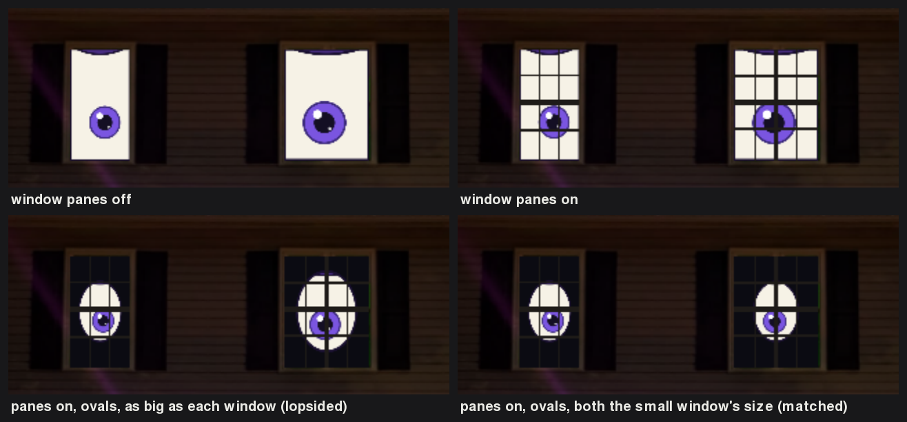
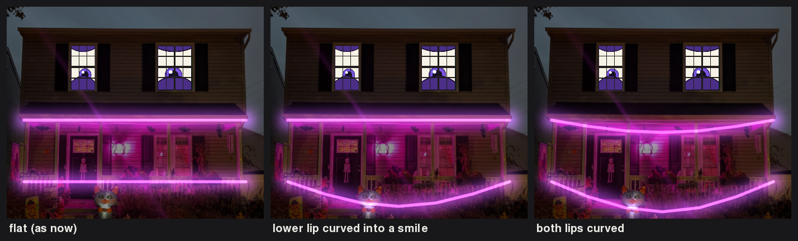

# Stage 0, Step 5: house preview

> **Status:** Draft, awaiting the owner's decisions ([UT-004](../../user-tests.md#ut-004)) · **Date:** 2026-11-26 · **Plan:** [Step 5](../../stage-0-plan.md#step-5--house-preview-january) · **Requirements:** SIM-005, SIM-006 · **Interfaces:** [ICD-001](../../interfaces/ICD-001-eye-commands.md) · **TBD:** TBD-004 (eye layout), TBD-018 (window positions)

**Done when:** the owner can decide lopsided vs. matched eyes, eye size and colors by
looking at it.

## Summary

**Built, 2026-11-26.** `sim/house_preview.py` shows the live eyes on the photo of the
house, at the two upstairs windows, with a glowing purple line where the lips will go.
Each eye is drawn by the real eye renderer, then warped onto its window in the photo,
all on the GPU. The preview listens to the brain like a third eye, so a pretend visit
plays on the house. The window corners and lip points can be dragged and saved. Keys
switch between four eye layouts, five iris colors and three dusk levels.

**The decisions are the owner's** ([UT-004](../../user-tests.md#ut-004)). The pictures
below are the same drawing, made offscreen, to start from.

## What it looks like

The whole face: neutral eyes looking at a kid on the sidewalk, the photo dimmed a step.



The handles you drag. The window corners were measured from the photo: the left glass
comes out 0.54 wide to tall, and the right 0.76. The real glass is 0.56 and 0.75
(27×48 in and 36×48 in), so the corners are on the glass. The lip points are a guess
at the porch roof edge and the railing.



### Lopsided or matched (`m`)



- **Fills each window:** the site config's default (`square`). The window frame is the
  eye's edge, so the eyes are as different as the windows. (The iris was made bigger
  on 2026-11-26; see Updates.)
- **Ovals as big as each window:** still lopsided, but rounder.
- **Matched:** both ovals the small window's size in meters, so they read as a pair.
  The big window shows more dark glass around its eye.
- **Stretched:** ovals stretched to each window's shape.

### Iris color (`c`)

The theme's purple first, then four to compare (`iris_colors` in
`sim/house_preview.yaml`). The lids stay the theme's purple.



### Expressions, near and far

The eyes are about 5 m up, so a kid near the porch makes them look well down. In
`happy` the lower lid rises, and for a kid on the walk it covers much of the iris.



## What to decide (UT-004)

1. Lopsided or matched eyes, and their size.
2. Iris color, and whether the purple lids go with it.
3. In "fills each window": is the iris big enough? (Made about 1.25× bigger on 2026-11-26.)
4. Is `happy` hiding the iris for a nearby kid all right, or should it rise less?

## Tests

All 261 tests pass (255 before this step); the requirements checker reports 0 errors.
`tests/test_house_preview.py` has 6 new tests:

| What it checks |
|---|
| The warp puts the eye's corners on the window's corners, and back again |
| Corners in a line are refused (no crash while dragging) |
| Saving the layout keeps its comments and the dragged points |
| Matched eyes are the same size in meters |
| The preview never reports itself as an eye (SIM-006) |
| A real render (software, offscreen): the photo's lit green windows are covered by eyes |

## Try it yourself

**Where:** on the desktop `lighthouse`, as user `dev`, in `~/dev/monster-house`. The windows need a `dev` desktop session on the monitor (the owner starts one); the broker is the Mosquitto service already running there (localhost:1883).

```bash
.venv/bin/python -m sim.house_preview --no-mqtt     # on its own: the eyes wander
```

Or run it with the brain, the fake FPP and the fake radar
([UT-003](../../user-tests.md#ut-003)'s commands) to watch a pretend visit on the house.
Keys are in `sim/README.md`.

## Reproduce

**Where:** on `lighthouse`, as `dev`, in `~/dev/monster-house`. No desktop session is needed (it draws offscreen), so it also works over SSH.

```bash
.venv/bin/python -m tools.results.stage_0_step_5              # the figures (GPU)
.venv/bin/python -m tools.results.stage_0_step_5 --software   # without a GPU
.venv/bin/python -m pytest -q
```

The figures were drawn on the desktop's NVIDIA RTX 5060 Ti through EGL, offscreen.

## Calls made without asking

Technical calls Claude made during the step. Overturn any of them with a gloss comment.

- **The preview listens like an eye but never reports itself as one** (`EyeLink` with
  no side), so the brain doesn't log a third eye.
- **The warp is done on the GPU** (a 3×3 matrix in the shader), solved in plain Python
  when a corner moves, so no numpy.
- **"Matched" means the same size in meters:** both ovals take the small window's eye
  size.
- **The window corners were measured from the photo;** the lip points are a guess to
  drag into place.
- **The comparisons use a kid on the sidewalk (6 m),** so the iris shows; the
  expressions figure also shows a kid on the walk (4 m).

## Updates

- **2026-11-26:** The owner's decisions are filed as
  [UT-004](../../user-tests.md#ut-004). Added where to run the commands.
- **2026-11-26, the owner's review (gloss #26):** "House looks worried but might be the
  flat lips and not the eyes. I think the eye pupil/iris can be larger with a full
  window. Could we do a version with the panes?" All three are done. The figures above
  are redrawn with the bigger iris and the panes.

  **A bigger iris in "fills each window".** The iris, pupil and lines are now sized to
  the eye's white, not the whole sketch, so they are about 1.25× bigger. This changes
  the real eye renderer too (`eyes/render.py`), not just the preview.

  

  **The window panes.** The sashes, grilles and the right window's mullion are drawn over
  the eye, dark, as they'd look backlit by a rear-projection screen. They were read from
  the photo, and are set in `sim/house_preview.yaml` (`panes`). `p` turns them off.

  

  **The mouth.** Three shapes to compare (with `happy` eyes). The real lips are LED strips,
  so a curve means bending the strip along the railing (and the roof edge) rather than
  running it straight. That's a choice for the lip design (UT-004, and the lip-lights
  trade study in gloss #22). The lip points in the preview can be dragged into any
  shape.

  
