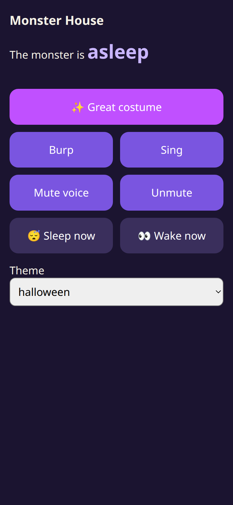

# Stage 0, Step 6: phone buttons

> **Status:** Draft, waiting for lighthouse to publish the page, then [UT-005](../../user-tests.md#ut-005) · **Date:** 2026-11-26 · **Plan:** [Step 6](../../stage-0-plan.md#step-6--phone-buttons-january) · **Requirements:** SHW-019, SHW-020, SHW-021, SHW-023, SHW-030, SHW-031, SYS-023, SYS-038 (changed) · **Interfaces:** [ICD-004](../../interfaces/ICD-004-phone-page.md)

**Done when:** pressing a button on a phone changes the monster within half a second.

## Summary

**Built and timed on this computer, 2026-11-26.** The brain now serves the phone page
from its own process: the current mood and big buttons, in any phone browser, with
Python's standard library only. A press reaches the eyes in **under 25 ms** (10 presses
through the real broker, against 0.5 s). The worst case is set by the brain's 0.1 s
loop.

**Not yet on the phone.** The page listens on this computer only (127.0.0.1:8080). The
owner chose to reach it through `tailscale serve`, like gloss (2026-11-26). That needs
lighthouse's approval and one root command from `gandriano`; the draft proposal is
[here](../../proposals/lighthouse-phone-page.md). Then [UT-005](../../user-tests.md#ut-005).

## What it looks like

The page at a phone's size, drawn by headless Chromium from the running brain:



The mood reads `asleep` here although Wake now was pressed. No fake radar was running,
so the brain was in ambient mode (radar offline: eyes open and wandering, no visits),
which shows as `asleep` because ICD-004 has no ambient mood. That's the open question
from Step 4; with the fake radar running, Wake now shows `waking`.

## What the buttons do

| Button | Does |
|---|---|
| ✨ Great costume | Sparkle eyes for 3 s and a compliment from the costume pool |
| Burp, Sing | A clip from that pool. The owner's clips skip the 10 s gap and cut in (SHW-017). Halloween has no songs yet, so Sing does nothing |
| Mute voice / Unmute | No voice; the eyes carry on (SHW-020) |
| 😴 Sleep now | Asleep at once, and held asleep (no visits) until Wake now |
| 👀 Wake now | Waking at once (the yawn), and show hours don't apply until Sleep now (SHW-019) |
| Theme | Switches the theme folder; the eyes are told (SHW-021) |

## Timing (SYS-023, SHW-023)

From [results.json](results.json): 10 presses of Great costume, each timed from the HTTP
request to the eyes' `sparkle` message arriving on the broker:
2.4, 23.4, 22.6, 18.4, 23.9, 22.5, 23.2, 22.6, 23.3 and 23.6 ms. The press waits in the
brain's inbox for the next tick, so the worst case is about 0.1 s more than this: still
well inside 0.5 s. The eyes then ease into the expression over 0.4 s, so "visibly
changes" starts at once. Through Tailscale from the phone add the network's own delay
(UT-005).

## Calls made without asking

- **The page runs inside the brain** (ICD-004 puts the phone page in the brain's process),
  so a press needs no extra message; it goes into the brain's loop.
- **Sleep now holds** the monster asleep until Wake now, so a kid walking up doesn't undo
  it. Wake now ignores show hours until Sleep now (SHW-019).
- **The owner's clips cut in** on a clip that is playing, as well as skipping the gap.
- **Great costume twice within 3 s** doesn't restart the sparkle; the eyes are still
  sparkling.
- **The tailnet port** in the proposal is 8080, like the local one; lighthouse may pick
  another.

## Tests

All 279 tests pass (261 before this step); the requirements checker reports 0 errors.
`tests/test_phone_page.py` has 18 new tests: every button on the page; `/api/state` per
ICD-004; presses reach the brain's inbox; bad buttons, bad JSON, unknown themes and
oversized requests are refused; it listens on 127.0.0.1 only; mute; sleep now holding
against a kid coming; wake now outside show hours until sleep now; great costume
sparkling and going back; the owner's clips skipping the gap and cutting in; muted
buttons; an empty sing pool; switching theme; and **a press through the real broker
reaching the eyes within 0.5 s**.

## Try it yourself

**Where:** on the desktop `lighthouse`, as user `dev`, in `~/dev/monster-house`, with the
broker running.

```bash
.venv/bin/python -m brain --any-time
```

Then open `http://127.0.0.1:8080/` in a browser on the desktop. From the phone, once
lighthouse has published it: `https://lighthouse.tail3dcfe9.ts.net:8080/`. For the whole
monster, run UT-003's programs too.

## Reproduce

**Where:** on `lighthouse`, as `dev`, in `~/dev/monster-house`, with the broker running.
No desktop session is needed.

```bash
.venv/bin/python -m tools.results.stage_0_step_6   # the screenshot and the timings
.venv/bin/python -m pytest -q -ra
```

## Updates

- **2026-11-26:** SYS-038 changed by the owner to "only for the owner's devices on the
  tailnet" (option A). Draft proposal written for lighthouse, and a gloss note left for it
  (lighthouse #4).
