# TS-001 results report — requirements, architecture and ICD format

> **Status:** Final for A, A′, B and D; provisional for C and D's SysML half † (validator run pending) · **Date:** 2026-11-08 · **Study:** [TS-001](../../TS-001-requirements-approach.md) · **Decision:** [ADR 0001](../../../decisions/0001-requirements-and-architecture-format.md) · **TBD:** TBD-001 (closed), TBD-019 (SysML revisit)

This report backs up TS-001 with its evidence: the same sample written in every option,
the checks run against it, screenshots of each tool's output, and the scoring. Everything
here can be regenerated from [`trials/ts-001/`](../../../../trials/ts-001/README.md) (see
[Reproduce](#reproduce)).

## Summary

**Option A (YAML requirements, Markdown architecture and ICDs, our own checker) scores
highest under two of the three weight sets and ties with D under the third.** The
evidence supports the decision already recorded in ADR 0001: start with A, and move the
architecture to SysML v2 (option D) once its tooling and viewing are established.

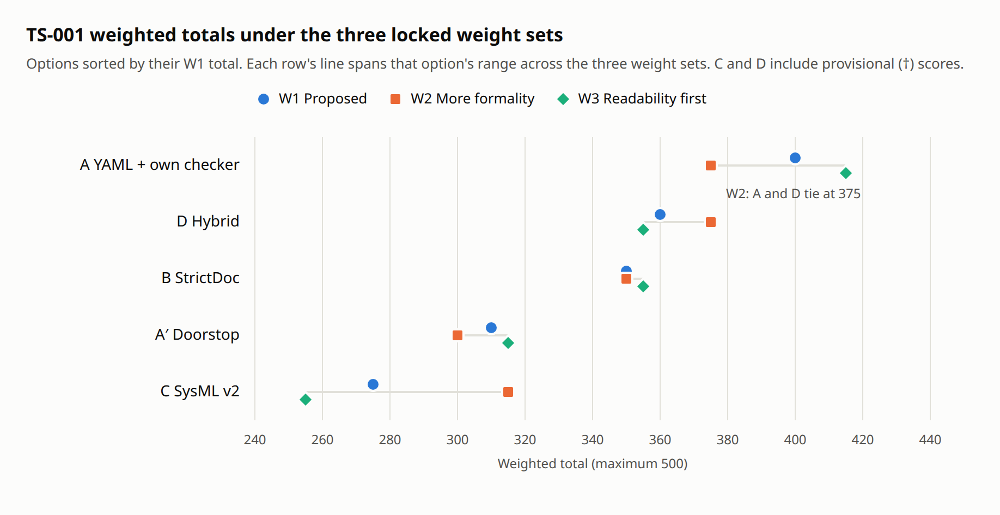

| | W1 Proposed | W2 More formality | W3 Readability first |
|---|---|---|---|
| **A** YAML + Markdown, own checker | **400** | **375** (tie) | **415** |
| **D** SysML v2 architecture + YAML requirements † | 360 | **375** (tie) | 355 |
| **B** StrictDoc | 350 | 350 | 355 |
| **A′** Doorstop | 310 | 300 | 315 |
| **C** SysML v2 throughout † | 275 | 315 | 255 |

Totals are out of 500. † marks scores that depend on the SysML v2 validator run, which is
still pending (see [Limitations](#limitations)).

**What decided it:**
1. **Catching mistakes (gate G2).** A's 150-line checker caught all 6 kinds of planted
   error. StrictDoc and Doorstop each caught 2 on their own. The four they missed (no
   parent or bad type; unallocated; interface without an ICD; unknown TBD) would need a
   script like A's anyway.
2. **Effort per change.** In A, a requirement is one 7-line block in one file. In SysML
   v2, its text, its parent links and its allocation sit in three places.
3. **Readability.** YAML and Markdown render on GitHub. StrictDoc's `.sdoc` and SysML text
   don't render as documents there.
4. **Formality** is where C and D are strongest, and only the formality-heavy weights
   (W2) close the gap.

**Order of events.** The owner decided on A after the framing. The weights were locked
(commit `5b9a112`) before any evidence was gathered. This evaluation was then run at the
owner's request, and it supports the decision rather than having shaped it.

## What was compared

| Option | Requirements | Architecture and ICDs | Checking |
|---|---|---|---|
| **A** | YAML, one file per subsystem | Markdown + YAML blocks | Our `check.py` |
| **A′** | Doorstop, one YAML file per requirement | as A | `doorstop` |
| **B** | StrictDoc `.sdoc` | as A | `strictdoc export` |
| **C** | SysML v2 `requirement` | SysML v2 parts, ports, interfaces | OMG pilot implementation † |
| **D** | as A | SysML v2 (short names = YAML IDs) | A's checker + glue † |

Doorstop (A′) was added at the evidence step. The framing had screened it out as
"dominated by StrictDoc", but checking showed it's maintained (3.2, July 2026) and is
essentially A's requirements half with a ready-made tool.

Screened out at framing: Cameo/MagicDraw, Papyrus, Capella, sphinx-needs, spreadsheets,
and DOORS/Jama (study §4).

## Method

- **The sample:** the same content in every option. Three system requirements (SYS-001
  functional, SYS-002 performance, SYS-003 constraint), seven subsystem requirements
  (BRN-001…003, EYE-001…004, covering every type), five components (monster brain, eye
  renderer, desktop, porch Pi, left eye pod), and ICD-001 (brain → eyes, `monster/eyes/look`).
- **Weights:** three sets, W1, W2 and W3, locked before evidence (study §3).
- **Evidence:** every finding is tagged measured, documented (with source and date) or
  judgment (study §5, E1–E18).
- **Seeded errors:** for gate G2, six kinds of error were planted one at a time in a
  scratch copy. "Caught" means the check exits non-zero and names the problem.
- **Environment:** the owner's Ubuntu 24.04 desktop; Python 3.12 (uv virtual
  environment); StrictDoc 0.30.4; Doorstop 3.2; Java 21 with the SysML v2 pilot
  implementation 2026-09.1 (kernel 0.63.1); screenshots with Playwright's headless
  Chromium.

## Gates

| Gate | A | A′ Doorstop | B StrictDoc | C SysML v2 | D Hybrid |
|---|---|---|---|---|---|
| G1 Plain text in git | Pass | Pass, but validating rewrites and stages files (fig. 10) | Pass | Pass | Pass |
| G2 Errors flagged automatically | **Pass, 6/6** | Narrow: 2/6 on its own | Narrow: 2/6 on its own | Provisional †: references resolve; nothing flags the other kinds | **Pass, 6/6** (glue) + SysML validity † |
| G3 No paid license | Pass | Pass (LGPL-3) | Pass (Apache-2.0) | Pass (pilot is EPL-2.0; Syside's CLI is paid) | Pass |
| G4 Runs on Ubuntu 24.04 | Pass | Pass | Pass | Pass (Java 21) | Pass |
| G5 Claude can write and edit it | Pass | Pass | Pass (first export clean) | Written; validation † | Pass + † |

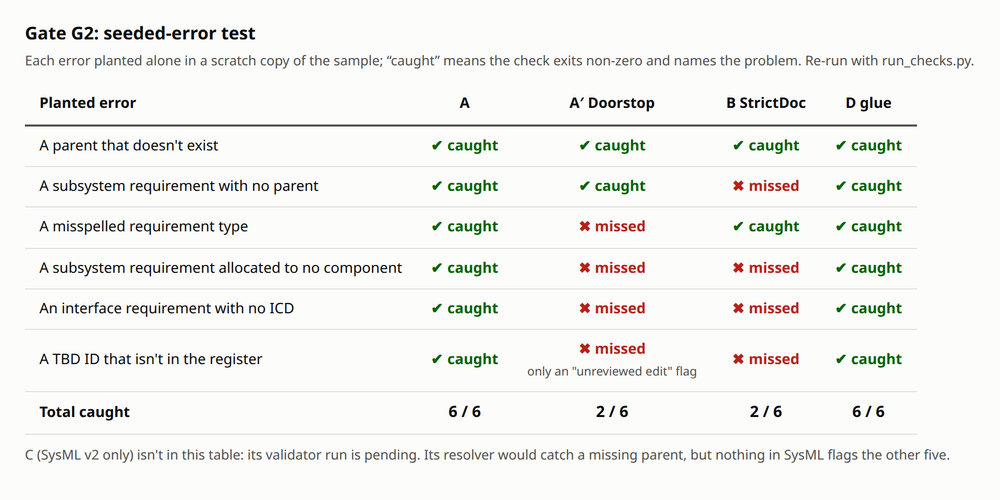

The terminal output behind each column:
[A](figures/05-seeded-a.png) ·
[A′ Doorstop](figures/05-seeded-a-doorstop.png) ·
[B StrictDoc](figures/05-seeded-b-strictdoc.png) ·
[D glue](figures/05-seeded-d-glue.png). Raw logs are in [`logs/`](logs/), and the
machine-readable results in [`seeded-errors.json`](seeded-errors.json).

**Two notes on the seeded test:**
- **Doorstop's "TBD" result:** with `--error-all`, Doorstop exits 1 on the TBD case, but
  only because *any* edit to a requirement's text is flagged as "unreviewed changes". It
  doesn't check TBD references, so this counts as missed.
- **StrictDoc could do better than 2/6.** Splitting the grammar into separate system and
  subsystem element types, with `ALLOCATED_TO` required on the subsystem type, would
  probably catch the unallocated case. That wasn't tested.

## Evidence by criterion

### C1 — Readable without tools · C5 — Effort per change

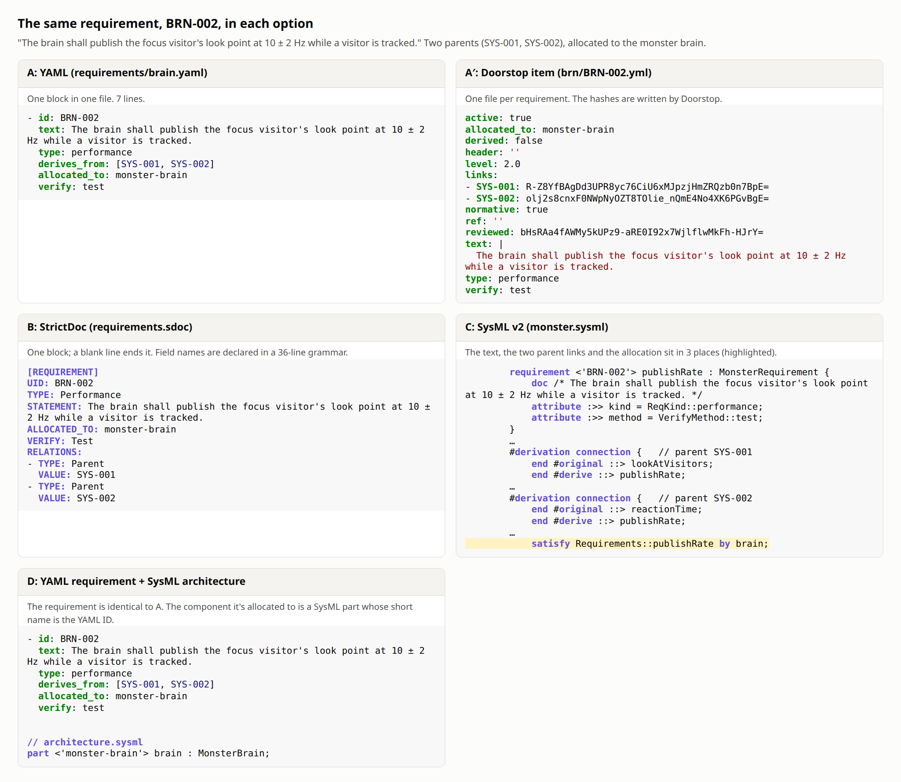

Size of the same sample, counting non-blank lines:

| | Requirements | Architecture | Notes |
|---|---|---|---|
| A | 66 (3 files) | 21 (components.yaml) | One block per requirement |
| A′ | 139 (10 files) | — | One file per requirement, with Doorstop's housekeeping fields and hashes |
| B | 132 (1 file) | — | Includes a 36-line grammar header. A blank line ends a requirement, which caused one syntax error during the trial |
| C | 70 | 37 | Text, parent links and allocation in 3 separate places per requirement |
| D | 66 (as A) | 32 (architecture.sysml) | A new component is one SysML line plus a validator run |

### C2 — Traceability reports

**A** generates a traceability matrix plus allocation and interface diagrams as Markdown
that GitHub renders. It also answers "what does changing SYS-001 touch?":

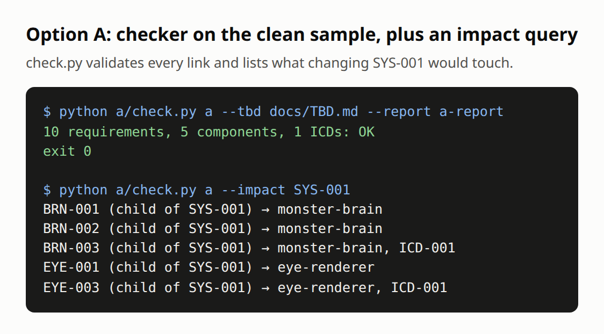

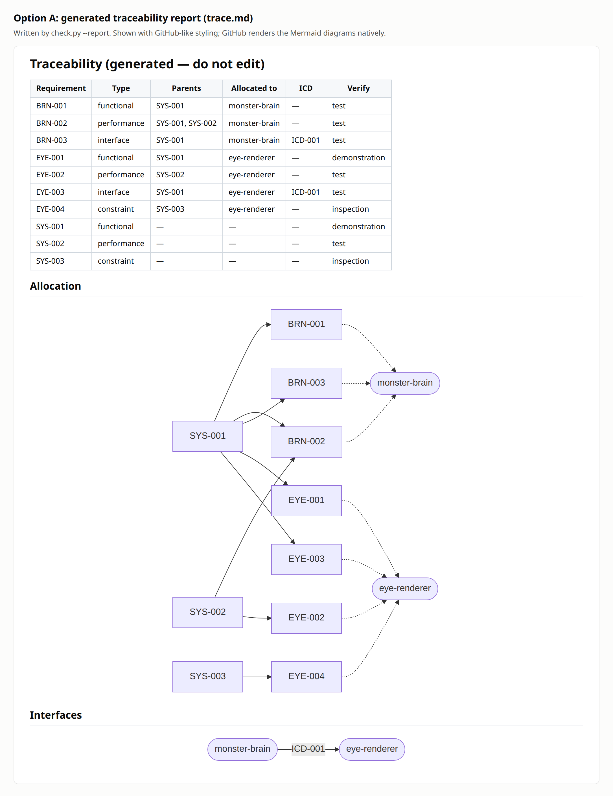

**B, StrictDoc**, generates document, table, trace and deep-trace views (1.1 s for the
sample). The deep-trace view shows each system requirement beside its children:

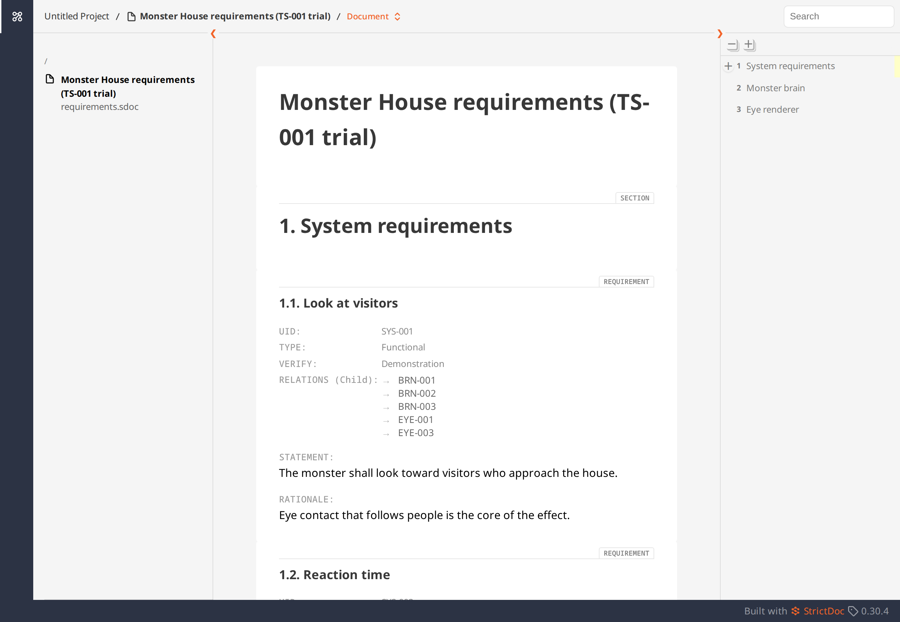

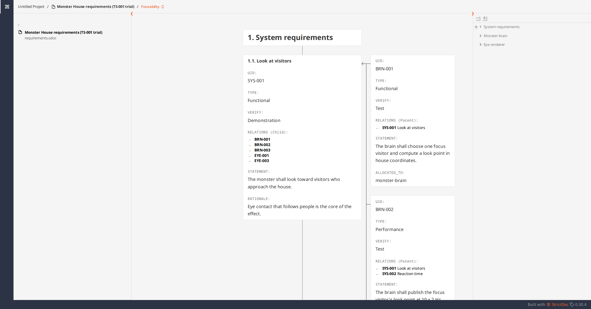

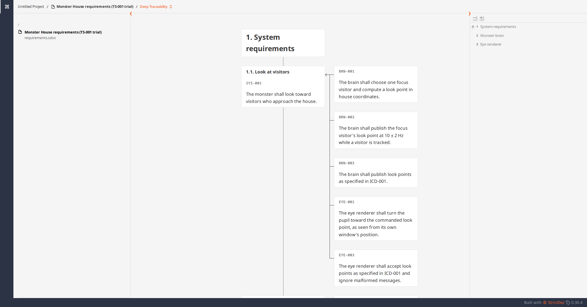

**A′, Doorstop**, publishes a parent/child matrix and a page for each document. It has no
coverage or impact reports:

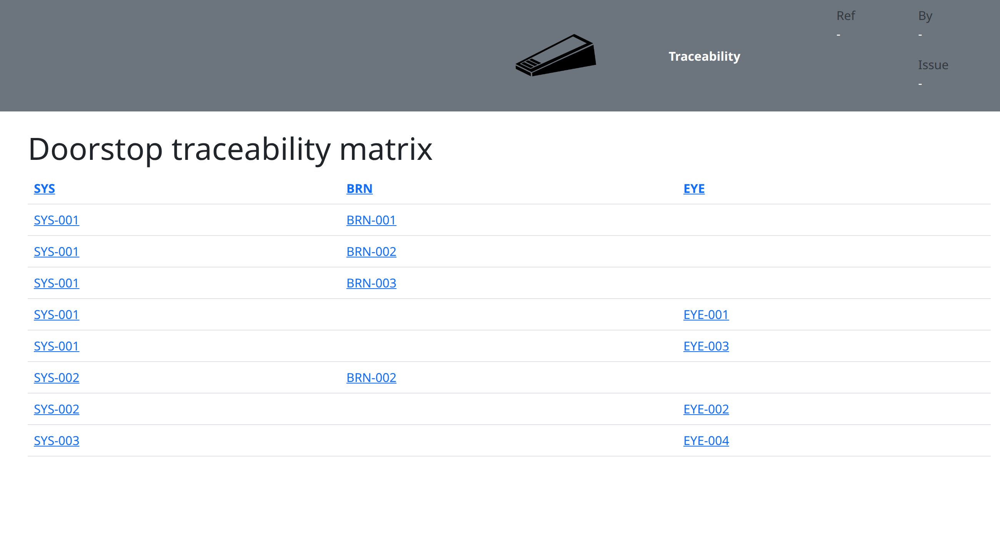

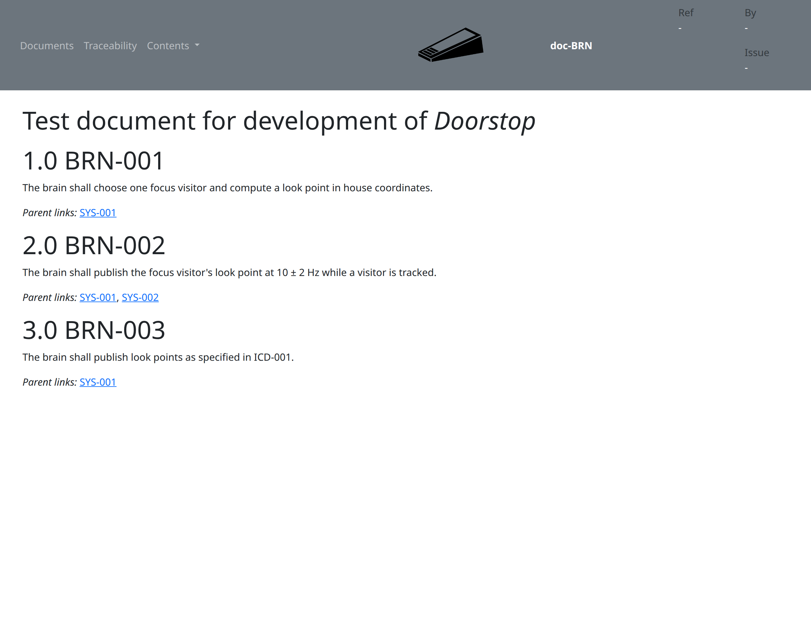

**C**: the pilot implementation prints element trees (`%show`) and diagrams (`%viz`), but
has no matrix or coverage report. Those would be our own queries over its JSON output †.

### C3 — Formality

- **A:** borrows SysML terms. A 20-line script converted it to Doorstop's format in minutes,
  so a converter to other formats is cheap.
- **B:** exported standard ReqIF (a 43 KB `output.reqif`; [log](logs/b-clean.txt)).
- **C and D:** use the real thing. SysML v2.0 is a formal OMG standard (adopted 2025,
  published 2025-09, revised 2026-03 for ISO).

### C4 — Generated diagrams

- **A:** Mermaid diagrams generated by our script (fig. 04).
- **A′ and B:** generate no architecture diagrams.
- **C and D:** the pilot's `%viz` renders standard SysML views through its bundled
  PlantUML. Not yet run †.

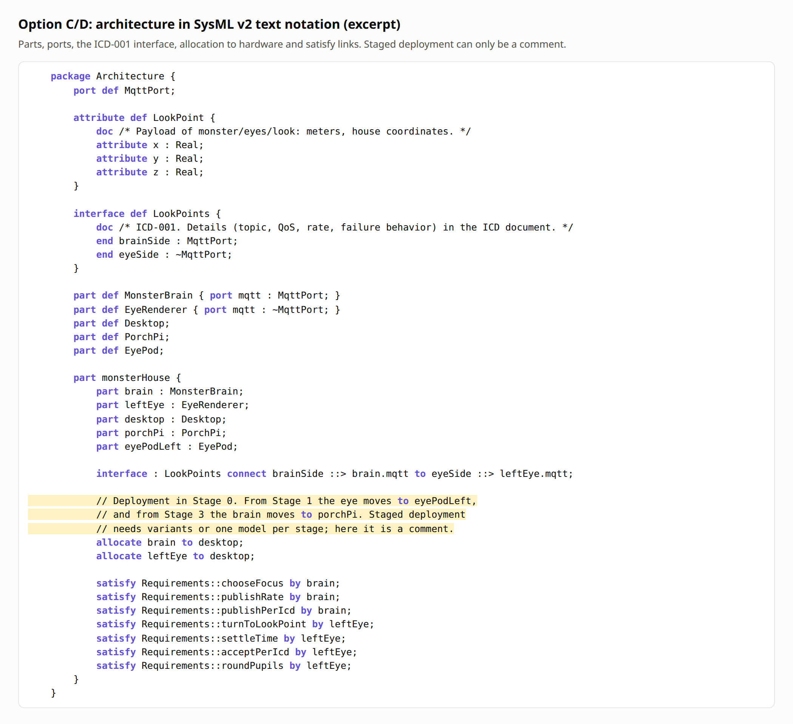

The excerpt also shows the staged-deployment problem. The brain runs on the desktop in
Stages 0–2 and on the porch Pi from Stage 3; in the model this can only be a comment.
Expressing it properly would take variants, or one model per stage.

### C6 — Longevity (checked 2026-11-08)

| Tool | Latest release | Activity | License |
|---|---|---|---|
| Our checker (A) | — | Ours to maintain | — |
| Doorstop | 3.2 (2026-07-10) | 110 releases | LGPL-3 |
| StrictDoc | 0.30.4 (2026-10-22) | 212 releases; pushed 2026-11-06 | Apache-2.0 |
| SysML v2 pilot | 2026-09.1 (2026-10-28) | Monthly; pushed 2026-11-06 | EPL-2.0 |
| Syside (CLI) | 0.11.0 (2026-09-29) | — | Proprietary; CLI on paid plans only |

### C7 — ICDs drive the code

- **A, A′, B and D:** ICDs are Markdown with a YAML block that holds a JSON-Schema payload
  and examples. A's checker validates the examples against the schema
  ([ICD-001](../../../../trials/ts-001/a/interfaces/ICD-001.md)), and the same block could
  generate or test `shared/`.
- **C:** the payload is a SysML `attribute def` and would need the pilot's JSON export plus
  a generator.

### C8 — Learning curve

Judgment, after writing the sample:
- **A:** plain YAML and Markdown.
- **A′:** Doorstop's command-line tool plus its review and fingerprint concepts.
- **B:** a new file format and grammar.
- **D:** a subset of SysML for about 30 lines.
- **C:** a new language and toolchain.

### Doorstop changes files when it validates

Doorstop stamps a hash on each link and a `reviewed` field on validation, and **stages
the changed files in git itself**. In the trial, one `doorstop` run changed all 10 items.
Part of that diff is key re-ordering, because the trial's converter didn't write
Doorstop's key order. The hashes and the staging are Doorstop's own behavior. In daily
use, this means routine validation adds changes to whatever is about to be committed.

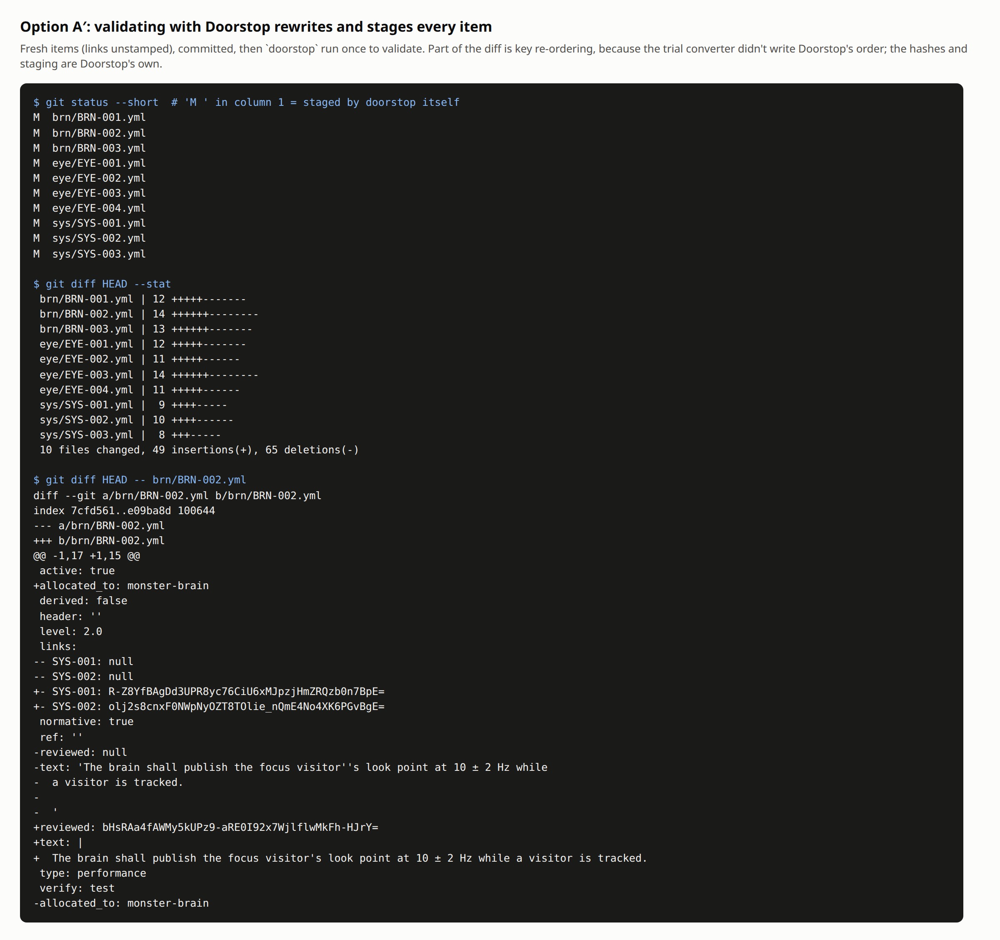

## Scores and sensitivity

| Criterion | W1 | W2 | W3 | A | A′ | B | C | D |
|---|---|---|---|---|---|---|---|---|
| C1 Readable without tools | 20 | 15 | 25 | 4 | 3 | 3 | 2 | 3 |
| C2 Trace reports | 20 | 20 | 20 | 4 | 3 | 4 | 2 † | 4 |
| C3 Formality | 10 | 20 | 5 | 3 | 3 | 4 | 5 | 4 |
| C4 Generated diagrams | 10 | 15 | 5 | 3 | 2 | 2 | 4 † | 4 † |
| C5 Effort per change | 15 | 10 | 20 | 5 | 3 | 4 | 3 | 4 |
| C6 Longevity | 5 | 5 | 5 | 3 | 3 | 4 | 4 | 4 |
| C7 Drives the code | 10 | 10 | 10 | 4 | 4 | 4 | 3 | 4 |
| C8 Learning curve | 10 | 5 | 10 | 5 | 4 | 3 | 1 | 2 |

The evidence ID behind each score is in study §6. Totals are computed by
[`score.py`](../../../../trials/ts-001/score.py).

**How close it is:**
- **W1:** A leads D by 40. D would need about 40 more weight on C3, C4 or C6 to tie.
  Not close.
- **W2: A and D tie at 375.** The choice comes down to taste: is SysML formality worth the
  learning curve and some readability?
- **W3:** A leads B and D by 60. Not close.
- **The † items cut both ways.**
  - If the pilot validates the full sample cleanly and `%viz` produces usable diagrams, C
    and D keep their C4 = 4.
  - If the sample won't validate without fighting the tool, D's G5 is in doubt and A's
    lead widens.

## Limitations

1. **The SysML v2 validator wasn't run on the full C and D samples.** The OMG pilot jar ran
   once, successfully, on a toy model. Auto mode's safety check then blocked further runs
   of this downloaded jar, pending the owner's permission. The scores marked † are
   provisional until it runs (`trials/ts-001/sysml_check.sh`).
2. **No `%viz` diagrams**, for the same reason; Graphviz is also not installed.
3. **GitHub rendering is approximated.** Figure 04 uses GitHub-like styling and the same
   Mermaid library GitHub uses; it isn't a screenshot of github.com.
4. **C1, C3 and C8 are partly judgment,** and are labeled that way in study §5.
5. **StrictDoc's stricter grammar variant wasn't tried** (see Gates).
6. **The sample is small** (10 requirements). Effort per change and readability would
   both differ more at the expected 100–150 requirements, in A's favor for readability
   and in StrictDoc's for navigation.

## Recommendation and decision

**Decided (owner, 2026-11-08): option A, written SysML-ready, with option D as the planned
destination** once SysML v2 tooling and viewing are established (TBD-019). The evaluation
supports it. What would change it:
- the pilot validating the full sample cleanly, combined with formality-heavy weights,
  which makes D an equal choice now rather than later;
- A's checker growing past a few hundred lines, at which point StrictDoc's ready-made
  reports start to pay for its format.

## Reproduce

From the repository root, with a Python 3.12 virtual environment that has
`strictdoc==0.30.4 doorstop==3.2 pyyaml playwright markdown pygments`, and
`playwright install chromium-headless-shell`:

```bash
python trials/ts-001/run_checks.py /tmp/ts001-run      # every check + seeded errors → logs, JSON, HTML
python trials/ts-001/make_figures.py /tmp/ts001-run docs/trades/results/TS-001/figures [path/to/validate_palette.js]
python trials/ts-001/score.py                          # weighted totals and sensitivity
SYSML_KERNEL=<pilot kernel dir> trials/ts-001/sysml_check.sh trials/ts-001/c-sysml/monster.sysml   # † pending
```

## Figure index

| # | File | Shows |
|---|---|---|
| 01 | [same-requirement-each-option](figures/01-same-requirement-each-option.png) | BRN-002 in every option (C1, C5) |
| 02 | [seeded-error-matrix](figures/02-seeded-error-matrix.png) | G2 results, 6 errors × 4 options |
| 03 | [a-checker-clean](figures/03-a-checker-clean.png) | A: clean check and an impact query |
| 04 | [a-trace-report](figures/04-a-trace-report.png) | A: generated matrix and diagrams |
| 05 | [A](figures/05-seeded-a.png), [A′](figures/05-seeded-a-doorstop.png), [B](figures/05-seeded-b-strictdoc.png), [D](figures/05-seeded-d-glue.png) | Seeded-error terminal output |
| 06–08 | [document](figures/06-strictdoc-document.png), [trace](figures/07-strictdoc-trace.png), [deep trace](figures/08-strictdoc-deep-trace.png) | StrictDoc HTML views |
| 09 | [traceability](figures/09-doorstop-traceability.png), [BRN document](figures/09-doorstop-brn-document.png) | Doorstop HTML |
| 10 | [doorstop-churn](figures/10-doorstop-churn.png) | Doorstop rewriting and staging files |
| 11 | [sysml-architecture](figures/11-sysml-architecture.png) | SysML v2 architecture excerpt |
| 12 | [score-dot-plot](figures/12-score-dot-plot.png) | Totals under W1–W3 ([palette check](figures/12-palette-validator.md)) |

## Sources

- [OMG SysML specification](https://www.omg.org/spec/SysML)
- [SysML v2 Pilot Implementation releases](https://github.com/Systems-Modeling/SysML-v2-Pilot-Implementation/releases)
- [Syside pricing](https://sensmetry.com/syside-pricing/)
- [Syside Editor license change](https://sensmetry.com/syside-editor-rebirth-sysml-v2-0-50x-speed-up-license-change-free-as-before/)
- PyPI and GitHub APIs for StrictDoc, Doorstop and Syside release data (checked 2026-11-08)
