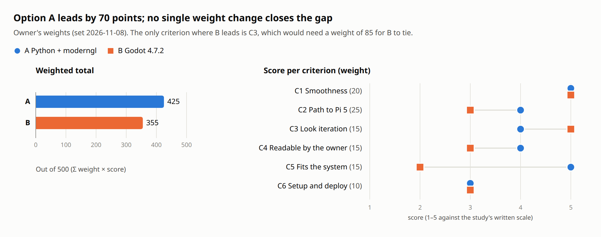
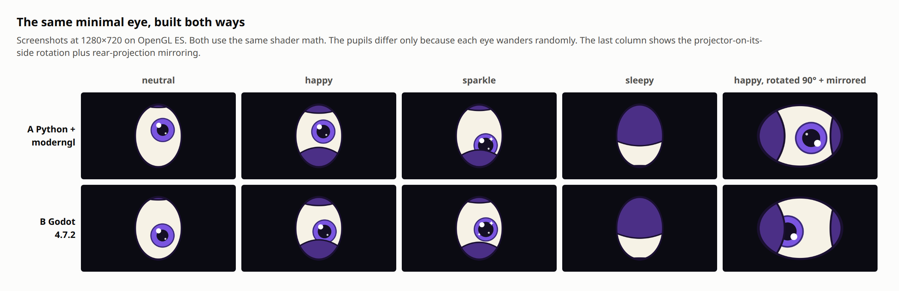
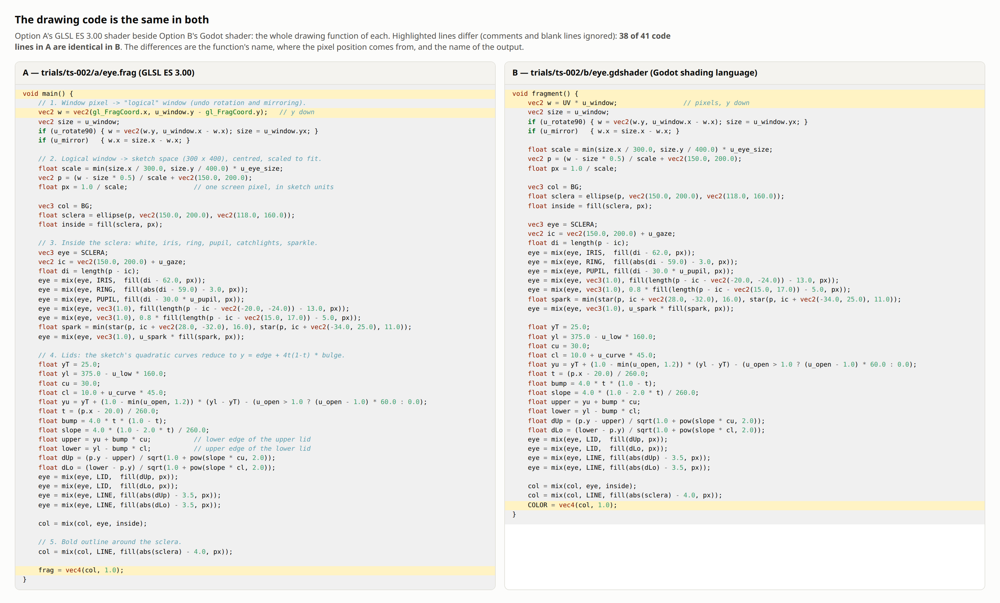
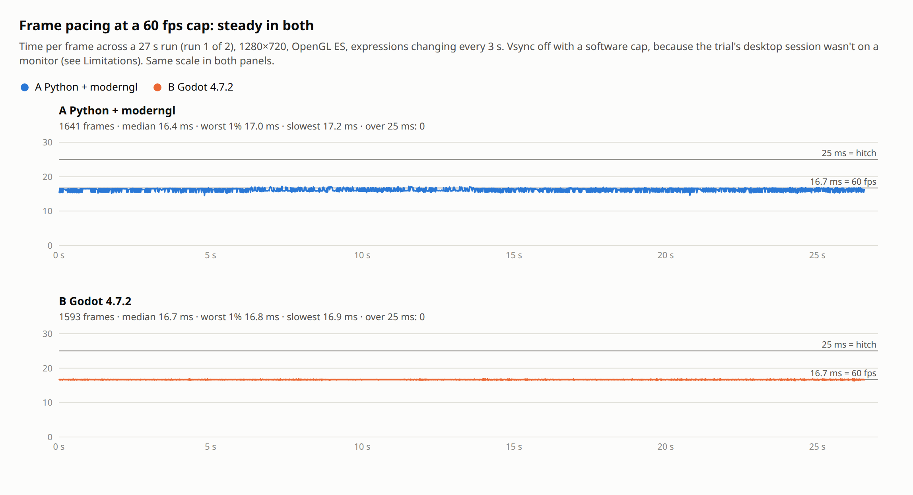
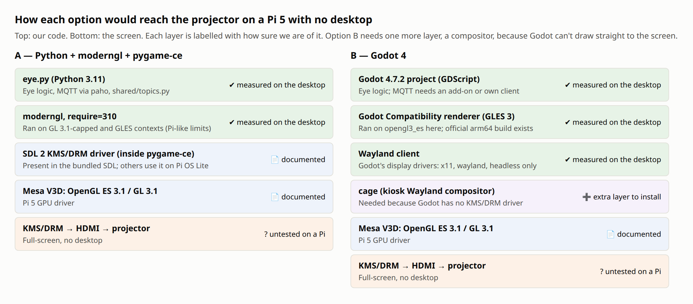
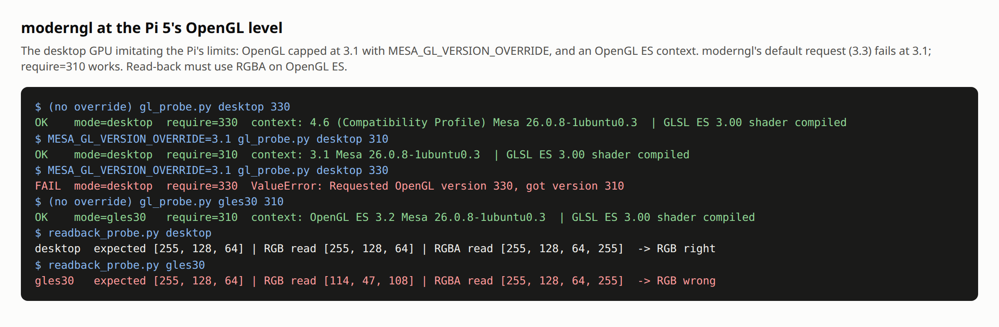
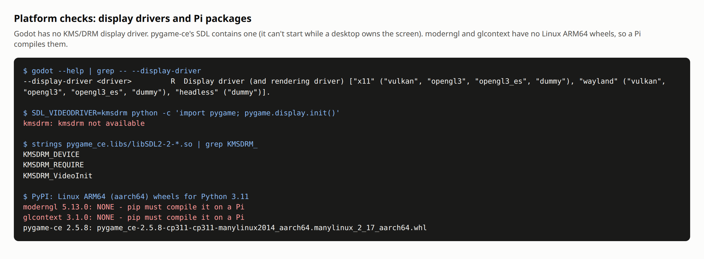
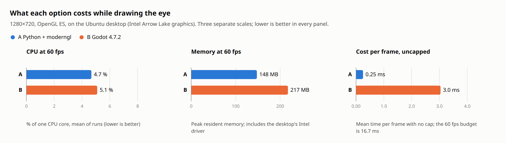
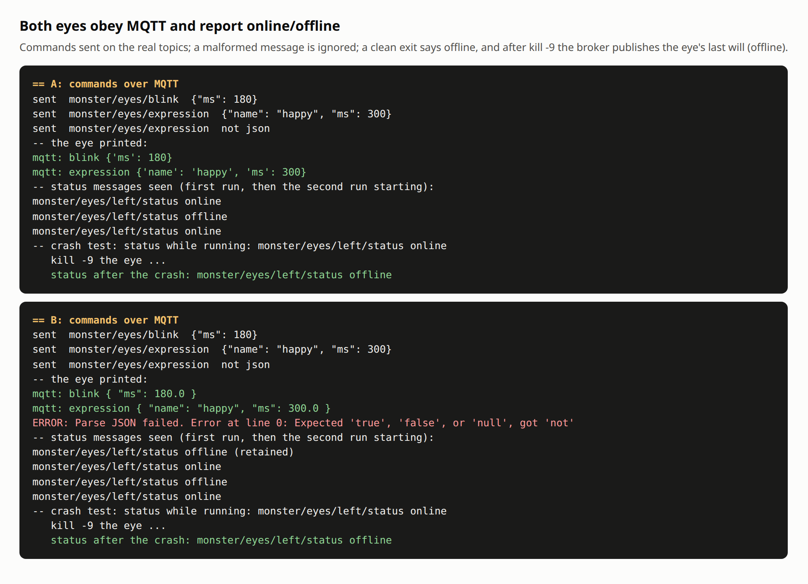

# TS-002 results report — eye renderer: Python + moderngl, or Godot

> **Status:** Final · **Date:** 2026-11-08 · **Study:** [TS-002](../../TS-002-eye-renderer.md) · **Decision:** [ADR 0002](../../../decisions/0002-eye-renderer.md) (Accepted) · **TBD:** TBD-002 (closed), TBD-013 (buy a Pi 5 early: reopened)

This report backs up TS-002 with its evidence: the same minimal eye built both ways, the
measurements taken on each, screenshots of what each drew, and the scoring. Everything
here can be regenerated from [`trials/ts-002/`](../../../../trials/ts-002/README.md) (see
[Reproduce](#reproduce)).

## Summary

**Option A (Python + `moderngl` + `pygame-ce`) scores 425 of 500; option B (Godot 4.7.2)
scores 355.** The gap is 70 points, and no change to a single weight closes it. The owner
chose option A on 2026-11-08.



| | Total | C1 Smooth (20) | C2 Pi path (25) | C3 Look iteration (15) | C4 Readable (15) | C5 Fits system (15) | C6 Setup (10) |
|---|---|---|---|---|---|---|---|
| **A** Python + moderngl + pygame-ce | **425** | 5 | 4 | 4 | 4 | 5 | 3 |
| **B** Godot 4.7.2 | 355 | 5 | 3 | 5 | 3 | 2 | 3 |

**What decided it:**
1. **Fitting the rest of the system (C5).** A imports `shared/topics.py` and the shared
   MQTT helper and can be tested with `pytest`. B can't import Python: the trial copied
   the topic names into GDScript by hand and needed its own MQTT client.
2. **The path to a Pi 5 with no desktop (C2).** A's window library (pygame-ce's SDL)
   includes a KMS/DRM driver that draws straight to the screen. Godot has no such driver
   and would need a compositor (`cage`) underneath. A also used about a third less memory.
3. **Smoothness doesn't separate them.** Both held 60 fps with no frame over 25 ms.
4. **Godot's strength is look iteration (C3),** thanks to its editor. That's the only
   criterion it wins.

**Order of events.** The owner set the weights (Stop 1) before any evidence was gathered.
The trial was run by hand first and scored (Stop 2), then the owner chose A. This report
comes from a scripted re-run of every measurement the same day. Its numbers agree with
the first session except for CPU use, which overlapped more than first reported (see
[C2](#c2--path-to-a-pi-5-with-no-desktop)). The study and ADR were corrected.

## What was compared

| Option | Drawing | Window and screen | Eye logic | MQTT |
|---|---|---|---|---|
| **A** | `moderngl` 5.13.0, GLSL ES 3.00 fragment shader | `pygame-ce` 2.5.8 (SDL 2.32.10) | Python 3.11 | `paho-mqtt` 2.2.0 + `shared/` |
| **B** | Godot Compatibility renderer, Godot shader | Godot 4.7.2 display server | GDScript | Hand-written 82-line client (an MIT add-on exists) |

Screened out at framing (study §4): CPU drawing with pygame, C/C++ with SDL, LÖVE, Rust/Bevy,
Unity, `pi3d`. Kept as fallbacks if A fails on a real Pi: **Python + raylib** and a
**browser kiosk (WebGL)**.

## Method

- **The sample:** the same minimal eye in both, matching `docs/reference/eye-sketch.html`:
  - **Shapes:** sclera, iris and ring, pupil, two catchlights, sparkle stars, upper and
    lower lids with the lower-lid smile, and a bold outline.
  - **Behaviour:** the six expressions from architecture §2 with the sketch's easing,
    gaze smoothing, idle wandering and blinks.
  - **Window options:** mirroring and 90° rotation.
  - **MQTT:** obeys `monster/eyes/blink` and `monster/eyes/expression`, and publishes
    `monster/eyes/left/status` with a last will.
- **Same drawing code:** each eye is one fragment shader, and B's is a line-for-line copy
  of A's (fig. 02).
- **Weights:** set by the owner before scoring (study §3).
- **Evidence:** every finding is tagged measured, documented (with source and date) or
  judgment (study §5, E1–E19).
- **Benchmark mode:** each program runs for a fixed time, cycles through the expressions
  every 3 s, and logs every frame time.
- **Environment:**
  - **Machine:** the owner's desktop, Ubuntu 26.04.1 LTS, Intel Arrow Lake graphics,
    Mesa 26.0.8, 24 cores.
  - **Software:** Python 3.11.18 (uv virtual environment) and Godot 4.7.2.
  - **Broker:** Mosquitto 2.0.22 with `deploy/mosquitto/mosquitto-dev.conf`.
  - **Screenshots:** Playwright's headless Chromium.
- **Not on a monitor:** the eyes ran in the `dev` account's desktop session, which isn't
  shown on a screen. The compositor throttles windows that wait for vsync there, so vsync
  was off throughout: either a software 60 fps cap or no cap (see
  [Limitations](#limitations)).

## Gates

| Gate | A | B |
|---|---|---|
| G1 GPU, GLSL ES 3.00 shaders | **Pass:** `#version 300 es` shader, compiled on GL 3.1 and GLES contexts (fig. 06) | **Pass:** ran on Godot's `opengl3_es` driver |
| G2 Full-screen on Pi OS Lite with no desktop | **Pass, narrowly:** SDL's KMS/DRM driver is present and `moderngl` runs at the Pi's GL level, but the two haven't run together on a Pi (fig. 05) | **Pass, narrowly:** needs a kiosk compositor (`cage`); no source shows Godot + `cage` on a Pi 5 (figs. 05, 07) |
| G3 Window on the Ubuntu desktop | Pass | Pass |
| G4 MQTT with last will | **Pass:** `paho-mqtt` (fig. 08) | **Pass, narrowly:** hand-written client or third-party add-on (fig. 08) |
| G5 Open source, no per-device fee | Pass (MIT, LGPL-2.1) | Pass (MIT) |

## Evidence by criterion

### What each one drew





**38 of 41 code lines are identical.** The three that differ are the function's name,
where the pixel position comes from, and the output's name. The look itself doesn't
depend on the choice.

### C1 — Smoothness



| 60 fps cap, 27 s, OpenGL ES, 1280×720 | A run 1 | A run 2 | B run 1 | B run 2 |
|---|---|---|---|---|
| Mean fps | 61.8 | 61.9 | 60.0 | 60.0 |
| Worst 1 % of frames | 16.95 ms | 16.98 ms | 16.85 ms | 16.95 ms |
| Slowest frame | 17.18 ms | 17.12 ms | 16.94 ms | 17.08 ms |
| Frames over 25 ms | **0** | **0** | **0** | **0** |

Both earn a 5, though only provisionally. A's line sits slightly under 16.7 ms because
pygame's software cap runs a touch fast (about 62 fps). That's a property of the cap, not
of the drawing. On the real eye, vsync will set the pace.

### C2 — Path to a Pi 5 with no desktop





- **The Pi 5's GPU** offers OpenGL ES 3.1 and desktop OpenGL 3.1 (documented: Mesa V3D,
  Phoronix, FOSDEM 2025).
- **`moderngl` asks for OpenGL 3.3 by default** and fails at 3.1. With `require=310` it
  works on a context capped at 3.1 and on an OpenGL ES context. Measured on the desktop
  by imitating the Pi's limits, not on a Pi.
- **On OpenGL ES, reading pixels back as RGB returns garbage; RGBA works.** This only
  matters for screenshots, and ADR 0002 makes RGBA a rule.



- **Godot 4.7.2 can only show a window through X11 or Wayland.** On a Pi with no
  desktop it needs a compositor such as `cage`: one more package to install, configure
  and keep running.
- **pygame-ce's SDL includes the KMS/DRM driver.** It reports "not available" here only
  because the desktop owns the screen.



| | A | B |
|---|---|---|
| CPU at 60 fps, % of one core (4 runs over two sessions) | 4.0 · 4.4 · 5.2 · 4.15 | 5.9 · 5.0 · 5.45 · 4.74 |
| Peak memory at 60 fps | 147–153 MB | 217–218 MB |
| Cost per frame with no cap (3 runs) | 0.25 ms (about 3,950 fps) | 3.0–3.06 ms (about 330 fps) |

- **CPU use is similar.** The ranges overlap, and A is a little lower on average. The
  first session suggested a clearer gap, and the study now says "similar".
- **Memory differs consistently:** about 70 MB more for Godot. Desktop figures include
  the Intel driver, so a Pi's will differ, but the comparison holds.
- **Godot's uncapped figure isn't pure drawing cost:** it includes its engine loop and
  the compositor's pacing (the slowest frame was about 7 ms every run). Both are far
  inside the 16.7 ms budget.
- **Godot sometimes didn't exit.** In the first, hand-run session it finished its work
  and then failed to exit after `quit()` in 2 of about 12 launches. In the scripted
  re-run it exited normally all 15 times. On a Pi, the system service would have to
  handle a hung shutdown.

### C3 — Ease of iterating on the look

- **Start to quit:** A 0.28–0.32 s, B 0.43–0.49 s (3 runs each in `results.json`). Either
  restarts fast enough to tweak and look.
- **Godot's editor** shows shader values as live sliders. That's documented in tutorials
  but wasn't tried here, because the editor needs a visible screen. Godot scores 5.
- **A has no editor** and scores 4. Step 2 will add reloading of the shader and theme
  values while the eye runs.

### C4 — Readable by the owner

| | Eye logic | MQTT | Shader | Scene/config | Languages |
|---|---|---|---|---|---|
| A | 204 lines Python | (shared `paho` helper) | 69 lines | — | Python + GLSL |
| B | 164 lines GDScript | 82 lines | 68 lines | 24 lines | GDScript + Godot shader + scenes/editor |

Non-blank, non-comment lines. The shader math is the hardest part in both, so neither
scores 5.

### C5 — Fits the rest of the system



Both obey the commands and report online/offline, and the broker sends each one's last
will when it's killed. The differences:

- **A uses the project's code directly:** `shared/topics.py`, `shared/mqtt_client.py`,
  and a payload read as plain JSON (TBD-003). It ignored the malformed message without a
  sound.
- **B copies the topic names by hand.** It turns JSON whole numbers into decimals
  (`180` → `180.0`), logs an engine error for the malformed message (in the log, not on
  screen), and has no built-in YAML reader for config.
- **A Godot eye would need** a neutral topics/schema file and its own test setup.

### C6 — Setup and deploy

- **A on a Pi:** `pygame-ce` has a ready-made ARM64 package, but **`moderngl` and
  `glcontext` don't**, so a Pi compiles them. On this desktop, a source build stopped at
  a missing `X11/Xlib.h`, so the setup script needs build tools and X11/GL headers.
  Alternatively, Bookworm packages an older `python3-moderngl` 5.7.4.
- **B on a Pi:** one 146 MB program (an official ARM64 build of 4.7.2 exists), plus
  `cage` installed and configured.
- **Score:** 3 for each.

## Scores and sensitivity

The weights, scores and evidence IDs are in study §6. Totals are computed by
[`score.py`](../../../../trials/ts-002/score.py) ([output](logs/score-output.txt)).

| Criterion (weight) | Runner-up B tied if the weight became… |
|---|---|
| C1 Smoothness (20) | No effect: equal scores |
| C2 Path to Pi 5 (25) | −45: impossible |
| C3 Look iteration (15) | **85** (+70) |
| C4 Readable (15) | −55: impossible |
| C5 Fits the system (15) | −8: impossible |
| C6 Setup (10) | No effect: equal scores |

**Not close.** Only combinations flip it, for example C5 at 0 and C3 up by 25 together.
That would mean sharing code with the rest of the system doesn't matter at all and a
visual editor matters most.

## Limitations

1. **Nothing ran on a Raspberry Pi 5.** The Pi path is pieced together from the desktop,
   with the Pi's GL limits imitated, plus documentation. TBD-013 (buy one Pi 5 early)
   would test it directly: A full-screen with `SDL_VIDEODRIVER=kmsdrm` and
   `require=310`, plus fps, memory, start-up time, and whether `moderngl` builds.
2. **Smoothness wasn't seen on a real screen.** Claude's desktop session isn't on a
   monitor, so the tests used a software cap with vsync off. The owner can check by
   logging into the `dev` session and running each eye with `--bench 30` (trial README).
3. **Godot's editor wasn't tried,** for the same reason. C3 rests on documentation.
4. **Godot's exit hang** (2 of about 12 in one session, 0 of 15 in another) wasn't
   investigated, and may be specific to the off-screen session.
5. **Memory figures include the desktop's Intel driver.** Absolute numbers on a Pi will
   differ.
6. **A full source build of `moderngl` wasn't completed,** because the X11 headers need
   `sudo` to install.

## Recommendation and decision

**Decided (owner, 2026-11-08, in session): option A, Python + `moderngl` +
`pygame-ce`**, recorded in [ADR 0002](../../../decisions/0002-eye-renderer.md). The rules it
sets: GLSL ES 3.00 only, `require=310` or lower, and RGBA read-back.

**What would change it:**
- A Pi 5 test where `moderngl` can't run on V3D (fall back to Python + raylib, or Godot).
- The owner valuing a visual editor over sharing code with the rest of the system.
- A visible-screen check showing A stutters where Godot doesn't.

## Reproduce

From the repository root, with the trial virtual environment from the
[trial README](../../../../trials/ts-002/README.md) plus `playwright markdown pygments`.
You also need Godot 4.7.2 in `trials/ts-002/godot/`, a desktop session to draw in, and,
for the MQTT checks, the broker running (`deploy/mosquitto/run-dev.sh`).

```bash
trials/ts-002/.venv/bin/python trials/ts-002/run_trials.py /tmp/ts002-run       # every measurement → logs, frames, screenshots, results.json
python3 trials/ts-002/score.py /tmp/ts002-run/scores.json                       # weighted totals and sensitivity
trials/ts-002/.venv/bin/python trials/ts-002/make_figures.py /tmp/ts002-run /tmp/ts002-run/scores.json \
    docs/trades/results/TS-002/figures [path/to/dataviz/scripts/validate_palette.js]
```

`run_trials.py --steps platform_checks` (or any comma-separated subset) re-runs only those
steps. In the trial, Claude's `dev` desktop session was used with
`WAYLAND_DISPLAY=wayland-0 XDG_RUNTIME_DIR=/run/user/1001`.

**Files in this folder:**
- `results.json`: every measurement.
- `scores.json`: weights, scores, totals and sensitivity.
- `logs/`: raw output of each run.
- `logs/frames/`: every frame time from the 60 fps runs, in ms.
- `figures/palette-validator.md`: the chart palette check (all checks pass).

## Figure index

| # | File | Shows |
|---|---|---|
| 01 | [expressions-a-vs-b](figures/01-expressions-a-vs-b.png) | Five states drawn by each option |
| 02 | [shader-side-by-side](figures/02-shader-side-by-side.png) | The two shaders; 38 of 41 lines identical |
| 03 | [frame-pacing](figures/03-frame-pacing.png) | Frame times at a 60 fps cap (C1) |
| 04 | [cost-cpu-memory-frame](figures/04-cost-cpu-memory-frame.png) | CPU, memory, uncapped cost per frame (C2) |
| 05 | [pi-software-stack](figures/05-pi-software-stack.png) | Each option's layers down to the projector, with confidence (C2, G2) |
| 06 | [gl-probes](figures/06-gl-probes.png) | moderngl at the Pi's GL level; RGB vs RGBA read-back |
| 07 | [platform-checks](figures/07-platform-checks.png) | Godot's display drivers, SDL's KMS/DRM, PyPI ARM64 wheels (C2, C6) |
| 08 | [mqtt](figures/08-mqtt.png) | Commands, malformed message, online/offline and last will (G4, C5) |
| 09 | [scores](figures/09-scores.png) | Totals and per-criterion scores ([palette check](figures/palette-validator.md)) |

## Sources

Checked 2026-11-08.

- [Mesa V3D driver docs](https://docs.mesa3d.org/drivers/v3d.html)
- [Phoronix: Raspberry Pi 5 graphics](https://Phoronix.com/review/raspberry-pi-5-graphics)
- [FOSDEM 2025: Raspberry Pi GPU drivers from Bookworm to Trixie](https://fosdem.org/schedule/event/BMFQSE-raspberry-pi-gpu-drivers-from-bookworm-to-trixie)
- [moderngl context reference](https://moderngl.readthedocs.io/en/latest/reference/context.html)
- [PyPI: moderngl 5.13.0 files](https://pypi.org/project/moderngl/5.13.0/#files), and the PyPI JSON API for `glcontext` and `pygame-ce`
- [Debian: python-moderngl](https://sources.debian.org/src/python-moderngl/)
- [pygame-ce with KMS/DRM on Pi OS Lite (photobooth project)](https://git.autonomic.zone/trav/nissaphotobooth/commit/f51f204a9deb96fcab959aa5fe159af6bbced1b3)
- [SDL Raspberry Pi notes](https://wiki.libsdl.org/SDL3/README/raspberrypi)
- [Godot: Wayland and X11](https://docs.godotengine.org/en/4.7/tutorials/platform/linux/wayland_x11.html)
- [Godot forum: Godot 4 on the Raspberry Pi](https://forum.godotengine.org/t/godot-4-x-on-the-raspberry-pi/34417)
- [Godot downloads](https://godotengine.org/download/linux)
- [godot-mqtt add-on](https://github.com/goatchurchprime/godot-mqtt)
- [Godot shader tutorial (Inspector sliders)](https://www.generalistprogrammer.com/tutorials/godot-4-shaders-tutorial)
